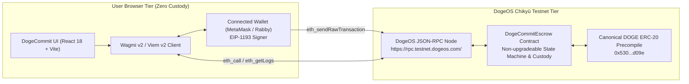
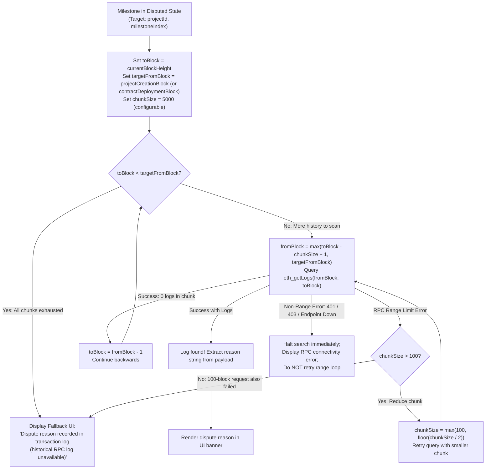
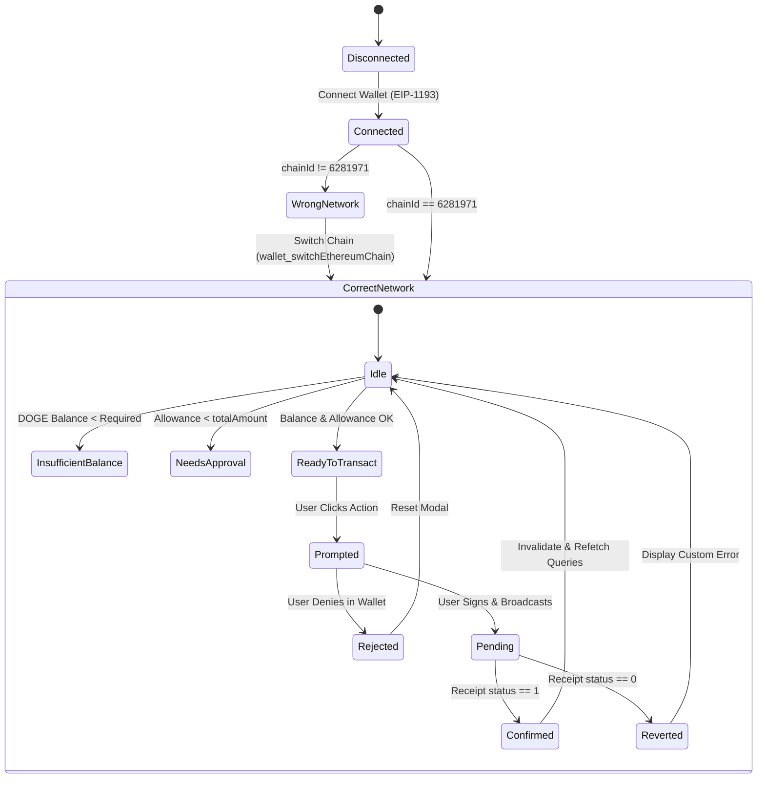
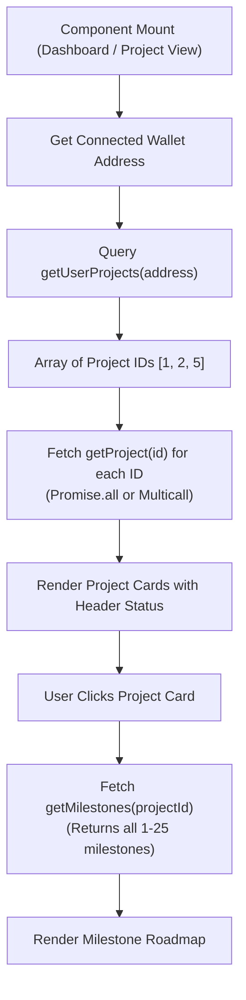
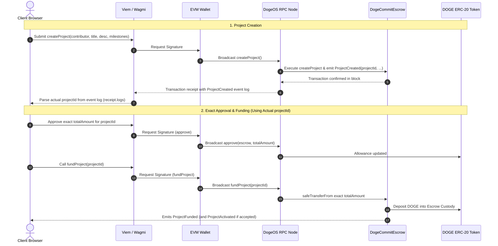
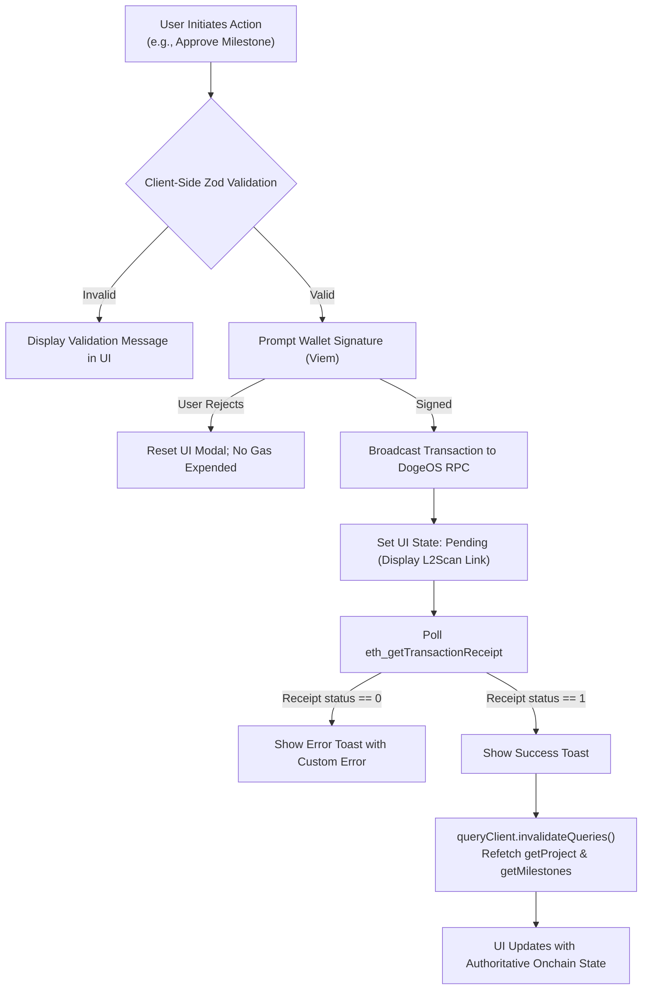
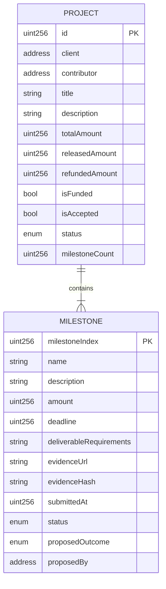

# DogeCommit — API and Data Model Specification

**Document:** API-AND-DATA-MODEL.md  
**Version:** 1.1  
**Status:** Approved Technical Blueprint (Post-Audit Revision)  
**Project:** DogeCommit  
**Target Platform:** DogeOS Chikyū Testnet (Chain ID: `6281971`)  
**Settlement Asset:** DOGE (`0x530000000000000000000000000000000000d09e`)  
**Primary Contract:** [`contracts/DogeCommitEscrow.sol`](file:///C:/Users/sumit/DogeCommit/contracts/DogeCommitEscrow.sol)

---

## 1. Document Purpose and Architecture Model

This document specifies the complete interface and data model through which the DogeCommit frontend single-page application (SPA) communicates with the `DogeCommitEscrow` smart contract on DogeOS Chikyū Testnet.

### Architectural Reality: Zero-Backend Web3 Model
DogeCommit operates strictly without a centralized web server, database, or intermediary API:
- **No REST / GraphQL API:** There are no Node.js, Express, or microservice backends.
- **No Offchain Database:** There is no PostgreSQL, MongoDB, or Redis instance.
- **Direct RPC Communication:** The user's browser interacts directly with the DogeOS EVM JSON-RPC node (`https://rpc.testnet.dogeos.com/`) via the user's connected wallet (EIP-1193) and the Viem/Wagmi client library.
- **Autonomous Source of Truth:** The smart contract [`DogeCommitEscrow.sol`](file:///C:/Users/sumit/DogeCommit/contracts/DogeCommitEscrow.sol) embodies an **intended non-upgradeable, ownerless architecture** (zero admin keys, no proxy wrappers, no pause or backdoor drain mechanisms). Pending onchain deployment verification, the contract code serves as the authoritative source of truth for all project balances, milestone statuses, permissions, and fund disbursements.



---

## 2. Contract Interaction Mapping

Every user action maps directly to either a **read-only view call** (`eth_call`) or a **state-mutating blockchain transaction** requiring external wallet signature.

### 2.1 State-Changing Transactions

All state-mutating functions follow the **Checks-Effects-Interactions (CEI)** pattern and emit standardized onchain events.

| Function Signature | Access Control | Purpose | Required Parameters | Preconditions | State Changes | Emitted Events | Error Cases |
|---|---|---|---|---|---|---|---|
| `createProject(address contributor, string title, string description, MilestoneInput[] milestones)` | Anyone (becomes `client`) | Registers a new milestone escrow agreement | `contributor`: Contributor address<br>`title`: Project title<br>`description`: Scope summary<br>`milestones`: Array of 1–25 milestone structs | • `contributor != address(0)`<br>• `msg.sender != contributor`<br>• `1 <= milestones.length <= 25`<br>• Each `amount > 0`<br>• Each `deadline > block.timestamp` | • Increments `projectCount`<br>• Writes `Project` struct (`status = Created`)<br>• Writes each `Milestone` struct (`status = Pending`)<br>• Appends ID to `userProjectIds` for client & contributor | `ProjectCreated(projectId, client, contributor, title, totalAmount, count)` | `InvalidContributorAddress`<br>`ClientEqualsContributor`<br>`EmptyMilestones`<br>`TooManyMilestones`<br>`InvalidMilestoneAmount`<br>`InvalidMilestoneDeadline` |
| `fundProject(uint256 projectId)` | `onlyClient(projectId)` | Deposits exact total DOGE into contract custody | `projectId`: Numeric project ID | • `project.status == Created`<br>• `!project.isFunded`<br>• Client granted exact DOGE token allowance $\ge$ `project.totalAmount` | • Sets `project.isFunded = true`<br>• Calls `dogeToken.safeTransferFrom(msg.sender, address(this), totalAmount)`<br>• If `project.isAccepted == true`, sets `project.status = Active` | `ProjectFunded(projectId, client, totalAmount)`<br>`ProjectActivated(projectId)` *(if already accepted)* | `Unauthorized`<br>`InvalidProjectState`<br>`AlreadyFunded`<br>*(Token: `ERC20InsufficientAllowance`, `ERC20InsufficientBalance`)* |
| `acceptProject(uint256 projectId)` | `onlyContributor(projectId)` | Formally accepts agreement terms | `projectId`: Numeric project ID | • `project.status == Created`<br>• `!project.isAccepted` | • Sets `project.isAccepted = true`<br>• If `project.isFunded == true`, sets `project.status = Active` | `ProjectAccepted(projectId, contributor)`<br>`ProjectActivated(projectId)` *(if already funded)* | `Unauthorized`<br>`InvalidProjectState`<br>`AlreadyAccepted` |
| `cancelProject(uint256 projectId)` | `onlyClient(projectId)` | Cancels pre-activation project & refunds deposited DOGE | `projectId`: Numeric project ID | • `project.status == Created`<br>• `!(project.isAccepted && project.isFunded)` | • Sets `project.status = Cancelled`<br>• If funded: sets `project.refundedAmount = totalAmount` and calls `dogeToken.safeTransfer(client, totalAmount)` | `ProjectCancelled(projectId, client, refundedAmount)` | `Unauthorized`<br>`InvalidProjectState` |
| `submitMilestone(uint256 projectId, uint256 milestoneIndex, string evidenceUrl, string evidenceHash)` | `onlyContributor(projectId)` | Submits deliverable evidence for client review | `projectId`: Project ID<br>`milestoneIndex`: 0-based index<br>`evidenceUrl`: Web deliverable URL<br>`evidenceHash`: SHA-256 or IPFS CID | • `project.status == Active`<br>• `milestoneIndex < milestoneCount`<br>• `milestone.status == Pending`<br>• At least one non-empty string in `evidenceUrl` or `evidenceHash` | • Sets `milestone.evidenceUrl` & `evidenceHash`<br>• Sets `milestone.submittedAt = block.timestamp`<br>• Sets `milestone.status = Submitted` | `MilestoneSubmitted(projectId, milestoneIndex, evidenceUrl, evidenceHash, timestamp)` | `Unauthorized`<br>`InvalidProjectState`<br>`InvalidMilestoneIndex`<br>`InvalidMilestoneState`<br>`EmptyEvidence` |
| `approveMilestone(uint256 projectId, uint256 milestoneIndex)` | `onlyClient(projectId)` | Approves deliverable & releases DOGE to contributor | `projectId`: Project ID<br>`milestoneIndex`: 0-based index | • `project.status == Active`<br>• `milestoneIndex < milestoneCount`<br>• `milestone.status == Submitted` | • Sets `milestone.status = Approved`<br>• Increments `project.releasedAmount += milestone.amount`<br>• Calls `dogeToken.safeTransfer(contributor, milestone.amount)`<br>• Evaluates `_checkProjectCompletion` | `MilestoneApproved(projectId, milestoneIndex, amount, contributor)`<br>`ProjectCompleted(projectId)` *(if all settled)* | `Unauthorized`<br>`InvalidProjectState`<br>`InvalidMilestoneIndex`<br>`InvalidMilestoneState` |
| `disputeMilestone(uint256 projectId, uint256 milestoneIndex, string reason)` | `onlyClient(projectId)` | Disputes submission, freezing milestone DOGE | `projectId`: Project ID<br>`milestoneIndex`: 0-based index<br>`reason`: Dispute explanation | • `project.status == Active`<br>• `milestoneIndex < milestoneCount`<br>• `milestone.status == Submitted` | • Sets `milestone.status = Disputed`<br>• Resets `proposedOutcome = None` & `proposedBy = address(0)` | `MilestoneDisputed(projectId, milestoneIndex, reason)` | `Unauthorized`<br>`InvalidProjectState`<br>`InvalidMilestoneIndex`<br>`InvalidMilestoneState` |
| `proposeDisputeResolution(uint256 projectId, uint256 milestoneIndex, ResolutionOutcome outcome)` | `onlyParticipant(projectId)` (Client or Contributor) | Proposes a bilateral settlement outcome | `projectId`: Project ID<br>`milestoneIndex`: 0-based index<br>`outcome`: `1` (Release) or `2` (Refund) | • `project.status == Active`<br>• `milestoneIndex < milestoneCount`<br>• `milestone.status == Disputed`<br>• `outcome != ResolutionOutcome.None` | • Sets `milestone.proposedOutcome = outcome`<br>• Sets `milestone.proposedBy = msg.sender` | `DisputeResolutionProposed(projectId, milestoneIndex, outcome, proposedBy)` | `Unauthorized`<br>`InvalidProjectState`<br>`InvalidMilestoneIndex`<br>`InvalidMilestoneState`<br>`InvalidResolutionOutcome` |
| `resolveDispute(uint256 projectId, uint256 milestoneIndex, ResolutionOutcome outcome)` | `onlyParticipant(projectId)` (Client or Contributor) | Executes settlement via bilateral confirmation or direct concession | `projectId`: Project ID<br>`milestoneIndex`: 0-based index<br>`outcome`: `1` (Release) or `2` (Refund) | • `project.status == Active`<br>• `milestoneIndex < milestoneCount`<br>• `milestone.status == Disputed`<br>• `outcome != ResolutionOutcome.None`<br>• **Either:** Caller confirms counterpart's active proposal **OR** caller makes voluntary direct concession | • Sets status (`ResolvedReleased` or `ResolvedRefunded`)<br>• Updates `releasedAmount` or `refundedAmount`<br>• Calls `dogeToken.safeTransfer(recipient, milestone.amount)`<br>• Evaluates `_checkProjectCompletion` | `DisputeResolved(projectId, milestoneIndex, outcome, amount, recipient)`<br>`ProjectCompleted(projectId)` *(if all settled)* | `Unauthorized`<br>`InvalidProjectState`<br>`InvalidMilestoneIndex`<br>`InvalidMilestoneState`<br>`InvalidResolutionOutcome`<br>`ResolutionNotAgreed` |

---

### 2.2 Read-Only Contract View Functions (`eth_call`)

View functions execute locally against the RPC node without wallet signatures, gas consumption, or state modifications.

| Function Signature | Parameters | Return Type | Frontend Usage | Error Cases |
|---|---|---|---|---|
| `getProject(uint256 projectId)` | `projectId` (uint256) | `Project` struct (tuple) | Loads project header, participant addresses, total amounts, funding/acceptance flags, and project status | `ProjectDoesNotExist()` (if ID == 0 or > projectCount) |
| `getMilestone(uint256 projectId, uint256 milestoneIndex)` | `projectId`, `milestoneIndex` | `Milestone` struct (tuple) | Loads granular milestone detail for single-milestone cards or modals | `ProjectDoesNotExist()`<br>`InvalidMilestoneIndex()` |
| `getMilestones(uint256 projectId)` | `projectId` (uint256) | `Milestone[]` (array of structs) | Primary method to retrieve all 1–25 milestones in a single RPC call for dashboard rendering | `ProjectDoesNotExist()` |
| `getUserProjects(address user)` | `user` (address) | `uint256[]` (array of project IDs) | Retrieves array of all project IDs where `user` is either client or contributor | None (returns empty array if no projects) |
| `projectCount()` | None | `uint256` | Returns total number of projects created across the contract | None |
| `MAX_MILESTONES()` | None | `uint256` (returns `25`) | Exposes the contract-level milestone boundary limit constant | None |
| `dogeToken()` | None | `address` | Returns canonical DOGE ERC-20 contract address bound to escrow | None |

---

### 2.3 Companion Token Functions (`IERC20`)

The frontend interacts with the canonical DOGE precompile (`0x530000000000000000000000000000000000d09e`) to verify balances, validate runtime decimals, and authorize deposits.

| Token Function | Call Type | Purpose | Parameters | Precondition / Invariant |
|---|---|---|---|---|
| `decimals()` | `eth_call` (Read) | Dynamically verifies token decimals at runtime | None | **Mandatory runtime check** before computing deposit base units |
| `balanceOf(address account)` | `eth_call` (Read) | Checks DOGE balance before project funding | `account`: User address | Must be $\ge \text{project.totalAmount}$ prior to funding |
| `allowance(address owner, address spender)` | `eth_call` (Read) | Checks existing approved DOGE allowance for escrow | `owner`: Client address<br>`spender`: Escrow contract address | If allowance $< \text{totalAmount}$, frontend displays "Approve DOGE" button |
| `approve(address spender, uint256 amount)` | Transaction (Write) | Grants escrow permission to deposit exact DOGE | `spender`: Escrow contract address<br>`amount`: Exact `totalAmount` in base units | **Exact Approval Policy:** Strictly approvals for exact `totalAmount`; never infinite `type(uint256).max` |

---

## 3. Data Model & Field Mapping

The table below maps the onchain Solidity storage layout directly to TypeScript types used by the frontend.

### 3.1 `Project` Data Model

```typescript
export interface Project {
  id: bigint;
  client: `0x${string}`;
  contributor: `0x${string}`;
  title: string;
  description: string;
  totalAmount: bigint;       // Exact wei-DOGE (18 decimals assumed, runtime-verified)
  releasedAmount: bigint;    // Cumulative DOGE released to contributor
  refundedAmount: bigint;    // Cumulative DOGE refunded to client
  isFunded: boolean;         // True once client deposits totalAmount
  isAccepted: boolean;       // True once contributor accepts agreement
  status: ProjectStatus;     // 0: Created, 1: Active, 2: Completed, 3: Cancelled
  milestoneCount: bigint;    // 1 to 25
}
```

#### On-Chain vs. Derived Project Fields:
- **Directly Stored Onchain:** All fields listed above are stored in the contract's `projects` mapping.
- **Derived by Frontend:**
  - `activeAmount`: `totalAmount - releasedAmount - refundedAmount` (actively locked in escrow).
  - `progressPercentage`: `(releasedAmount + refundedAmount) * 100n / totalAmount`.
  - `userRole`: `'client' | 'contributor' | 'observer'` (derived by comparing connected wallet to `project.client` and `project.contributor`).

---

### 3.2 `Milestone` Data Model

```typescript
export interface Milestone {
  name: string;
  description: string;
  amount: bigint;                    // Milestone DOGE allocation (base units)
  deadline: bigint;                  // Unix timestamp (seconds)
  deliverableRequirements: string;  // Detailed deliverable expectations
  evidenceUrl: string;               // URL submitted by contributor (or "")
  evidenceHash: string;              // Content hash submitted by contributor (or "")
  submittedAt: bigint;               // Submission timestamp (0 if pending)
  status: MilestoneStatus;           // Enum 0 to 5
  proposedOutcome: ResolutionOutcome; // Enum 0 to 2
  proposedBy: `0x${string}`;         // Address proposing dispute resolution (or 0x0)
}
```

#### On-Chain vs. Derived Milestone Fields:
- **Directly Stored Onchain:** All fields listed above are stored in the contract's `projectMilestones` mapping.
- **NOT Stored Onchain (Retrieved via Events):**
  - **`disputeReason`:** The reason string passed to `disputeMilestone()` is **not** written to contract storage to save gas. It is emitted in `MilestoneDisputed(projectId, milestoneIndex, reason)` and must be retrieved by searching backwards through event logs (see Section 5).
- **Derived by Frontend:**
  - `isOverdue`: `status === MilestoneStatus.Pending && deadline < currentBlockTimestamp`.

---

### 3.3 Milestone Input Calldata Model (`MilestoneInput`)

Used exclusively when creating a project via `createProject()`:

```typescript
export interface MilestoneInput {
  name: string;
  description: string;
  amount: bigint;
  deadline: bigint;
  deliverableRequirements: string;
}
```

---

## 4. Enums and Lifecycle State Transitions

### 4.1 Enums Reference

```solidity
enum ProjectStatus {
    Created,    // 0
    Active,     // 1
    Completed,  // 2
    Cancelled   // 3
}

enum MilestoneStatus {
    Pending,          // 0
    Submitted,        // 1
    Approved,         // 2
    Disputed,         // 3
    ResolvedReleased, // 4
    ResolvedRefunded  // 5
}

enum ResolutionOutcome {
    None,                 // 0
    ReleaseToContributor, // 1
    RefundToClient        // 2
}
```

---

### 4.2 Project Lifecycle and Synchronous Activation

```mermaid
stateDiagram-v2
    [*] --> Created: createProject()
    
    Created --> Created: fundProject() [if not accepted yet]
    Created --> Created: acceptProject() [if not funded yet]
    
    Created --> Active: fundProject() [when already accepted]
    Created --> Active: acceptProject() [when already funded]
    
    Created --> Cancelled: cancelProject() [Client only; refunds if funded]
    
    Active --> Completed: All milestones reached terminal status
    
    Cancelled --> [*]
    Completed --> [*]
```



#### Synchronous Activation Rule (Zero Background Keeper)
Project activation occurs **synchronously inside whichever onchain transaction satisfies the second condition**:
- If the Client funds first, `isFunded = true`, but status remains `Created`. When the Contributor subsequently calls `acceptProject()`, the contract checks `project.isFunded == true` and synchronously sets `project.status = Active` and emits `ProjectActivated`.
- If the Contributor accepts first, `isAccepted = true`, but status remains `Created`. When the Client subsequently calls `fundProject()`, the contract checks `project.isAccepted == true` and synchronously sets `project.status = Active` and emits `ProjectActivated`.
- **There is no offchain daemon, cron service, or backend worker.**

#### Project Completion Rule
A project transitions to `ProjectStatus.Completed` when and only when **all milestones reach a terminal state**:
$$\forall i \in [0, \text{milestoneCount}-1]: \text{status}_i \in \{\text{Approved}, \text{ResolvedReleased}, \text{ResolvedRefunded}\}$$
This evaluation occurs automatically within `approveMilestone()` and `resolveDispute()` via the internal `_checkProjectCompletion()` helper.

---

### 4.3 Milestone Lifecycle and Settlement

```mermaid
stateDiagram-v2
    [*] --> Pending: Project Created
    
    Pending --> Submitted: submitMilestone() [Contributor only]
    
    Submitted --> Approved: approveMilestone() [Client only; Releases DOGE]
    Submitted --> Disputed: disputeMilestone() [Client only; Freezes DOGE]
    
    Disputed --> ResolvedReleased: resolveDispute(ReleaseToContributor) [Mutual consensus or Client concession]
    Disputed --> ResolvedRefunded: resolveDispute(RefundToClient) [Mutual consensus or Contributor concession]
    
    Approved --> [*]
    ResolvedReleased --> [*]
    ResolvedRefunded --> [*]
```



#### Terminal Milestone States
`Approved`, `ResolvedReleased`, and `ResolvedRefunded` are strictly terminal. Once reached, a milestone cannot be modified, submitted, disputed, or refunded again. Double approval or duplicate settlement reverts with `InvalidMilestoneState()`.

---

## 5. Events and Frontend Event Retrieval Strategy

### 5.1 Contract Events Reference

All events emitted by `DogeCommitEscrow.sol`:

```solidity
event ProjectCreated(uint256 indexed projectId, address indexed client, address indexed contributor, string title, uint256 totalAmount, uint256 milestoneCount);
event ProjectFunded(uint256 indexed projectId, address indexed client, uint256 amount);
event ProjectAccepted(uint256 indexed projectId, address indexed contributor);
event ProjectActivated(uint256 indexed projectId);
event ProjectCancelled(uint256 indexed projectId, address indexed client, uint256 refundedAmount);
event MilestoneSubmitted(uint256 indexed projectId, uint256 indexed milestoneIndex, string evidenceUrl, string evidenceHash, uint256 submittedAt);
event MilestoneApproved(uint256 indexed projectId, uint256 indexed milestoneIndex, uint256 amount, address indexed contributor);
event MilestoneDisputed(uint256 indexed projectId, uint256 indexed milestoneIndex, string reason);
event DisputeResolutionProposed(uint256 indexed projectId, uint256 indexed milestoneIndex, ResolutionOutcome outcome, address indexed proposedBy);
event DisputeResolved(uint256 indexed projectId, uint256 indexed milestoneIndex, ResolutionOutcome outcome, uint256 amount, address recipient);
event ProjectCompleted(uint256 indexed projectId);
```

---

### 5.2 Event Retrieval: The Backwards Chunking Dispute Reason Strategy

Because dispute reasons are emitted exclusively as event arguments in `MilestoneDisputed(projectId, milestoneIndex, reason)` and are **not** stored in contract state, the frontend retrieves them via `eth_getLogs`.

> [!IMPORTANT]
> **Why Searching Only the Latest 5,000 Blocks is Insufficient:**
> Escrow projects may remain active across weeks or months. Disputed milestones may have occurred thousands or tens of thousands of blocks prior to the current block height. Searching only a fixed `[latest - 5000, latest]` window will fail for any dispute older than that window.



#### Written Algorithmic Sequence for Backwards Chunking:
1. **Initialize Query Bounds:** Set `toBlock = currentBlockHeight`, `targetFromBlock = projectCreationBlock` (or `contractDeploymentBlock` if creation block is unavailable), and `chunkSize = 5000` (configurable default).
2. **Bounds Termination Check:** If `toBlock < targetFromBlock`, all historical blocks for the project lifespan have been scanned without finding the event; halt search and transition to Graceful Fallback UI.
3. **Compute Chunk Window:** Calculate `fromBlock = Math.max(toBlock - chunkSize + 1, targetFromBlock)`.
4. **Execute RPC Query:** Call `eth_getLogs` for event `MilestoneDisputed(projectId, milestoneIndex, ...)` over the block range `[fromBlock, toBlock]`.
5. **Handle Successful Response:**
   - **Matching Log Found:** Parse `reason` string argument from the event payload and render in UI banner. Terminate search successfully.
   - **Zero Logs Found:** Decrement `toBlock = fromBlock - 1` and loop back to step 2 to scan the preceding block chunk.
6. **Handle RPC Errors:**
   - **Range Limit Error (e.g., `"block range too wide"` or payload size exceeded):**
     - If `chunkSize > 100`: Reduce chunk size via `chunkSize = Math.max(100, Math.floor(chunkSize / 2))` and retry the query for the current `toBlock` from step 3. Because halving floors at `100`, an attempt with a 100-block window is guaranteed to be executed.
     - If `chunkSize <= 100`: The 100-block request was already attempted and still failed with a range limit error; halt search and transition to Graceful Fallback UI.
   - **Non-Range Error (e.g., HTTP 401/403, 429 rate limit, network disconnection, endpoint down):** Halt search immediately and surface an RPC connectivity error to the user. Do **not** trigger range halving loops or retry on authentication/network errors.

#### Rules for Historical Dispute Event Retrieval:
1. **Backwards Search Through Relevant Lifespan:** The query engine starts at the current block height and searches backwards in block chunks toward the project's inception block (or the contract deployment block if the creation block is unknown).
2. **Configurable Chunk Size:** Default chunk size is **5,000 blocks** (`CHUNK_SIZE = 5000`), explicitly marked **UNVERIFIED on DogeOS**.
3. **Adaptive Range Halving on Chunk Limit Errors:** If an RPC node returns a range limit error (e.g., `"block range too wide"` or payload size exceeded), the engine checks whether `chunkSize > 100`. If so, it recalculates `chunkSize = Math.max(100, Math.floor(chunkSize / 2))` and retries the window, ensuring that an attempt with a 100-block window is actually executed before giving up. Only if a 100-block chunk request still fails with a range error does it transition to the fallback UI.
4. **Distinct Non-Range Error Handling:** Non-range failures (HTTP 401/403, malformed requests, endpoint down) must **never** trigger range halving loops; they must be surfaced immediately as network connectivity errors.
5. **Graceful Fallback UI:** If all relevant historical chunks are scanned without finding logs (e.g., RPC node prunes non-archive event logs), the UI displays:
   > *"Status: Disputed. Dispute reason recorded in transaction log (historical RPC event log unavailable). Check transaction on L2Scan."*
6. **No Fabricated Reasons:** The frontend must **never invent, speculate, or guess a dispute reason**. If unretrievable, it must be reported as unavailable.

---

## 6. Wallet and Transaction States

The UI derives interactive capabilities by synchronizing the connected wallet state with blockchain read states.

### 6.1 State Matrix



### 6.2 Transaction Lifecycle Specifications

| UI State | Trigger Condition | Displayed Elements | Permitted User Actions |
|---|---|---|---|
| **`Disconnected`** | No wallet connected via Wagmi | Connect Wallet button in header | Click "Connect Wallet" |
| **`WrongNetwork`** | `chainId !== 6281971` | Warning banner: *"Wrong Network. Connect to DogeOS Chikyū Testnet"* | Click "Switch to DogeOS Testnet" (`wallet_switchEthereumChain`) |
| **`NeedsApproval`** | `allowance < project.totalAmount` | Button: *"Approve Exact DOGE"* + explanation of exact allowance | Sign `approve(escrow, totalAmount)` |
| **`Prompted`** | Transaction initiated, awaiting signature | Modal spinner: *"Confirm in wallet..."* | Confirm or reject in wallet |
| **`Pending`** | Transaction broadcast to mempool | Floating notification with spinner + *"Transaction submitted. View on L2Scan"* | Click explorer link |
| **`Confirmed`** | Receipt received (`status === 'success'`) | Success toast + auto-invalidates TanStack Query keys | View updated status |
| **`Reverted`** | Receipt failed or RPC simulation failed | Error banner with parsed custom error message | Review error, retry, or dismiss |

#### State Cache Invalidation Strategy
Upon confirmation of any state-changing transaction, the frontend executes:
```typescript
queryClient.invalidateQueries({ queryKey: ['project', projectId] });
queryClient.invalidateQueries({ queryKey: ['milestones', projectId] });
queryClient.invalidateQueries({ queryKey: ['userProjects', userAddress] });
queryClient.invalidateQueries({ queryKey: ['dogeBalance', userAddress] });
```
This guarantees that UI components re-render immediately with fresh onchain data without manual page refreshes.

---

## 7. DOGE Amount Handling & Arithmetic Rules

### 7.1 Precision, Units, and Mandatory Decimals Verification
- **Token Decimals:** Standard **18 decimals** ($1 \text{ DOGE} = 10^{18} \text{ base units / wei-DOGE}$) is assumed based on testnet specifications and local mock tests, but is **explicitly UNVERIFIED on DogeOS Chikyū Testnet**.
- **Mandatory Runtime Verification:** The frontend must perform a runtime verification of `decimals()` on the precompile contract (`0x530000000000000000000000000000000000d09e`) via `eth_call` before enabling deposit, allowance, or funding workflows. If `decimals()` returns a value other than 18 (or reverts), the UI must halt funding actions with an explicit configuration warning.
- **Canonical Address:** `0x530000000000000000000000000000000000d09e` (**Live precompile runtime behavior remains UNVERIFIED on testnet**).

### 7.2 Strict Prohibition of Floating-Point Arithmetic
JavaScript `number` types utilize IEEE-754 double-precision floating-point arithmetic, which loses precision above $2^{53} - 1$ (approx. $9 \times 10^{15}$, or $0.009 \text{ DOGE}$ in 18-decimal base units).
- **Prohibited:** `const total = amount1 + amount2;` (floating-point addition).
- **Required:** All token amounts must be handled exclusively as native **`bigint`** types in base units.
- **Conversion Utilities (via Viem):**
  - **User Input $\rightarrow$ Contract Unit:** `parseUnits(inputValue, runtimeDecimals)` (returns `bigint`).
  - **Contract Unit $\rightarrow$ Display String:** `formatUnits(amountBigInt, runtimeDecimals)` (returns formatted `string`).

```typescript
import { parseUnits, formatUnits } from 'viem';

// Runtime-verified decimals (expected 18):
const decimals = await dogeToken.read.decimals(); // e.g. 18

// Valid conversion:
const userEnteredAmount = "25.5";
const amountInBaseUnits: bigint = parseUnits(userEnteredAmount, decimals); // 25500000000000000000n

// Display formatting:
const displayAmount: string = formatUnits(amountInBaseUnits, decimals); // "25.5"
```

### 7.3 Exact Allowance Enforcement
In conformance with Section 3 of [`SMART-CONTRACT-SPEC.md`](file:///C:/Users/sumit/DogeCommit/DogeCommit-Blueprint/SMART-CONTRACT-SPEC.md):
- The frontend must strictly request token approval for **`project.totalAmount`**.
- It must **never** request infinite allowance (`type(uint256).max` or `2n**256n - 1n`).

---

## 8. Validation Rules and Custom Error Mapping

All boundary conditions are validated client-side by Zod prior to transaction submission to save user gas, and are enforced onchain by Solidity custom errors.

### 8.1 DogeCommit Custom Errors (All 20 Contract Errors)

The 20 custom errors declared in [`contracts/DogeCommitEscrow.sol`](file:///C:/Users/sumit/DogeCommit/contracts/DogeCommitEscrow.sol#L177-L196) and their exact contract triggering conditions:

| Custom Error | Contract Function / Scope | Triggering Condition in Contract | Client-Side Zod / UX Validation |
|---|---|---|---|
| `InvalidTokenAddress()` | `constructor` | `_dogeToken == address(0)` | Deployment check: verify valid precompile address |
| `InvalidClientAddress()` | Contract declaration (line 178) | Declared in contract ABI/source, but unused in contract logic (reserved guard; `msg.sender` cannot be `address(0)` in EVM execution) | Validates non-zero connected wallet address |
| `InvalidContributorAddress()` | `createProject` | `contributor == address(0)` | `z.string().refine(isAddress)`: contributor must be non-zero |
| `ClientEqualsContributor()` | `createProject` | `msg.sender == contributor` | `contributor !== clientAddress`: rejects self-hiring |
| `EmptyMilestones()` | `createProject` | `milestones.length == 0` | `milestones.length >= 1`: requires at least 1 milestone |
| `TooManyMilestones()` | `createProject` | `milestones.length > MAX_MILESTONES` (25) | `milestones.length <= 25`: rejects 26 or more milestones |
| `InvalidMilestoneAmount()` | `createProject` | Any `milestones[i].amount == 0` | `amount > 0n`: each milestone amount must be positive |
| `InvalidMilestoneDeadline()` | `createProject` | Any `milestones[i].deadline <= block.timestamp` | `deadline > Math.floor(Date.now() / 1000)`: future deadline required |
| `ProjectDoesNotExist()` | `getProject`, `getMilestone`, `getMilestones` | `projectId == 0 \|\| projectId > projectCount` | Validates project ID within `[1, projectCount]` before querying |
| `Unauthorized()` | `onlyClient`, `onlyContributor`, `onlyParticipant` | `msg.sender` does not match authorized project role | UI hides/disables actions restricted to counterpart |
| `InvalidProjectState()` | Lifecycle transitions | Action called in incompatible project status (e.g. submit when not `Active`, cancel when `Active`) | UI reveals actions strictly corresponding to active lifecycle state |
| `InvalidMilestoneIndex()` | `submitMilestone`, `approveMilestone`, `disputeMilestone`, `proposeDisputeResolution`, `resolveDispute`, `getMilestone` | `milestoneIndex >= project.milestoneCount` | **Strict type-safe rejection:** Since `project.milestoneCount` is typed as `bigint`, index validation avoids mixing JavaScript `number` and `bigint`. For `bigint` indexes: `z.bigint().nonnegative().refine(idx => idx < project.milestoneCount, { message: "Invalid milestone index" })`. For number form inputs: `z.number().int().safe().nonnegative().refine(idx => BigInt(idx) < project.milestoneCount, { message: "Invalid milestone index" })`. Invalid indexes produce an explicit validation error and are **never silently clamped or modified**. |
| `InvalidMilestoneState()` | Milestone transitions | Action attempted on milestone with incompatible status (e.g. approving a `Pending` or already `Approved` milestone) | Buttons shown only when milestone status satisfies exact prerequisite |
| `AlreadyFunded()` | `fundProject` | `project.isFunded == true` | Funding button disabled if `isFunded` is already true |
| `AlreadyAccepted()` | `acceptProject` | `project.isAccepted == true` | Acceptance button disabled if `isAccepted` is already true |
| `NotFunded()` | Contract declaration (line 192) | Declared in contract ABI/source, but unused in contract logic (lifecycle actions verify `project.status == ProjectStatus.Active`, reverting with `InvalidProjectState()`) | Guard prerequisite verified in UI before enabling dependent actions |
| `NotAccepted()` | Contract declaration (line 193) | Declared in contract ABI/source, but unused in contract logic (lifecycle actions verify `project.status == ProjectStatus.Active`, reverting with `InvalidProjectState()`) | Guard prerequisite verified in UI before enabling dependent actions |
| `EmptyEvidence()` | `submitMilestone` | `bytes(evidenceUrl).length == 0 && bytes(evidenceHash).length == 0` | Requires at least one non-empty string in URL or Hash fields |
| `InvalidResolutionOutcome()` | `proposeDisputeResolution`, `resolveDispute` | `outcome == ResolutionOutcome.None` | Select input strictly restricted to `ReleaseToContributor` or `RefundToClient` |
| `ResolutionNotAgreed()` | `resolveDispute` | Caller is not making a direct concession and is not confirming counterpart's active proposal | UI restricts direct resolution to voluntary concession unless active counterpart proposal exists |

---

### 8.2 Distinction from OpenZeppelin Token and Security Errors

The frontend clearly distinguishes contract-level custom errors from external OpenZeppelin 5.x token errors and internal OpenZeppelin security library errors:

1. **DogeCommit Custom Errors (listed in 8.1 above):**
   Originate from `DogeCommitEscrow.sol`. Decoded and presented with domain-specific explanations (e.g., *"This project already has 25 milestones"* or *"Resolution outcome requires mutual agreement"*).

2. **OpenZeppelin ERC-20 Token Errors (`IERC20Errors`):**
   Originate from the external DOGE ERC-20 token precompile/contract during `safeTransferFrom` (funding) or `safeTransfer` (milestone release or refund):
   - `IERC20Errors.ERC20InsufficientAllowance(address spender, uint256 currentAllowance, uint256 needed)`: Client has not approved sufficient DOGE allowance for the escrow contract. The frontend directs the user to sign "Approve Exact DOGE".
   - `IERC20Errors.ERC20InsufficientBalance(address sender, uint256 balance, uint256 needed)`: Client lacks sufficient DOGE balance in their wallet to fund the project escrow.

3. **OpenZeppelin Security Library Errors (`ReentrancyGuard`):**
   Originate from OpenZeppelin's `ReentrancyGuard` contract module inherited by `DogeCommitEscrow.sol`:
   - `ReentrancyGuardReentrantCall()`: Triggered if a reentrant call is detected during state mutations or external token transfers. Indicates an unexpected concurrent invocation or contract interaction vulnerability.

---

## 9. Frontend Data-Fetching & Caching Strategy



### 9.1 Data-Fetching Architecture Rules
1. **Fetching User Projects:** The frontend calls `escrow.getUserProjects(walletAddress)` to obtain the list of project IDs associated with the connected user.
2. **Fetching Full Project Details:**
   - Header details are retrieved via `getProject(projectId)`.
   - All 1–25 milestones are retrieved in a single call via `getMilestones(projectId)`.
3. **Multicall3 vs. Individual Fallback:**
   - If Multicall3 is verified present on DogeOS, queries are batched.
   - If Multicall3 is absent (**currently UNVERIFIED**), the frontend executes individual `eth_call` reads concurrently via `Promise.all`.
4. **Public Explorer / All Projects:** In the absence of an offchain indexing database, browsing all historical projects across the network queries `projectCount()` and reads recent IDs backwards ($N, N-1, \dots$). Deep historic discovery relies on DogeOS L2Scan explorer.
5. **State Caching with TanStack Query:**
   - Stale Time: 15 seconds (reduces RPC flooding while maintaining responsiveness).
   - Refetch on Window Focus: Enabled.
   - Refetch Interval: 10 seconds for active dispute / pending submission screens.

---

## 10. Security and Trust Boundaries

1. **Smart Contract as Ultimate Authority:** Frontend validation (Zod, role checks, disabled buttons) is strictly a **UX affordance**. The smart contract independently validates every parameter, role modifier (`onlyClient`, `onlyContributor`), and state condition onchain.
2. **Never Trust Local Client State:** The frontend must never display a payment as "released" or a project as "active" based on local optimism. It must await onchain receipt confirmation (`receipt.status === 'success'`) and refetch authoritative contract state.
3. **Zero Custody of Keys:** Private keys and seed phrases must **never** be handled, requested, or stored by application code or web storage (`localStorage` / `sessionStorage`). All signatures are requested through EIP-1193 wallet providers.
4. **External Evidence References:** Evidence URLs (GitHub, IPFS) are plain reference strings. The smart contract and frontend **do not verify deliverable quality**. Work inspection is exclusively the responsibility of the client.
5. **Anti-Seizure Enforcement:** Disputed funds remain locked in contract custody indefinitely until either:
   - One party concedes directly to the counterpart.
   - One party formally accepts a proposal made by the counterpart.
   There are no automated arbiters, admin backdoors, or unilateral claims.
6. **Non-Upgradeable Architecture:** The smart contract contains no proxy patterns, administrative upgrade keys, or emergency owner withdrawals. Trust boundaries are defined entirely by the immutable bytecode verified upon deployment.

---

## 11. Architectural Diagrams

### 11.1 Complete Interaction Flow (With Dynamic Project ID Resolution)



---

### 11.2 Transaction Lifecycle and Cache Synchronization



---

### 11.3 Project to Milestone Entity-Relationship Diagram



---

## 12. Verification Matrix & DogeOS Testnet Assumptions

| Architectural Item | Current Status | Verification Source / Test Evidence | Operational Requirement |
|---|---|---|---|
| **Contract Functions & Errors** | **Verified** | Verified directly in `contracts/DogeCommitEscrow.sol` and 53 unit tests | All function names, signatures, and custom errors match code |
| **`MAX_MILESTONES = 25` Limit** | **Verified** | Tested at boundaries: 0 reverts `EmptyMilestones`, 25 succeeds, 26/30/50 revert `TooManyMilestones` | Enforced client-side and onchain |
| **Milestone Index Validation** | **Verified** | Out-of-bounds indices strictly rejected with `InvalidMilestoneIndex` | Strict rejection client-side; never silently clamped |
| **Synchronous Project Activation** | **Verified** | Tested in `DogeCommitEscrow.test.js` (fund-then-accept & accept-then-fund) | Zero background service requirement |
| **Non-Upgradeable Contract Design** | **Intended Architecture** | Zero admin keys, no proxy wrappers, no pause/backdoors in Solidity code | Validate immutability upon onchain deployment |
| **DOGE Canonical Address** | Confirmed Spec | `0x530000000000000000000000000000000000d09e` | Bound in contract constructor |
| **DOGE Token Decimals** | **UNVERIFIED on testnet** | Assumed 18 decimals ($10^{18}$ base units) in testnet docs and local mock | **Mandatory runtime verification** of `decimals()` via `eth_call` before enabling funding |
| **EIP-1559 Support on DogeOS** | **UNVERIFIED on testnet** | DogeOS RPC gas mechanism not officially confirmed | Client must conditionally detect fee support or fall back to legacy `gasPrice` |
| **Multicall3 Deployment** | **UNVERIFIED on testnet** | Address `0xcA11bde05977b3631167028862bE2a173976CA11` not verified on DogeOS | Mandatory individual `eth_call` fallback via `Promise.all` |
| **`eth_getLogs` RPC Window Limit** | **UNVERIFIED on testnet** | Default chunk size 5,000 blocks configured | Adaptive backwards chunk halving down to 100 blocks implemented |
| **Network Gas Limits** | **UNVERIFIED on testnet** | `createProject(25 milestones)` consumes ~3.49M gas on local Hardhat | Probe testnet block and tx gas limits before deployment |
