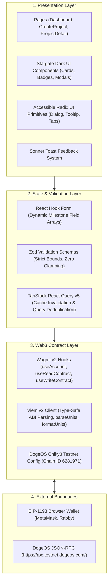
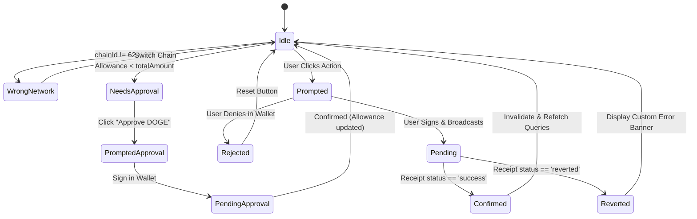

# DogeCommit — Noah AI Build Instructions

> **Document 9 of the DogeCommit Architecture Blueprint**  
> **Target Version:** 1.0 (Noah AI / Vibe Code Hackathon MVP)  
> **Status:** Approved Practical Build Manual  
> **Repository:** `C:\Users\sumit\DogeCommit`  
> **GitHub:** `https://github.com/sumitkr121003/DogeCommit`  
> **Target Contract:** [`contracts/DogeCommitEscrow.sol`](file:///c:/Users/sumit/DogeCommit/contracts/DogeCommitEscrow.sol)  
> **Target Network:** DogeOS Chikyū Testnet (Chain ID: `6281971`)

---

## 1. Document Purpose and Implementation Status

### 1.1 What DogeCommit Is
DogeCommit is a decentralized, milestone-based escrow platform native to the DogeOS Chikyū Testnet. It provides cryptographically secure, transparent payment certainty between clients and independent contributors using the DOGE token through the configured DogeOS token precompile (`0x530000000000000000000000000000000000d09e`). Client funds are locked in an autonomous, ownerless escrow smart contract upon project creation and funding, and are disbursed milestone-by-milestone upon explicit client approval or settled through bilateral consensus in the event of a dispute.

### 1.2 What Noah AI Is Expected to Build
Noah AI is expected to build the **complete client-side Web3 Single-Page Application (SPA)** that interacts directly with the existing `DogeCommitEscrow.sol` smart contract.

**The frontend must integrate with the existing escrow contract.** Noah AI must **never** write a second escrow contract, must **never** create mock tokens on the target testnet, and must **never** simulate blockchain transactions with fake local state or timer mockups.

### 1.3 Implementation Status Matrix

The codebase status at the time of authoring this manual is rigorously classified:

| Layer / Component | Specification Document | Implementation Status | Notes |
|---|---|:---:|---|
| **Escrow Smart Contract** | [`SMART-CONTRACT-SPEC.md`](file:///c:/Users/sumit/DogeCommit/DogeCommit-Blueprint/SMART-CONTRACT-SPEC.md) | **Implemented & Verified** | [`contracts/DogeCommitEscrow.sol`](file:///c:/Users/sumit/DogeCommit/contracts/DogeCommitEscrow.sol) (615 lines, Solidity 0.8.28, OpenZeppelin 5.6.1). |
| **Local Contract Tests** | [`SECURITY-AND-TESTING.md`](file:///c:/Users/sumit/DogeCommit/DogeCommit-Blueprint/SECURITY-AND-TESTING.md) | **Implemented & Verified** | 53 unit tests passing in [`test/DogeCommitEscrow.test.js`](file:///c:/Users/sumit/DogeCommit/test/DogeCommitEscrow.test.js) (3s runtime on Hardhat EVM). |
| **Contract Artifact & ABI** | [`TECH-STACK.md`](file:///c:/Users/sumit/DogeCommit/DogeCommit-Blueprint/TECH-STACK.md) | **Generated & Verified** | [`artifacts/contracts/DogeCommitEscrow.sol/DogeCommitEscrow.json`](file:///c:/Users/sumit/DogeCommit/artifacts/contracts/DogeCommitEscrow.sol/DogeCommitEscrow.json). |
| **Local Deployment Script** | [`TECH-STACK.md`](file:///c:/Users/sumit/DogeCommit/DogeCommit-Blueprint/TECH-STACK.md) | **Implemented & Verified** | [`scripts/deploy.js`](file:///c:/Users/sumit/DogeCommit/scripts/deploy.js); local deployment saved in [`deployments/hardhat.json`](file:///c:/Users/sumit/DogeCommit/deployments/hardhat.json). |
| **Testnet Contract Deployment** | [`SECURITY-AND-TESTING.md`](file:///c:/Users/sumit/DogeCommit/DogeCommit-Blueprint/SECURITY-AND-TESTING.md) | **Pending Live Execution** | `deployments/dogeosTestnet.json` does not exist yet. Contract awaits testnet deployment. |
| **Frontend Web Application** | [`UI-UX-DESIGN.md`](file:///c:/Users/sumit/DogeCommit/DogeCommit-Blueprint/UI-UX-DESIGN.md) | **Specified — NOT Yet Implemented** | Noah AI will implement the entire frontend in accordance with this guide. |
| **DogeOS Network Parameters** | [`API-AND-DATA-MODEL.md`](file:///c:/Users/sumit/DogeCommit/DogeCommit-Blueprint/API-AND-DATA-MODEL.md) | **Configured / Unverified Network** | Chain ID (6281971), RPC endpoint, and precompile address are configured in Hardhat & scripts; live decimals, precompile semantics, Multicall3, and `eth_getLogs` limits remain **UNVERIFIED**. |

---

## 2. Repository and Project Setup

### 2.1 Existing Repository Layout
Inspection of `C:\Users\sumit\DogeCommit` reveals the following structure:

```text
C:\Users\sumit\DogeCommit\
├── contracts/
│   ├── DogeCommitEscrow.sol       # Core escrow smart contract (615 lines)
│   └── test/
│       └── TestDOGE.sol           # Mock ERC-20 token for local tests only (19 lines)
├── test/
│   └── DogeCommitEscrow.test.js   # 53 automated contract tests (892 lines)
├── scripts/
│   └── deploy.js                  # Deployment script for local and testnet networks
├── deployments/
│   └── hardhat.json               # Recorded local deployment artifact
├── artifacts/                     # Hardhat build artifacts & compiled ABIs
├── cache/                         # Hardhat compilation cache
├── DogeCommit-Blueprint/          # Blueprint specification documents (Docs 3-8)
│   ├── SMART-CONTRACT-SPEC.md
│   ├── SYSTEM-ARCHITECTURE.md
│   ├── UI-UX-DESIGN.md
│   ├── TECH-STACK.md
│   ├── API-AND-DATA-MODEL.md
│   └── SECURITY-AND-TESTING.md
├── PRODUCT-REQUIREMENTS.md        # Document 1 (located at repository root)
├── USER-FLOWS.md                  # Document 2 (located at repository root)
├── README.md                      # Project overview
├── hardhat.config.js              # Hardhat configuration (Solidity 0.8.28, Paris)
├── package.json                   # Root package dependencies (Hardhat, OpenZeppelin)
├── package-lock.json              # Lockfile for root dependencies
├── .env.example                   # Template for DogeOS RPC & deployer private key
└── .gitignore                     # Git ignore rules
```

> [!NOTE]
> **Document Location Note:** In the blueprint series, Document 1 ([`PRODUCT-REQUIREMENTS.md`](file:///c:/Users/sumit/DogeCommit/PRODUCT-REQUIREMENTS.md)) and Document 2 ([`USER-FLOWS.md`](file:///c:/Users/sumit/DogeCommit/USER-FLOWS.md)) reside at the **repository root**. Documents 3 through 8 reside in the `DogeCommit-Blueprint/` directory.

### 2.2 Where the Frontend Should Live: Coexistence Strategy
To guarantee that Hardhat contract tooling and modern React/Vite tooling coexist cleanly without dependency collisions, the frontend must be placed in a dedicated directory:

**Recommended Location:** `C:\Users\sumit\DogeCommit\frontend\`

```
DogeCommit/
├── contracts/             # Smart contracts (Hardhat)
├── test/                  # Contract unit tests
├── scripts/               # Contract deployment scripts
├── hardhat.config.js      # Contract compiler & network config
├── package.json           # Root package.json (Contract devDependencies)
└── frontend/              # Web3 Client Application (Vite + React SPA)
    ├── src/
    │   ├── abis/          # Exported DogeCommitEscrow.json ABI
    │   ├── components/    # Reusable UI components & layouts
    │   ├── config/        # Wagmi, Viem, and custom chain definitions
    │   ├── hooks/         # Custom Wagmi contract read/write hooks
    │   ├── pages/         # Dashboard, Create Project, Project Detail
    │   ├── types/         # TypeScript interfaces & contract enums
    │   ├── utils/         # Formatting, Zod schemas, BigInt helpers
    │   ├── App.tsx        # Application root with Wagmi/Query providers
    │   ├── main.tsx       # React entry point
    │   └── index.css      # Tailwind directives & Stargate dark theme
    ├── public/            # Static assets & icons
    ├── index.html         # SPA HTML template
    ├── vite.config.ts     # Vite 8 configuration
    ├── tsconfig.json      # Strict TypeScript configuration
    ├── tailwind.config.js # Tailwind v3.4 theme dictionary
    ├── postcss.config.js  # PostCSS configuration
    └── package.json       # Frontend dependencies (React, Wagmi, Viem, etc.)
```

**Why this structure is strictly required:**
1. **Zero Dependency Interference:** Root `package.json` retains `@nomicfoundation/hardhat-toolbox` and Hardhat tooling. `frontend/package.json` manages browser dependencies without peer-dependency conflicts.
2. **Independent Testing:** `npx hardhat test` continues to run cleanly from root at any time.
3. **Decoupled Builds:** The frontend builds independently via `npm run build` inside `frontend/`, outputting to `frontend/dist/`.
4. **ES Module Configuration Standard:** Because `frontend/package.json` specifies `"type": "module"`, all JavaScript configuration files (`tailwind.config.js`, `postcss.config.js`, etc.) must strictly use valid ES Module syntax (`export default`). Do **not** use CommonJS `module.exports` in `.js` configuration files under this package unless the file is explicitly renamed to `.cjs`.

### 2.3 Exact Setup Commands

All commands are fully compatible with PowerShell on Windows (Node.js `v24.21.0`, npm `11.19.0`).

#### 1. Contract Test Verification (Root Level)
From the repository root `C:\Users\sumit\DogeCommit`:
```powershell
npx hardhat test
```
*Expected Result:* 53 passing tests, 0 failing.

#### 2. Frontend Initialization (Phase 0)
From the repository root:
```powershell
# Create the frontend directory
mkdir frontend
cd frontend

# Initialize frontend package.json
npm init -y
```

#### 3. Required Frontend npm Scripts
Ensure `frontend/package.json` specifies the standard scripts for development, building, typechecking, and previewing:
```json
{
  "name": "dogecommit-frontend",
  "private": true,
  "version": "1.0.0",
  "type": "module",
  "scripts": {
    "dev": "vite",
    "build": "tsc && vite build",
    "preview": "vite preview",
    "typecheck": "tsc --noEmit"
  }
}
```
- `npm run dev`: Starts the local Vite development server with Hot Module Replacement (HMR) at `http://localhost:5173`.
- `npm run build`: Executes the TypeScript compiler (`tsc`) and bundles static production assets into `frontend/dist/`.
- `npm run typecheck`: Runs `tsc --noEmit` to verify type safety across all components and contract hooks without generating build files.
- `npm run preview`: Locally serves the production `dist/` directory to inspect production bundle behavior before deployment.

#### 4. Exact Dependency Installation
Install the exact approved versions specified in [`TECH-STACK.md`](file:///c:/Users/sumit/DogeCommit/DogeCommit-Blueprint/TECH-STACK.md):

```powershell
# Core Framework & TypeScript (React 18.3.1 authoritative target)
npm install react@^18.3.1 react-dom@^18.3.1
npm install -D typescript@^5.6.3 @types/react@^18.3.12 @types/react-dom@^18.3.1

# Build Tooling (Vite 8 + React Plugin)
npm install -D vite@^8.3.5 @vitejs/plugin-react@^6.2.1

# Styling, Typography & Primitives
npm install -D tailwindcss@^3.4.17 postcss@^8.4.49 autoprefixer@^10.4.20
npm install @fontsource/geist-sans@^5.1.0 @fontsource/geist-mono@^5.1.0
npm install lucide-react@^0.469.0 clsx@^2.1.1 tailwind-merge@^2.6.0
npm install @radix-ui/react-dialog@^1.1.4 @radix-ui/react-dropdown-menu@^2.1.4 @radix-ui/react-tooltip@^1.1.6 @radix-ui/react-tabs@^1.1.2

# Web3, Viem & TanStack Query
npm install wagmi@^2.14.9 viem@^2.21.0 @tanstack/react-query@^5.62.0

# Forms, Validation & Notifications
npm install react-hook-form@^7.54.2 zod@^3.24.1 @hookform/resolvers@^3.9.1 sonner@^1.7.1
```

#### 5. Running the Frontend Development Server
From `C:\Users\sumit\DogeCommit\frontend`:
```powershell
npm run dev
```
*Expected Result:* Vite server starts at `http://localhost:5173`.

---

## 3. Noah AI Working Rules

Noah AI must adhere strictly to these 12 immutable operating principles:

1. **Phase-by-Phase Execution:** Work on **exactly one phase at a time**. Never attempt to generate or scaffold multiple phases in a single turn. Wait for explicit user verification before advancing.
2. **Inspect Before Modifying:** Always inspect existing files, configurations, and types before creating or editing code.
3. **Reuse Existing Contract Artifacts:** Use the compiled contract ABI from `artifacts/contracts/DogeCommitEscrow.sol/DogeCommitEscrow.json`. Copy this ABI into the frontend; **never re-author or guess ABI signatures**.
4. **Zero Invention of Contract Features:** Never add functions, parameters, events, or enum values that do not exist in [`contracts/DogeCommitEscrow.sol`](file:///c:/Users/sumit/DogeCommit/contracts/DogeCommitEscrow.sol).
5. **No Fake Blockchain Interactions:** Never mock transaction receipts, simulate balance deductions, or use `setTimeout` to mimic onchain confirmation. All state updates must reflect real blockchain receipts or read calls. Static placeholder data is permitted **strictly and exclusively during Phase 1** for visual preview and layout inspection of static shells; **all placeholder data must be completely removed prior to Phase 3/4 live contract integration**, ensuring live pages read exclusively from authoritative onchain state.
6. **No Mock DOGE on Testnet:** On DogeOS Chikyū Testnet, interact exclusively with the official precompile `0x530000000000000000000000000000000000d09e`. Test mocks (`TestDOGE.sol`) are strictly restricted to local Hardhat testing.
7. **Absolute Key Security:** Never request, log, handle, or store private keys or seed phrases in frontend code or web storage (`localStorage`/`sessionStorage`). All signing must go through the user's external EIP-1193 wallet.
8. **Preserve Existing Solidity Code:** Do **not** modify `contracts/DogeCommitEscrow.sol`. If an integration edge case is encountered, handle it in frontend logic.
9. **Never Weaken Contract Tests:** Do **not** delete, modify, or comment out any of the 53 existing contract tests in `test/DogeCommitEscrow.test.js`.
10. **Zero Silent Errors:** Never swallow errors in empty `catch` blocks. All contract reverts, RPC errors, and wallet rejections must be parsed and displayed clearly in the UI.
11. **Strict MVP Scope Boundaries:** Do **not** implement out-of-scope features (third-party arbitration, automated deadline penalties, file uploads, messaging, reputations, or marketplace features).
12. **Mandatory Phase Reporting:** After each phase, report:
    - Files created or modified.
    - Commands run.
    - Verification evidence.
    - Any unresolved questions or blockers.

---

## 4. Frontend Architecture and Technology

The frontend architecture strictly mirrors [`TECH-STACK.md`](file:///c:/Users/sumit/DogeCommit/DogeCommit-Blueprint/TECH-STACK.md):



### Technology Roles and Packages

| Technology | Selected Version | Specific Role in DogeCommit |
|---|---|---|
| **React** | `^18.3.1` | Primary component rendering and application state tree. Authoritative target per [`TECH-STACK.md`](file:///c:/Users/sumit/DogeCommit/DogeCommit-Blueprint/TECH-STACK.md) Sections 2 & 21 (Wagmi v2 peer-supports `react: ">=18"`). |
| **TypeScript** | `^5.6.3` | Strict type safety for milestone tuples, contract arguments, BigInt accounting, and form inputs. |
| **Vite** | `^8.3.5` | Fast HMR dev server and deterministic production bundler. |
| **`@vitejs/plugin-react`** | `^6.2.1` | Official React JSX transformer for Vite 8. |
| **Wagmi** | `^2.14.9` | Intentional v2 choice: manages wallet connections, accounts, and reactive contract hooks. |
| **Viem** | `^2.21.0` | EVM JSON-RPC client, ABI inference via `as const`, and BigInt currency calculations. |
| **TanStack Query** | `^5.62.0` | Server-state caching, automatic refetching upon transaction confirmation, and request deduplication. |
| **Tailwind CSS** | `^3.4.17` | Utility CSS framework implementing audited Stargate Finance dark-mode tokens via `tailwind.config.js`. |
| **Geist Fonts** | `^5.1.0` | Self-hosted Geist (clean UI headings) and Geist Mono (cryptographic hashes, DOGE amounts). |
| **Lucide React** | `^0.469.0` | Minimalist outline icons matching the DeFi aesthetic. |
| **Radix UI** | `^1.1.x` | Headless, accessible primitives for dialogs, dropdowns, tabs, and tooltips. |
| **React Hook Form** | `^7.54.2` | High-performance uncontrolled form state handling dynamic milestone arrays (`useFieldArray`). |
| **Zod** | `^3.24.1` | Schema validation enforcing milestone bounds (1–25), future deadlines, and valid recipient addresses. |
| **Sonner** | `^1.7.1` | Toast notification engine for transaction submission, confirmation, and revert feedback. |

---

## 5. Design Implementation

[`UI-UX-DESIGN.md`](file:///c:/Users/sumit/DogeCommit/DogeCommit-Blueprint/UI-UX-DESIGN.md) is the authoritative design blueprint, derived from a direct audit of Stargate Finance's production design tokens.

### 5.1 Color and Surface Palette

Noah AI must implement the exact color tokens in `frontend/tailwind.config.js`. Because `frontend/package.json` specifies `"type": "module"`, the Tailwind configuration must use valid ES Module (`export default`) syntax in `tailwind.config.js` (or use CommonJS `module.exports` in `tailwind.config.cjs`):

```javascript
/** @type {import('tailwindcss').Config} */
export default {
  content: ['./index.html', './src/**/*.{js,ts,jsx,tsx}'],
  darkMode: 'class',
  theme: {
    extend: {
      colors: {
        canvas: '#141414',       // Main page background
        sheet: '#1A1A1A',        // Intermediate containers
        card: '#212121',         // Interactive cards, modals
        input: '#272727',        // Inputs, inactive tabs
        emphasized: '#161616',   // Sub-panels, code blocks
        border: {
          subtle: '#252525',     // Soft dividers
          primary: '#2C2C2C',    // Default card borders
          hover: '#3D3D3D',      // Hovered card borders
        },
        doge: {
          gold: '#E1B342',       // Primary brand accent / CTA
          hover: '#F5C854',      // Hovered gold
          dark: '#C49626',       // Active/pressed gold
          subtle: 'rgba(225, 179, 66, 0.08)',
          light: 'rgba(225, 179, 66, 0.16)',
        },
        status: {
          success: '#0FB983',    // Approved milestone / completed
          'success-subtle': 'rgba(15, 185, 131, 0.12)',
          error: '#F3566B',      // Disputed milestone / reverted
          'error-subtle': 'rgba(243, 86, 107, 0.12)',
          warning: '#F46F28',    // Pre-activation / network mismatch
          'warning-subtle': 'rgba(244, 111, 40, 0.12)',
          info: '#3E92E0',       // Submitted milestone / awaiting review
          'info-subtle': 'rgba(62, 146, 224, 0.12)',
          // Distinct dispute resolution badges:
          'resolved-released': '#0FB983', // Dispute settled: payment released to contributor
          'resolved-released-subtle': 'rgba(15, 185, 131, 0.16)',
          'resolved-refunded': '#F46F28', // Dispute settled: payment refunded to client
          'resolved-refunded-subtle': 'rgba(244, 111, 40, 0.16)',
        },
        text: {
          primary: '#FAFAFA',    // Headings, primary text
          secondary: '#9A9A9A',  // Hints, descriptions
          disabled: '#636363',   // Disabled controls
        },
      },
      fontFamily: {
        sans: ['"Geist"', 'sans-serif'],
        mono: ['"Geist Mono"', 'monospace'],
      },
      borderRadius: {
        DEFAULT: '12px',
        control: '8px',
        panel: '16px',
      },
      boxShadow: {
        card: '0px 4px 12px 0px rgba(20, 20, 20, 0.45)',
        glow: '0px 0px 16px 0px rgba(225, 179, 66, 0.15)',
        dispute: '0px 0px 16px 0px rgba(243, 86, 107, 0.15)',
      },
    },
  },
  plugins: [],
};
```

### 5.2 Key Visual Principles to Preserve
- **High-Contrast Dark Aesthetic:** Pure `#141414` canvas layered with `#212121` cards and 1px `#2C2C2C` borders.
- **DOGE Gold Identity Without Clutter:** Gold (`#E1B342`) is reserved for primary CTAs, active status outlines, and critical brand touchpoints. Do not turn the whole UI yellow.
- **Glassmorphism:** Sticky navigation headers and modal overlays must use `backdrop-blur-md` with `bg-canvas/80`.
- **Monospace Financial Values:** All DOGE amounts, wallet addresses, and transaction hashes must use `font-mono` (`Geist Mono`).

---

## 6. Phased Noah AI Build Plan

Build the frontend across **11 sequential, verifiable phases** (Phase 0 through Phase 10).

---

### Phase 0 — Repository Inspection and Frontend Foundation

- **Objective:** Establish the clean `frontend/` directory, verify Vite 8 + React 18.3.1 + TypeScript + Tailwind v3.4 setup, configure required npm scripts, and confirm that contract tests at root remain unaffected.
- **Files Created/Modified:**
  - `frontend/package.json`
  - `frontend/vite.config.ts`
  - `frontend/tsconfig.json`
  - `frontend/tailwind.config.js`
  - `frontend/postcss.config.js`
  - `frontend/index.html`
  - `frontend/src/main.tsx`
  - `frontend/src/App.tsx`
  - `frontend/src/index.css`
- **Instructions for Noah AI:**
  1. Inspect the repository root and verify that `contracts/DogeCommitEscrow.sol` and `test/DogeCommitEscrow.test.js` exist.
  2. Create the `frontend/` directory and configure Vite, TypeScript, and Tailwind with the exact versions from Section 2.3.
  3. Configure the required npm scripts in `frontend/package.json`:
     - `"dev": "vite"`
     - `"build": "tsc && vite build"`
     - `"preview": "vite preview"`
     - `"typecheck": "tsc --noEmit"`
  4. Configure `frontend/postcss.config.js` using valid ES Module syntax (`export default`) to correctly load Tailwind CSS 3.4.17 and Autoprefixer:
     ```javascript
     export default {
       plugins: {
         tailwindcss: {},
         autoprefixer: {},
       },
     };
     ```
     Do not use `module.exports` in `.js` configuration files under this package unless the file is explicitly renamed to `.cjs`.
  5. Import `@fontsource/geist-sans` and `@fontsource/geist-mono` in `src/index.css`.
  6. Ensure `App.tsx` renders a basic "DogeCommit Escrow" headline using the Stargate `#141414` background and Geist font.
  7. Run `npx hardhat test` at root to verify contract tests still pass.
- **Acceptance Criteria:**
  - `npm run dev` in `frontend/` starts without errors at `http://localhost:5173`.
  - `npm run typecheck` and `npm run build` succeed with zero errors.
  - `npx hardhat test` at repository root passes all 53 tests.
  - Page canvas renders `#141414` dark theme.
- **Verification Commands:**
  ```powershell
  cd C:\Users\sumit\DogeCommit\frontend
  npm run typecheck
  npm run build
  cd C:\Users\sumit\DogeCommit
  npx hardhat test
  ```
- **Gate to Proceed:** Clean TypeScript build (`npm run build`) and 53 passing contract tests.

---

### Phase 1 — Design System and Static UI Shell

- **Objective:** Implement the global layout, navigation header, status badges, and static shell for all three core pages (Dashboard, Project Creation, and Project Detail View) without connecting to the blockchain.
- **Files Created/Modified:**
  - `frontend/src/components/layout/Navbar.tsx`
  - `frontend/src/components/layout/Footer.tsx`
  - `frontend/src/components/ui/Button.tsx`
  - `frontend/src/components/ui/Card.tsx`
  - `frontend/src/components/ui/Badge.tsx`
  - `frontend/src/components/ui/Modal.tsx`
  - `frontend/src/pages/DashboardPage.tsx`
  - `frontend/src/pages/CreateProjectPage.tsx`
  - `frontend/src/pages/ProjectDetailPage.tsx`
- **Instructions for Noah AI:**
  1. Build the fixed sticky header (`Navbar.tsx`, height 72px) with DogeCommit logo, navigation links ("My Projects", "New Agreement"), and a static "Connect Wallet" button.
  2. Implement `Badge.tsx` supporting the exact state badge variants from `UI-UX-DESIGN.md`:
     - Project Statuses: `Created` (Warning / Neutral), `Active` (DOGE Gold / Subtle), `Completed` (Success Green), `Cancelled` (Disabled / Slate)
     - Milestone Statuses: `Pending` (Neutral Slate), `Submitted` (Info Blue), `Approved` (Success Green), `Disputed` (Error Red), `ResolvedReleased` (Teal Green — Released to Contributor), `ResolvedRefunded` (Warning Amber — Refunded to Client)
  3. Build mock UI views for `DashboardPage` (empty state and card list), `CreateProjectPage` (step wizard container), and `ProjectDetailPage` (milestone roadmap timeline).
  4. Do **not** mock blockchain data with random timers or fake transaction confirmations. Use simple static placeholder data clearly labeled as mock UI preview.
     > [!IMPORTANT]
     > **Placeholder Data Policy:** Static placeholder data is permitted **only** during Phase 1 for visual preview and layout inspection of static shells. All placeholder and mock data **must be completely removed** prior to live contract integration in Phase 3 and Phase 4. Live application pages must read purely from onchain contract state.
- **Acceptance Criteria:**
  - All components strictly use `#141414`, `#1A1A1A`, `#212121`, and `#E1B342` tokens.
  - Layout is fully responsive across mobile (`< 600px`), tablet (`900px`), and desktop (`1200px`).
- **Verification Commands:**
  ```powershell
  cd frontend
  npm run build
  ```
- **Gate to Proceed:** Clean build with zero TypeScript or JSX linting errors.

---

### Phase 2 — Wallet Connection and Network Handling

- **Objective:** Configure Wagmi v2 and Viem v2 with the DogeOS Chikyū Testnet definition, enabling wallet connection (MetaMask, Rabby, injected) and active network validation.
- **Files Created/Modified:**
  - `frontend/src/config/chains.ts` (Custom DogeOS Chikyū chain definition)
  - `frontend/src/config/wagmi.ts` (Wagmi config with `injected()`, `metaMask()`)
  - `frontend/src/components/wallet/ConnectButton.tsx`
  - `frontend/src/components/wallet/NetworkGuard.tsx`
  - `frontend/src/App.tsx` (Wrapped with `WagmiProvider` and `QueryClientProvider`)
- **Instructions for Noah AI:**
  1. Define `dogeosTestnet` in `src/config/chains.ts` using Chain ID `6281971`, RPC `https://rpc.testnet.dogeos.com/`, and Explorer `https://dogeos-testnet.l2scan.co`.
  2. Set up Wagmi configuration with TanStack Query v5 in `src/config/wagmi.ts`.
  3. Replace the static connect button with `ConnectButton.tsx`:
     - Shows "Connect Wallet" when disconnected.
     - Shows truncated address (`0x12...34`) and DOGE balance when connected.
     - Opens an account modal with "Disconnect" and "Copy Address" options.
  4. Implement `NetworkGuard.tsx`:
     - Detects when `chainId !== 6281971`.
     - Displays a prominent warning banner: *"Wrong Network. Connect to DogeOS Chikyū Testnet"*.
     - Provides a "Switch to DogeOS Testnet" button invoking `switchChain({ chainId: 6281971 })`.
  5. Handle wallet rejection (`UserRejectedRequestError` / code `4001`) gracefully with an inline notice.
- **Acceptance Criteria:**
  - Clicking "Connect Wallet" opens the browser extension prompt.
  - Switching network in wallet triggers the `NetworkGuard` banner.
  - Clicking "Switch Network" initiates chain change to `6281971`.
- **Verification Commands:**
  - Run frontend locally and connect with a browser wallet.
- **Gate to Proceed:** Wallet connects, disconnects, and detects network switches cleanly.

---

### Phase 3 — Contract Integration Layer

- **Objective:** Export the verified contract ABI, configure typed contract hooks via Viem/Wagmi, and build the transaction lifecycle feedback system (Sonner toasts + modal indicators).
- **Files Created/Modified:**
  - `frontend/src/abis/DogeCommitEscrow.json`
  - `frontend/src/abis/IERC20.json`
  - `frontend/src/config/contracts.ts` (Addresses & typed ABI constants)
  - `frontend/src/hooks/useEscrowContract.ts`
  - `frontend/src/components/feedback/TransactionModal.tsx`
  - `frontend/src/utils/errors.ts` (Custom error decoder)
- **Instructions for Noah AI:**
  1. Copy the ABI from `artifacts/contracts/DogeCommitEscrow.sol/DogeCommitEscrow.json` to `frontend/src/abis/DogeCommitEscrow.json`.
  2. Export `DogeCommitEscrowABI` with `as const` in `contracts.ts`.
  3. Implement strict deployment address resolution with network-scoped safety guards:
     - On local Hardhat network (`chainId === 31337`): Read the escrow address from `deployments/hardhat.json`.
     - On DogeOS Chikyū Testnet (`chainId === 6281971`): Strictly require a valid deployed escrow address from `deployments/dogeosTestnet.json` (or `VITE_ESCROW_CONTRACT_ADDRESS`).
     - **Safety Guard:** If running on DogeOS testnet and the testnet deployment is missing or unpopulated:
       - Render a prominent configuration error banner: *"DogeCommit Escrow contract is not yet deployed on DogeOS Chikyū Testnet. Contract transactions are disabled."*
       - Completely disable all transaction submission buttons.
       - **Never silently fall back to a local Hardhat deployment address on DogeOS testnet.**
  4. Create `useEscrowContract.ts` wrapping Wagmi's `useReadContract` and `useWriteContract`.
  5. Implement `errors.ts` to decode all 20 DogeCommit custom errors (`InvalidMilestoneAmount`, `TooManyMilestones`, `AlreadyFunded`, `ResolutionNotAgreed`, etc.) into readable English messages.
  6. Implement `TransactionModal.tsx` showing the 4 standard transaction phases:
     - *Prompted:* "Confirm transaction in your wallet..."
     - *Pending:* "Transaction submitted. Waiting for DogeOS confirmation..." + L2Scan link.
     - *Confirmed:* "Transaction confirmed onchain!"
     - *Failed:* Displays decoded error message.
- **Acceptance Criteria:**
  - Viem types infer contract methods with full autocompletion.
  - Reverts decode into user-friendly messages instead of raw hex.
- **Verification Commands:**
  ```powershell
  cd frontend
  npm run build
  ```
- **Gate to Proceed:** Clean TypeScript build; contract read hooks compile without type errors.

---

### Phase 4 — Project Creation and Funding Workflow

- **Objective:** Implement the multi-step project creation wizard with strict Zod validation (1–25 milestones inclusive), string-based DOGE amount parsing via Viem `parseUnits`, and the complete sequential creation and funding workflow.
- **Files Created/Modified:**
  - `frontend/src/schemas/projectSchema.ts` (Zod schema for project creation)
  - `frontend/src/components/project/CreateProjectWizard.tsx`
  - `frontend/src/components/project/MilestoneFieldArray.tsx`
  - `frontend/src/hooks/useCreateProject.ts`
  - `frontend/src/hooks/useFundProject.ts`
  - `frontend/src/pages/CreateProjectPage.tsx`
- **Instructions for Noah AI:**
  1. Define `projectSchema.ts` with Zod:
     - `title`: 3–100 characters, non-empty.
     - `description`: 10–2000 characters.
     - `contributor`: Valid Ethereum address (`isAddress()`), non-zero, $\neq$ client address.
     - `milestones`: Array length strictly between **1 and 25 milestones inclusive** (`z.array(...).min(1, "At least 1 milestone is required").max(25, "Maximum 25 milestones allowed")`). Array length 0 reverts onchain with `EmptyMilestones()`; array length 26 or more reverts with `TooManyMilestones()`.
     - `milestones.*.amount`: Keep amount inputs as **strings** (`string`) throughout form state and validation schemas (e.g. `z.string().regex(/^\d+(\.\d+)?$/, "Invalid DOGE amount").refine(val => { try { return parseUnits(val, decimals) > 0n; } catch { return false; } }, "Amount must be greater than zero")`). Use Viem's `parseUnits(amountString, decimals)` directly on the string to compute the `bigint` base units. **Strictly avoid converting amounts to JavaScript `number`**, as IEEE-754 double precision introduces floating-point inaccuracies and truncates above $2^{53}-1$.
     - `milestones.*.deadline`: Unix timestamp (in seconds) strictly in the future (`> Math.floor(Date.now() / 1000)`). The smart contract enforces `if (milestones[i].deadline <= block.timestamp) revert InvalidMilestoneDeadline()`. Frontend validation acts strictly as an early UX safeguard to save user gas; it does not replace onchain contract validation. Milestone deadlines are informational targets and do **not** trigger automatic deadline refunds or approvals.
  2. In `CreateProjectWizard.tsx`, allow adding and removing milestones dynamically between 1 and 25 milestones.
  3. Calculate `totalAmount` by summing the `bigint` base units of all milestones:
     $$\text{totalAmount} = \sum_{i=0}^{n-1} \text{parseUnits}(\text{milestone}_i\text{.amount}, \text{decimals})$$
  4. Explicitly implement the documented sequential project creation and funding workflow:
     - **Step A (Create Project):** Client initiates `escrow.createProject(contributor, title, description, milestones)`.
     - **Step B (Wait for Creation Confirmation):** Wait for the transaction receipt (`status === 'success'`).
     - **Step C (Obtain Project ID):** Prefer decoding the newly assigned `projectId` deterministically from the `ProjectCreated` event log inside the confirmed transaction receipt (`receipt.logs` decoded via Viem's `parseEventLogs`). The public getter `escrow.projectCount()` exists in the compiled contract ABI and is retained solely as a read-only fallback in single-user testing, but should not be relied upon in multi-user production where concurrent creations could return another project's ID.
     - **Step D (Exact Token Approval):** Query current token allowance via `dogeToken.allowance(client, escrowAddress)`. If `allowance < project.totalAmount`, prompt the client to sign `dogeToken.approve(escrowAddress, project.totalAmount)`. If current allowance is already greater than or equal to `project.totalAmount`, skip the approval step and proceed directly to Step F. When approval is required, **request approval for exact `project.totalAmount` only; never request infinite approval (`type(uint256).max`).**
     - **Step E (Wait for Approval Confirmation):** Wait for the approval transaction receipt confirmation.
     - **Step F (Fund Project):** Client invokes `escrow.fundProject(projectId)`.
     - **Step G (Preserve Flexible Order of Operations):** Preserve the contract's specified capability where contributor acceptance (`acceptProject`) and client funding (`fundProject`) can occur in either order:
       - If the contributor has already accepted, calling `fundProject()` satisfies the final condition and activates the project synchronously (`project.status = Active`, emitting `ProjectActivated`).
       - If the client funds first, `isFunded = true` while status remains `Created`, awaiting the contributor's subsequent `acceptProject()`.
  5. Upon confirmation of funding, invalidate project queries in TanStack Query and navigate user to the project detail view.
- **Acceptance Criteria:**
  - Project creation explicitly validates and allows 1 to 25 milestones inclusive; rejects 0 and $\ge 26$.
  - DOGE amounts are stored and validated as strings, avoiding JavaScript floating-point conversions.
  - Complete sequential workflow executed: `createProject` $\to$ wait confirmation $\to$ extract `projectId` from event log $\to$ exact `approve` (if allowance insufficient) $\to$ wait confirmation $\to$ `fundProject`.
  - Funding and acceptance operate independently in either order.
- **Verification Commands:**
  ```powershell
  cd frontend
  npm run build
  ```
- **Gate to Proceed:** Form validates correctly; transaction hooks compile cleanly.

---

### Phase 5 — Contributor Acceptance and Project Dashboard

- **Objective:** Build the personal dashboard showing user projects (Client vs Contributor tabs) and the contributor agreement review/acceptance flow.
- **Files Created/Modified:**
  - `frontend/src/hooks/useUserProjects.ts`
  - `frontend/src/components/dashboard/ProjectCard.tsx`
  - `frontend/src/components/dashboard/ProjectFilters.tsx`
  - `frontend/src/pages/DashboardPage.tsx`
  - `frontend/src/components/project/AcceptanceBanner.tsx`
- **Instructions for Noah AI:**
  1. In `useUserProjects.ts`, call `escrow.getUserProjects(userAddress)` to fetch project IDs.
  2. For each ID, fetch project headers via `escrow.getProject(id)`.
  3. Filter projects into "Created by Me (Client)" and "Assigned to Me (Contributor)".
  4. On `ProjectDetailPage`, if connected wallet matches `project.contributor` and `project.isAccepted == false`:
     - Render `AcceptanceBanner.tsx` with project terms and an "Accept Agreement" button.
     - Clicking "Accept" executes `escrow.acceptProject(projectId)`.
  5. **Synchronous Activation Rule:** When both `isFunded` and `isAccepted` become true, the contract status automatically transitions to `Active`. **Do not build an offchain keeper or polling daemon.** Reflect `Active` immediately upon receipt confirmation.
  6. **Pre-Activation Cancellation:** Render the "Cancel Project" button only when the connected wallet is the client (`msg.sender == project.client`) AND the project status is explicitly `Created` (`project.status === ProjectStatus.Created`). Do not check merely `status !== Active`, because `Completed` and `Cancelled` projects must never expose cancellation actions. This preserves the contract invariant that cancellation is allowed strictly before activation (reverting with `InvalidProjectState` once `Active`). If funded, cancellation refunds 100% of deposited DOGE to the client.
- **Acceptance Criteria:**
  - Dashboard correctly separates Client and Contributor roles.
  - Contributor can call `acceptProject()`.
  - Project status updates to `Active` once both conditions are satisfied.
  - Client can cancel a project only when status is explicitly `Created`, receiving a full refund if funded; cancellation action is hidden once `Active`, `Completed`, or `Cancelled`.
- **Verification Commands:**
  ```powershell
  cd frontend
  npm run build
  ```
- **Gate to Proceed:** Dashboard renders user projects; acceptance and cancellation hooks compile.

---

### Phase 6 — Milestone Submission and Approval Workflow

- **Objective:** Implement deliverable evidence submission for contributors and milestone approval for clients, disbursing exact DOGE payments.
- **Files Created/Modified:**
  - `frontend/src/components/milestone/MilestoneTimeline.tsx`
  - `frontend/src/components/milestone/SubmitEvidenceModal.tsx`
  - `frontend/src/components/milestone/ApproveMilestoneModal.tsx`
  - `frontend/src/hooks/useMilestoneActions.ts`
- **Instructions for Noah AI:**
  1. In `MilestoneTimeline.tsx`, render all 1–25 milestones retrieved via `escrow.getMilestones(projectId)`.
  2. For `Pending` milestones on an `Active` project:
     - If connected wallet is contributor: Show "Submit Deliverable" button.
     - Opens `SubmitEvidenceModal.tsx` requiring `evidenceUrl` (e.g. GitHub PR) and/or `evidenceHash` (SHA-256 or IPFS CID). At least one must be non-empty (`EmptyEvidence` guard).
     - Submitting executes `escrow.submitMilestone(projectId, index, url, hash)`.
  3. For `Submitted` milestones:
     - Display evidence URL as an external link and evidence hash as a monospaced code badge.
     - If connected wallet is client: Show "Approve & Release Payment" button.
     - Clicking approve triggers `escrow.approveMilestone(projectId, index)`.
  4. Project Completion Evaluation: When all milestones reach a terminal state (`Approved`, `ResolvedReleased`, or `ResolvedRefunded`), the contract's internal `_checkProjectCompletion` helper automatically emits `ProjectCompleted(projectId)` and transitions project status to `Completed`. The UI must recognize all three terminal states when evaluating completion and update the status badge and roadmap header to "Completed".
- **Acceptance Criteria:**
  - Contributor can submit evidence URL and hash.
  - Client can approve, releasing exact DOGE to contributor.
  - Double approval is blocked in UI and contract (`InvalidMilestoneState`).
  - Terminal project status updates to `Completed` when all milestones reach any combination of terminal states (`Approved`, `ResolvedReleased`, or `ResolvedRefunded`).
- **Verification Commands:**
  ```powershell
  cd frontend
  npm run build
  ```
- **Gate to Proceed:** Submission and approval workflows compile without type errors.

---

### Phase 7 — Dispute Workflow and Mutual Resolution

- **Objective:** Implement client milestone disputes, the bilateral proposal/confirmation mechanism, and voluntary concessions, clearly visualizing frozen funds.
- **Files Created/Modified:**
  - `frontend/src/components/dispute/DisputeModal.tsx`
  - `frontend/src/components/dispute/ResolutionPanel.tsx`
  - `frontend/src/hooks/useDisputeActions.ts`
- **Instructions for Noah AI:**
  1. For `Submitted` milestones, allow client to click "Raise Dispute", opening `DisputeModal.tsx`.
     - Client enters a dispute explanation `reason`.
     - Calls `escrow.disputeMilestone(projectId, index, reason)`.
  2. For `Disputed` milestones, render `ResolutionPanel.tsx`:
     - Highlight the milestone card with `border-status-error` and `bg-status-error-subtle`.
     - Display a prominent notice: *"Funds frozen in contract custody until mutual resolution."*
     - Clearly communicate the **Indefinite Lockup Rule**: if parties do not agree, funds stay locked forever. There is no automated arbitration in the MVP.
  3. Provide two resolution actions for participants:
     - **Option A: Propose Settlement:** Client or contributor selects outcome (`ReleaseToContributor` or `RefundToClient`) and calls `proposeDisputeResolution(projectId, index, outcome)`.
     - **Option B: Confirm Counterpart's Proposal:** If counterpart has an active proposal, show "Accept Counterpart Proposal" button executing `resolveDispute(projectId, index, outcome)`.
     - **Option C: Direct Voluntary Concession:** Client can directly concede via `ReleaseToContributor`; Contributor can directly concede via `RefundToClient`.
  4. Unilateral self-payment (e.g. client resolving `RefundToClient` without contributor proposal) must be disabled in the UI (contract reverts with `ResolutionNotAgreed`).
- **Acceptance Criteria:**
  - Client can dispute submitted work.
  - Mutual settlement via proposal + confirmation works.
  - Direct voluntary concessions work.
  - Unilateral self-refund is prevented in UI.
- **Verification Commands:**
  ```powershell
  cd frontend
  npm run build
  ```
- **Gate to Proceed:** Dispute and resolution workflows compile cleanly.

---

### Phase 8 — Event History and Data Synchronization

- **Objective:** Implement backwards chunking event retrieval via `eth_getLogs` for historical dispute reasons, with adaptive range halving and graceful fallbacks.
- **Files Created/Modified:**
  - `frontend/src/utils/eventQuery.ts` (Adaptive backwards chunking engine)
  - `frontend/src/components/dispute/DisputeReasonBanner.tsx`
- **Instructions for Noah AI:**
  1. Implement `fetchDisputeReason(projectId, milestoneIndex)` in `eventQuery.ts`:
     - Inspect the contract ABI for `event MilestoneDisputed(uint256 indexed projectId, uint256 indexed milestoneIndex, string reason)`. Note that **only `projectId` and `milestoneIndex` are indexed event parameters (topics)**; the `reason` string is an **unindexed data argument** stored in the log data payload.
     - Start at `toBlock = currentBlockHeight`, `targetFromBlock = projectCreationBlock` (or contract deployment block).
     - Set initial `chunkSize = 5000` (configurable default).
     - Query `eth_getLogs` filtering strictly by supported indexed event topics:
       - `topics[0]`: `keccak256("MilestoneDisputed(uint256,uint256,string)")`
       - `topics[1]`: `toHex(projectId, { size: 32 })` (`indexed uint256 projectId`)
       - `topics[2]`: `toHex(milestoneIndex, { size: 32 })` (`indexed uint256 milestoneIndex`)
     - Do **not** pass `reason` as an indexed filter topic.
     - Decode the `reason` string from the unindexed log `data` payload using Viem's `decodeEventLog`.
  2. Implement **Adaptive Range Halving**:
     - If RPC returns a range limit error (e.g. "block range too wide" or payload size exceeded), check `chunkSize > 100`.
     - If yes, recalculate `chunkSize = Math.max(100, Math.floor(chunkSize / 2))` and retry the window.
     - A 100-block window must be attempted before falling back.
     - If non-range error (HTTP 401/403/endpoint down), halt immediately and surface connectivity error without retrying.
  3. If logs cannot be found across all historical chunks (e.g. RPC pruned old events), render `DisputeReasonBanner.tsx`:
     > *"Status: Disputed. Dispute reason recorded in transaction log (historical RPC event log unavailable). Check transaction on L2Scan."*
  4. Never invent, guess, or synthesize a dispute reason string.
- **Acceptance Criteria:**
  - Event queries search backwards through project history.
  - Range errors adaptively halve chunk size down to 100 blocks.
  - Missing event logs display fallback banner with explorer link.
- **Verification Commands:**
  ```powershell
  cd frontend
  npm run build
  ```
- **Gate to Proceed:** Event querying engine compiles without errors.

---

### Phase 9 — Error Handling, Accessibility, and Responsive Polish

- **Objective:** Refine all UI states (loading skeletons, empty states, disabled buttons), ensure full keyboard accessibility, and polish responsive breakpoints.
- **Files Created/Modified:**
  - `frontend/src/components/ui/Skeleton.tsx`
  - `frontend/src/components/ui/EmptyState.tsx`
  - `frontend/src/components/feedback/ErrorBanner.tsx`
  - All page and modal components
- **Instructions for Noah AI:**
  1. Add loading skeletons (`Skeleton.tsx`) for dashboard cards and milestone timelines during initial query load.
  2. Add empty states (`EmptyState.tsx`) when a user has no created or assigned projects.
  3. Ensure all interactive buttons, dialogs, and tabs have proper WAI-ARIA attributes and keyboard navigation (Tab, Enter, Escape).
  4. Verify mobile responsiveness:
     - On `< 600px`, milestone timelines wrap vertically.
     - Dialogs occupy full mobile width with bottom-sheet appearance.
     - Long addresses and hashes truncate with ellipsis and copy-to-clipboard buttons.
- **Acceptance Criteria:**
  - Zero layout overflow on mobile screens (`375px` width).
  - Esc key dismisses all modals.
  - All loading and empty states visually aligned with Stargate dark theme.
- **Verification Commands:**
  ```powershell
  cd frontend
  npm run build
  ```
- **Gate to Proceed:** Production bundle builds without warnings.

---

### Phase 10 — Integration Testing and Release Readiness

- **Objective:** Perform end-to-end user flow verification, ensure clean environment configurations, and verify zero secrets in the repository.
- **Files Created/Modified:**
  - `frontend/.env.example`
  - `frontend/README.md`
- **Instructions for Noah AI:**
  1. Create `frontend/.env.example`:
     ```bash
     VITE_DOGEOS_RPC_URL=https://rpc.testnet.dogeos.com/
     VITE_CHAIN_ID=6281971
     VITE_ESCROW_CONTRACT_ADDRESS=
     VITE_DOGE_TOKEN_ADDRESS=0x530000000000000000000000000000000000d09e
     VITE_EXPLORER_URL=https://dogeos-testnet.l2scan.co
     ```
  2. Verify that `.gitignore` ignores `.env`, `node_modules/`, and `dist/`.
  3. Run full production build (`npm run build`) in `frontend/` and run `npx hardhat test` at root.
  4. Produce a final phase completion report documenting all created components and verification checks.
- **Acceptance Criteria:**
  - `frontend/` builds clean (`npm run build`).
  - Root contract tests pass (53/53 passing).
  - Zero secrets or private keys committed.
- **Verification Commands:**
  ```powershell
  cd C:\Users\sumit\DogeCommit\frontend
  npm run build
  cd C:\Users\sumit\DogeCommit
  npx hardhat test
  git status --short
  ```
- **Gate to Proceed:** Both frontend build and contract tests pass 100%.

---

## 7. Contract and Product Rules That Must Never Change Accidentally

The smart contract [`contracts/DogeCommitEscrow.sol`](file:///c:/Users/sumit/DogeCommit/contracts/DogeCommitEscrow.sol) is the single source of truth. Noah AI must memorize and uphold these exact rules:

### 7.1 Exact Contract Enums and Numerical Values

```solidity
enum ProjectStatus {
    Created,    // 0: Awaiting funding and/or contributor acceptance
    Active,     // 1: Funded by client AND accepted by contributor
    Completed,  // 2: All milestones reached terminal settlement
    Cancelled   // 3: Cancelled by client before activation; funds refunded
}

enum MilestoneStatus {
    Pending,          // 0: Work in progress; awaiting submission
    Submitted,        // 1: Evidence submitted by contributor; awaiting client review
    Approved,         // 2: Client approved submission; payment released to contributor
    Disputed,         // 3: Client disputed submission; funds frozen in escrow
    ResolvedReleased, // 4: Dispute resolved; funds released to contributor
    ResolvedRefunded  // 5: Dispute resolved; funds refunded to client
}

enum ResolutionOutcome {
    None,                 // 0: Invalid / uninitialized
    ReleaseToContributor, // 1: Release milestone payment to contributor
    RefundToClient        // 2: Refund milestone payment to client
}
```

### 7.2 Core Contract Function Signatures

Noah AI must use these exact function signatures:

```solidity
function createProject(
    address contributor,
    string calldata title,
    string calldata description,
    MilestoneInput[] calldata milestones
) external returns (uint256 projectId);

function fundProject(uint256 projectId) external;
function acceptProject(uint256 projectId) external;
function cancelProject(uint256 projectId) external;

function submitMilestone(
    uint256 projectId,
    uint256 milestoneIndex,
    string calldata evidenceUrl,
    string calldata evidenceHash
) external;

function approveMilestone(uint256 projectId, uint256 milestoneIndex) external;
function disputeMilestone(uint256 projectId, uint256 milestoneIndex, string calldata reason) external;

function proposeDisputeResolution(
    uint256 projectId,
    uint256 milestoneIndex,
    ResolutionOutcome outcome
) external;

function resolveDispute(
    uint256 projectId,
    uint256 milestoneIndex,
    ResolutionOutcome outcome
) external;

function getProject(uint256 projectId) external view returns (Project memory);
function getMilestone(uint256 projectId, uint256 milestoneIndex) external view returns (Milestone memory);
function getMilestones(uint256 projectId) external view returns (Milestone[] memory);
function getUserProjects(address user) external view returns (uint256[] memory);
```

### 7.3 Immutable Business Logic Rules
1. **Milestone Limits:** A project must have between **1 and 25 milestones** (`MAX_MILESTONES = 25`). Submitting 0 reverts `EmptyMilestones()`; submitting $\ge 26$ reverts `TooManyMilestones()`.
2. **Order of Funding & Acceptance:** The client may fund first, or the contributor may accept first. The project status transitions to `Active` **synchronously** within whichever transaction satisfies the second condition.
3. **Cancellation Rule:** The client can cancel the project **only before activation** (`status == Created && !(isFunded && isAccepted)`). Cancellation refunds 100% of deposited DOGE. Once `Active`, cancellation reverts with `InvalidProjectState()`.
4. **No Third-Party Arbitration:** In the event of a dispute, funds remain frozen in contract custody indefinitely until either:
   - One party concedes voluntarily to the counterpart.
   - One party confirms an active proposal made by the counterpart.
5. **No Unilateral Self-Settlement:** A client cannot resolve a dispute in their own favor without contributor agreement; a contributor cannot resolve in their own favor without client agreement (`revert ResolutionNotAgreed()`).
6. **Independence of Milestones:** Disputing Milestone $k$ does not prevent Milestone $k+1$ from being submitted or approved.
7. **Project Completion:** The project automatically completes when and only when all milestones reach terminal status (`Approved`, `ResolvedReleased`, or `ResolvedRefunded`).
8. **MVP Exclusions:** No decentralized arbitration, no automatic deadline refunds, no automatic approvals, no AI work verification, no evidence resubmission after dispute, no contributor replacement, and no admin drain functions.

---

## 8. DogeOS Testnet Configuration

### 8.1 Network Parameters

| Parameter | Specification | Status |
|---|---|:---:|
| **Network Name** | DogeOS Chikyū Testnet | Configured in Hardhat & Scripts |
| **Chain ID** | `6281971` (`0x5fdaf3`) | Configured in Hardhat & Deploy Scripts |
| **RPC Endpoint** | `https://rpc.testnet.dogeos.com/` | Configured Public RPC Endpoint |
| **Block Explorer** | `https://dogeos-testnet.l2scan.co` | Configured Explorer |
| **DOGE Token Precompile** | `0x530000000000000000000000000000000000d09e` | Configured Precompile Address |
| **Settlement Asset Symbol** | `DOGE` | Configured Precompile (`0x530000000000000000000000000000000000d09e`) |

### 8.2 Handling Unverified Testnet Assumptions

Noah AI must implement defensive runtime checks for all unverified parameters:

```typescript
// 1. Mandatory Runtime Decimals Check:
const dogeDecimals = await publicClient.readContract({
  address: DOGE_TOKEN_ADDRESS,
  abi: erc20Abi,
  functionName: 'decimals',
}); // Verify 18 vs 8 dynamically before parsing amounts

// 2. Dynamic EIP-1559 Support Detection & Gas Pricing Strategy:
// Do NOT assume baseFeePerGas is a property returned by estimateFeesPerGas().
// Instead, inspect the latest block directly via publicClient.getBlock():
try {
  const latestBlock = await publicClient.getBlock({ blockTag: 'latest' });
  const isEip1559Supported = latestBlock.baseFeePerGas !== null && latestBlock.baseFeePerGas !== undefined;

  if (isEip1559Supported) {
    // DogeOS supports EIP-1559: query Type-2 fee parameters (maxFeePerGas, maxPriorityFeePerGas)
    const fees = await publicClient.estimateFeesPerGas({ type: 'eip1559' });
    // Pass fees.maxFeePerGas and fees.maxPriorityFeePerGas to transaction requests
  } else {
    // DogeOS lacks EIP-1559: fall back to legacy Type-0 transaction with gasPrice
    const gasPrice = await publicClient.getGasPrice();
    // Pass { gasPrice } to transaction requests
  }
} catch (error) {
  // Explicitly handle RPC transport/network errors (timeouts, rate limits, node offline)
  // Do NOT assume that every fee-estimation error means EIP-1559 is unsupported.
  console.error("Failed to query block header or fee data from DogeOS RPC:", error);
  // Surface a clear RPC connectivity warning to the user rather than guessing fee parameters
}

// 3. Multicall3 Detection Fallback:
// If Multicall3 (0xcA11bde05977b3631167028862bE2a173976CA11) fails or returns no code,
// fall back immediately to concurrent individual eth_call queries via Promise.all.
```

### 8.3 Mandatory Pre-Funding Token Interface Verification Protocol

Before live funding integration is considered verified on DogeOS Chikyū Testnet, the following five ERC-20 methods on the official DOGE token precompile (`0x530000000000000000000000000000000000d09e`) must be actively verified on the live network via test calls:

1. **`decimals()`:** Call `decimals()` via `eth_call`. Verify it returns the expected `18` (or confirm the actual value if different) before any amount parsing occurs.
2. **`balanceOf(address)`:** Query the client's testnet wallet balance via `balanceOf(client)`. Verify it accurately reports token balances received from the faucet.
3. **`allowance(owner, spender)`:** Query allowance between client and escrow contract address. Verify initial zero state and post-approval state.
4. **`approve(spender, amount)`:** Broadcast an exact approval transaction. Verify the transaction succeeds onchain, updates allowance, and emits the standard `Approval(owner, spender, value)` event.
5. **`transferFrom(sender, recipient, amount)`:** Verify that `DogeCommitEscrow.fundProject(projectId)` successfully executes `safeTransferFrom` on the token contract without silent failures or unexpected reverts, confirming full OpenZeppelin `SafeERC20` compatibility.

---

## 9. Transaction and UX Requirements

### 9.1 Transaction State Matrix

The UI must reflect the exact transaction lifecycle:



### 9.2 Error Handling Standards
- **Wallet Rejection (Code 4001):** Display inline warning toast: *"Transaction rejected in wallet"*. Leave application state intact.
- **Insufficient Balance:** Pre-check `dogeToken.balanceOf(client) < totalAmount`. If insufficient, disable funding button and show *"Insufficient DOGE balance in wallet"*.
- **Insufficient Allowance:** Query current allowance via `dogeToken.allowance(client, escrowAddress)`. If `allowance < project.totalAmount`, prompt the client to sign `approve(escrowAddress, project.totalAmount)` (**exact approval only; never request infinite approval**). If current allowance is already $\ge \text{totalAmount}$, skip the approval step and proceed directly to funding.
- **Custom Contract Errors:** Map error selectors to clear messages:
  - `EmptyMilestones` $\to$ *"At least one milestone is required."*
  - `TooManyMilestones` $\to$ *"Projects cannot exceed 25 milestones."*
  - `InvalidMilestoneDeadline` $\to$ *"Milestone deadlines must be in the future."*
  - `ResolutionNotAgreed` $\to$ *"Dispute resolution requires agreement or concession."*

---

## 10. Security and Scope Restrictions

Noah AI must strictly enforce these security boundaries:

1. **Zero Secret Handling:** No private keys or seed phrases in frontend code, git commits, or console logs.
2. **Authoritative Contract State:** Never assume a transaction succeeded. Always wait for transaction receipt confirmation (`receipt.status === 'success'`) and refetch onchain data.
3. **Exact Token Allowances:** Approval is required only when current allowance is less than `project.totalAmount`. When required, the frontend must request approval for exact `project.totalAmount` only; infinite allowances (`type(uint256).max`) are strictly prohibited.
4. **No Quality Verification Claims:** The frontend must display deliverable evidence as external references (URLs and hashes). It must **never** claim the system verifies code quality or deliverable completeness.
5. **Clear Dispute Deadlock Communication:** The UI must explicitly inform users that disputed funds stay locked in escrow permanently unless resolved through mutual agreement or concession.

---

## 11. Noah AI Prompt Templates

Use these copy-ready prompts to direct Noah AI during development:

### Prompt 1: Starting a New Phase
```markdown
We are implementing Phase [X] ([Phase Name]) of DogeCommit according to DogeCommit-Blueprint/NOAH-AI-BUILD-INSTRUCTIONS.md.

Instructions:
1. First, inspect all relevant files mentioned in Phase [X].
2. Create or modify ONLY the files specified for Phase [X].
3. Adhere strictly to the design tokens in UI-UX-DESIGN.md and the contract rules in Section 7.
4. Do not proceed to any subsequent phase.
5. Once complete, run the build command and report:
   - Files created/modified
   - Verification commands executed
   - Acceptance criteria status
```

### Prompt 2: Inspecting Before Editing
```markdown
Before modifying any files for Phase [X], please inspect:
- [File 1 Path]
- [File 2 Path]

Report back a summary of existing types, exports, and dependencies in these files, and outline your planned changes to ensure zero breaking regressions.
```

### Prompt 3: Fixing a TypeScript or Build Error
```markdown
A TypeScript/Vite build error occurred during Phase [X]:
[Paste Error Message Here]

Instructions:
1. Fix this specific error without refactoring unrelated components.
2. Ensure you do not change contract types or remove working tests.
3. Re-run `npm run build` in the frontend directory and confirm it passes.
```

### Prompt 4: Reviewing Contract Integration Against ABI
```markdown
Please review the hook [Hook Name] against artifacts/contracts/DogeCommitEscrow.sol/DogeCommitEscrow.json.

Verify:
1. Are the function name and arguments an exact match for the contract ABI?
2. Are all uint256 values typed and handled as `bigint`?
3. Does the hook handle transaction pending, confirmation, and custom error decoding?
```

### Prompt 5: Phase Completion Report
```markdown
Phase [X] is now complete. Please provide a structured summary containing:
1. Exact files created or modified.
2. Commands executed to verify the phase.
3. Test/build output showing success.
4. Any unresolved assumptions or blockers before we proceed to Phase [X+1].
```

---

## 12. Final Checklist and Unresolved Assumptions

### 12.1 Pre-Release Checklist

- [ ] **1. Clean Build:** `npm run build` inside `frontend/` succeeds with zero errors.
- [ ] **2. Contract Tests Intact:** `npx hardhat test` at root passes all 53 tests.
- [ ] **3. Strict Milestone Boundaries:** Frontend enforces 1 to 25 milestones inclusive with Zod and handles onchain custom errors (`EmptyMilestones`, `TooManyMilestones`).
- [ ] **4. Exact Token Approvals:** Exact approval requested only when current allowance is less than `project.totalAmount`; infinite approval is strictly prohibited.
- [ ] **5. Dynamic Decimals Check:** Token decimals verified at runtime via `decimals()` before formatting amounts.
- [ ] **6. Adaptive Event Halving:** `eth_getLogs` halving from 5,000 down to 100 blocks implemented, filtering only indexed topics (`projectId`, `milestoneIndex`).
- [ ] **7. Zero Secret Exposure:** `.env` is ignored by `.gitignore`; zero private keys or credentials in client code.
- [ ] **8. No Excluded Features:** Arbitration, automatic approvals, and admin drain keys are omitted.
- [ ] **9. Wallet Compatibility:** Verified wallet connection, network switching (`wallet_switchEthereumChain`), chain addition (`wallet_addEthereumChain`), and transaction signing across MetaMask, Rabby, and standard injected browser extensions on DogeOS (Chain ID `6281971`).
- [ ] **10. Pre-Funding Token Verification:** Executed the 5-point token interface verification protocol (`decimals`, `balanceOf`, `allowance`, `approve`, `transferFrom`) on the live DOGE precompile before main testnet demo.

### 12.2 Unresolved Assumptions (Must Verify on Live Testnet)

The following parameters cannot be verified locally and must be checked once testnet access is active:

1. **DogeOS DOGE Token Decimals:** Assumed 18; verify dynamically via `dogeToken.decimals()`.
2. **Pre-Funding Token Interface Semantics:** Live behavior of `balanceOf`, `allowance`, `approve`, and `transferFrom` on the official precompile (`0x530000000000000000000000000000000000d09e`) adhering to OpenZeppelin `SafeERC20`.
3. **Live Deployed Escrow Address:** The contract has not yet been broadcast to DogeOS testnet; the address will be recorded in `deployments/dogeosTestnet.json` upon deployment.
4. **DogeOS Block/Tx Gas Limits:** Project creation with 25 milestones consumes ~3.49M gas on local Hardhat; verify testnet transaction gas limit accommodates this.
5. **EIP-1559 Dynamic Fee Support:** Verify whether `rpc.testnet.dogeos.com` supports Type-2 transactions or requires legacy `gasPrice`.
6. **Multicall3 Availability:** Verify whether `0xcA11bde05977b3631167028862bE2a173976CA11` exists on DogeOS testnet.
7. **`eth_getLogs` RPC Window:** Verify maximum block span permitted by public DogeOS RPC.
8. **Wallet Compatibility on DogeOS:** Behavior of external browser extensions (MetaMask, Rabby, Coinbase Wallet) when adding/switching to custom chain ID `6281971` and processing transactions on DogeOS testnet.
