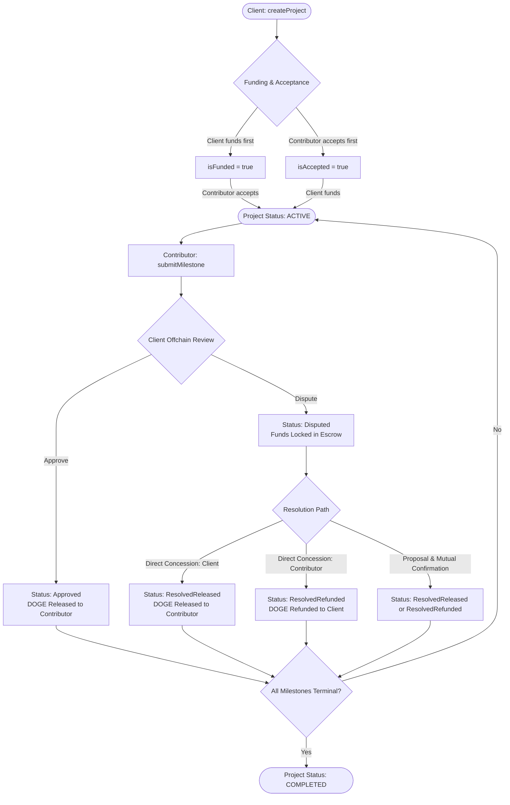

# DogeCommit — DOGE-Native Milestone Escrow Protocol

> **Work delivered. DOGE secured.**  
> Trustless, milestone-based escrow platform for independent Web3 builders and clients on **DogeOS Chikyū Testnet**. Built for the **Noah AI / Vibe Code Hackathon**.

[](https://soliditylang.org/)
[](https://hardhat.org/)
[](https://openzeppelin.com/contracts/)
[-C2A633?logo=dogecoin)](https://rpc.testnet.dogeos.com/)
[](../test/DogeCommitEscrow.test.js)

---

## 1. Project Overview

**DogeCommit** is a decentralized, milestone-based escrow platform engineered specifically for the **DogeOS EVM Layer-2 ecosystem**. It reduces trust-related payment friction between Web3 clients and independent technical contributors by locking funds onchain in DOGE and releasing payments upon client review and approval of deliverables whose evidence URLs and cryptographic hashes are recorded onchain.

### Core Value Proposition

- **Configured DogeOS DOGE Settlement:** Direct contract configuration for the official DogeOS DOGE token precompile (`0x530000000000000000000000000000000000d09e`). Token decimals and live transfer semantics remain unverified on the live testnet.
- **Exact Deposit Matching:** Full escrow funding is required upfront; zero floating token custody or overpayment.
- **Bilateral Agreement Activation:** The project activates only when both the client deposits the required funds and the contributor explicitly accepts the terms, in either sequence.
- **Onchain Deliverable Evidence:** Contributors record evidence URLs and/or cryptographic content hashes (SHA-256) onchain; the contract does not independently or automatically verify work quality, leaving deliverable evaluation and approval/dispute decisions to the client.
- **Checks-Effects-Interactions (CEI):** Internal state updates occur prior to external token transfers on external-interaction paths (`approveMilestone`, `cancelProject`, `fundProject`, `resolveDispute`), backed by OpenZeppelin `SafeERC20`.
- **Dispute Fund Freezing & Symmetrical Resolution:** Contested milestones freeze onchain. Neither party can unilaterally drain or extract disputed funds without counterparty agreement; funds can only be unlocked via direct concession or mutual proposal-confirmation, with the tradeoff that uncooperative parties can cause an indefinite lockup.
- **Pre-Activation Cancellation:** Safe client exit with full refund before agreement activation if terms or timelines change.

---

## 2. Problem Statement

Freelance technical collaboration in Web3 suffers from a systemic counterparty trust dilemma:

```
        ┌─────────────────────────────────────────────────────────┐
        │             The Freelancer Payment Dilemma              │
        └─────────────────────────────────────────────────────────┘
                   ▲                                   ▲
                   │                                   │
      ┌────────────┴─────────────┐       ┌─────────────┴────────────┐
      │      Client's Risk       │       │    Contributor's Risk    │
      ├──────────────────────────┤       ├──────────────────────────┤
      │ • Pays upfront: Worker   │       │ • Works upfront: Client  │
      │   may abandon project or │       │   may delay payment,     │
      │   deliver poor quality.  │       │   dispute arbitrarily,   │
      │ • Has zero recourse once │       │   or ghost entirely.     │
      │   tokens leave wallet.   │       │ • No payment guarantee.  │
      └──────────────────────────┘       └──────────────────────────┘
```

1. **Clients face delivery risk:** Paying upfront leaves them vulnerable to abandonment, missed deadlines, or substandard deliverables with zero recourse once funds leave their wallet.
2. **Contributors face payment risk:** Delivering work upfront leaves builders exposed to non-payment, scope creep, delayed disbursements, or clients ghosting upon receiving source code.
3. **Centralized escrow fails Web3 ethos:** Traditional freelance platforms take 10–20% intermediary fees, enforce opaque dispute procedures, suffer multi-week resolution delays, and maintain custodial control over user funds.
4. **Dogecoin lacked escrow infrastructure:** Despite being one of the world's most recognized and liquid digital assets, Dogecoin historically lacked programmable EVM smart contract capability. With the arrival of DogeOS, high-speed, low-fee smart contract escrow for DOGE is now possible.

---

## 3. Proposed Solution

DogeCommit addresses this impasse by providing a non-custodial smart contract escrow protocol configured for DogeOS Chikyū Testnet.

```
       CLIENT                                                         CONTRIBUTOR
      ┌──────┐                                                         ┌───────┐
      │Client│                                                         │Worker │
      └──┬───┘                                                         └───┬───┘
         │                                                                 │
         │ 1. createProject() [1-25 milestones, descriptions, deadlines]   │
         ├─────────────────────────────────────────┐                       │
         │                                         ▼                       │
         │ 2. fundProject()               ┌─────────────────┐              │
         │    (exact DOGE deposit)        │ DogeCommitEscrow│              │
         ├───────────────────────────────►│  Smart Contract │              │
         │                                │ (Locked Assets) │              │
         │                                └────────▲────────┘              │
         │                                         │  3. acceptProject()   │
         │                                         │     (reviews terms)   │
         │                                         └───────────────────────┤
         │                                                                 │
         │               ═════ PROJECT BECOMES ACTIVE ═════                │
         │                                                                 │
         │                                            4. submitMilestone() │
         │                                               (URL and/or Hash) │
         │                                ┌─────────────────┐              │
         │ 5. approveMilestone()          │ Releases exact  │◄─────────────┤
         │    (client reviews offchain)   │ milestone DOGE  │              │
         ├───────────────────────────────►│ to contributor  │              │
         │                                └────────┬────────┘              │
         │                                         │                       │
         │                                         ▼                       │
         │                                  [DOGE Transferred] ───────────►│
```

- **Escrow Protection & Deadlock Tradeoff:** Funds are locked in escrow and cannot be unilaterally extracted by either party once active. However, because there is no centralized backdoor or automated arbiter, a party refusing to compromise can cause disputed funds to remain indefinitely locked in the contract.
- **Granular Milestones:** Large projects can be divided into 1 to 25 milestones that can progress and be submitted independently.
- **Lifecycle Event Logging:** Major milestone and project state transitions emit onchain events with indexed identity parameters (`projectId`, `client`, `contributor`, `milestoneIndex`), facilitating offchain tracking and auditability.

---

## 4. Core Features and User Roles

### User Roles

| Role | Permissions & Capabilities |
|---|---|
| **Client** | Creates projects, funds escrow with exact DOGE, reviews deliverable submissions offchain, decides whether to approve milestones (releasing funds) or dispute (freezing funds), proposes dispute compromises, concedes funds to contributor, and cancels unactivated projects. |
| **Contributor** | Reviews project terms, accepts project agreements, submits milestone evidence (URL and/or content hash) recorded onchain, disputes invalid proposals, proposes dispute compromises, and concedes refunds to client. |
| **Public / Observer** | Transparently queries project details, milestone progression, escrow balances, and dispute statuses via contract view functions and the DogeOS block explorer. |

### Core Feature Matrix

| Feature | Implementation Status | Technical Mechanism |
|---|---|---|
| **DOGE Escrow Settlement** | **Implemented (Contract)** | Configured DogeOS precompile `0x530000000000000000000000000000000000d09e` via `SafeERC20` (live network decimals and transfer semantics unverified) |
| **Milestone Batching (1–25)** | **Implemented (Contract)** | Enforced via `MAX_MILESTONES = 25` to bound array iteration; live DogeOS block gas limits remain unverified |
| **Dual Activation Order** | **Implemented (Contract)** | `(Funded -> Accepted)` or `(Accepted -> Funded)` transitions project to `Active` |
| **Deliverable Evidence Logging** | **Implemented (Contract)** | Onchain recording of `evidenceUrl` and/or `evidenceHash`; client performs offchain review without automated onchain verification |
| **Checks-Effects-Interactions** | **Implemented (Contract)** | State updated before token transfer on external-interaction paths (`fundProject`, `cancelProject`, `approveMilestone`, `resolveDispute`) |
| **Dispute Fund Freezing** | **Implemented (Contract)** | Status shifts to `Disputed`; normal approvals locked until mutual resolution or concession |
| **Mutual Dispute Resolution** | **Implemented (Contract)** | Direct Concession & Proposal-Confirmation (unilateral claims strictly revert; unresolved disputes remain locked indefinitely) |
| **Pre-Activation Cancellation** | **Implemented (Contract)** | Client can cancel if not active; 100% refund of deposited tokens |
| **Responsive Web Interface** | *Specification Complete (Blueprint)* | Planned Vite 8 + React 18 + Tailwind v3.4 + Wagmi v2 / Viem integration (*not yet implemented*) |
| **Multicall3 RPC Batching** | *Specification Complete (Blueprint)* | Planned read-optimization with automatic concurrent `eth_call` fallback (*not yet implemented*) |

---

## 5. How DogeCommit Works — Complete User Workflow

The platform operates through a deterministic 8-step lifecycle:



### Step 1: Project Creation (`createProject`)
The client defines project parameters: title, description, contributor wallet address, and an array of 1 to 25 `MilestoneInput` structs. Each milestone requires a name, description, DOGE payout amount, future timestamp deadline, and deliverable requirements. The contract records the project with status `Created`. Milestones are not required to execute strictly sequentially; any pending milestone may be submitted independently once the project becomes active.

### Step 2: Escrow Funding (`fundProject`)
The client executes an ERC-20 `approve(escrowAddress, totalAmount)` transaction on the configured DogeOS DOGE token contract, followed by `fundProject(projectId)`. The contract transfers the exact total sum into escrow using `safeTransferFrom`.

### Step 3: Contributor Acceptance (`acceptProject`)
The assigned contributor inspects the project scope and deliverables. Calling `acceptProject(projectId)` records their onchain consent.

### Step 4: Bilateral Activation
Activation requires both funding and acceptance:
- If funded first, acceptance activates the project (`ProjectActivated` event).
- If accepted first, funding activates the project.
- *Prior to activation, the client may invoke `cancelProject(projectId)` to abort and immediately recover all deposited DOGE.*

### Step 5: Deliverable Submission (`submitMilestone`)
For any pending milestone, the contributor completes the work and submits deliverable evidence: an `evidenceUrl` (e.g. repository link, pull request, IPFS link, or deployment URL) and/or an `evidenceHash` (e.g. cryptographic SHA-256 hash of the deliverable bundle). The contract requires at least one non-empty evidence field and records both onchain alongside a timestamp. The contract does not parse, evaluate, or automatically verify the quality of the submitted work. Status transitions to `Submitted`.

### Step 6: Client Review & Approval (`approveMilestone`)
The client reviews the submitted deliverable offchain against agreed requirements. If satisfied, the client calls `approveMilestone(projectId, milestoneIndex)`. The contract transitions the milestone status to `Approved`, increments `releasedAmount`, and transfers the milestone DOGE amount directly to the contributor via `safeTransfer`.

### Step 7: Dispute Handling (`disputeMilestone`)
If the deliverable is missing, incomplete, or fails specifications, the client calls `disputeMilestone(projectId, milestoneIndex, reason)`. The milestone status shifts to `Disputed`, freezing that milestone's funds.

### Step 8: Project Completion
When every milestone reaches a terminal state (`Approved`, `ResolvedReleased`, or `ResolvedRefunded`), the contract automatically marks the overall project status as `Completed`.

---

## 6. Milestone Lifecycle and Dispute-Resolution Explanation

### Milestone State Machine

```
              ┌─────────┐
              │ Pending │
              └────┬────┘
                   │ submitMilestone()
                   ▼
             ┌───────────┐
             │ Submitted │
             └─────┬─────┘
         ┌─────────┴─────────┐
         │ approveMilestone()│ disputeMilestone()
         ▼                   ▼
   ┌──────────┐        ┌──────────┐
   │ Approved │        │ Disputed │ (Funds Frozen)
   └──────────┘        └─────┬────┘
                             │
            ┌────────────────┴────────────────┐
            │ Mutual Agreement (Concession or │
            │      Proposal & Confirmation)   │
            ▼                                 ▼
  ┌──────────────────┐              ┌──────────────────┐
  │ ResolvedReleased │              │ ResolvedRefunded │
  │(Paid to Builder) │              │ (Refund to Client│
  └──────────────────┘              └──────────────────┘
```

### The Inherent Deadlock Dilemma & Symmetrical Protection

A critical architectural consideration in smart contract escrow is handling disputes without introducing centralized arbiters or unilateral fund-drain vectors:
- **No Unilateral Client Withdrawal:** The client cannot unilaterally declare a dispute and reclaim their DOGE, which would allow unscrupulous clients to steal completed work.
- **No Unilateral Contributor Extraction:** The contributor cannot unilaterally force release of disputed funds without client approval.
- **Tradeoff — Indefinite Lockup:** Because DogeCommit deliberately avoids administrative backdoors or centralized arbiters, disputed funds remain frozen indefinitely in the escrow contract unless the parties reach an agreement or one party concedes.

### Two Trustless Resolution Mechanisms

#### Mechanism A: Direct Concession
Either party may voluntarily concede the dispute in favor of the counterparty at any time:
- **Client Concession:** The client calls `resolveDispute(projectId, index, ReleaseToContributor)`. The contract releases the milestone payment to the contributor.
- **Contributor Concession:** The contributor calls `resolveDispute(projectId, index, RefundToClient)`. The contract refunds the milestone payment back to the client.

#### Mechanism B: Proposal & Mutual Confirmation
When parties negotiate a compromise (e.g., partial rework or agreed refund):
1. **Party A Proposes:** Calls `proposeDisputeResolution(projectId, index, outcome)`. The proposal is stored onchain in the milestone struct and emits `DisputeResolutionProposed`.
2. **Party B Confirms:** Calls `resolveDispute(projectId, index, outcome)` matching the exact proposed outcome. The contract verifies that the caller is different from the proposer (`msg.sender != milestone.proposedBy`), executes the token transfer, and updates the milestone to `ResolvedReleased` or `ResolvedRefunded`.

*Any attempt by an unauthorized third party or an attempt by a party to confirm their own unilateral claim reverts with custom error `ResolutionNotAgreed()` or `Unauthorized()`.*

---

## 7. System Architecture

DogeCommit is structured into decoupled onchain and offchain layers:

```
┌────────────────────────────────────────────────────────────────────────┐
│                        DogeCommit Architecture                         │
└────────────────────────────────────────────────────────────────────────┘

 [ USER LAYER ]
    │
    ├── Client Browser (Chrome / Brave / Edge)
    └── Contributor Browser (Chrome / Brave / Edge)
         │
         │ (EIP-1193 Injected Wallet: MetaMask / OKX / Rabby)
         ▼
 [ PRESENTATION LAYER (Planned Frontend — Blueprint Specified) ]
    │
    ├── React 18.3.1 SPA (Vite ^8.3.5, TypeScript ^5.7.2, Strict Mode)
    ├── Stargate Dark Theme (Tailwind CSS ^3.4.17 + Geist Sans/Mono Fonts)
    ├── State Management: Wagmi ^2.14.9 + Viem ^2.23.0 + TanStack Query ^5.66.0
    └── Input Validation: Zod schemas with BigInt decimal precision
         │
         │ (JSON-RPC over HTTPS: https://rpc.testnet.dogeos.com/)
         ▼
 [ DOGEOS LAYER-2 TESTNET (EVM Execution Environment) ]
    │
    ├── RPC Node & Multicall3 (Chain ID: 6281971)
    │
    ├── [ SMART CONTRACT LAYER (Implemented & Verified Locally) ]
    │    │
    │    ├── DogeCommitEscrow.sol (Solidity 0.8.28, 200 Optimizer Runs)
    │    │   ├── nonReentrant on token transfer paths (fund, cancel, approve, resolve)
    │    │   ├── SafeERC20 (OpenZeppelin 5.6.1)
    │    │   ├── Custom Error Guards (20 Contract Errors)
    │    │   └── Lifecycle Event Logs (10 events with indexed ID/role parameters)
    │    │
    │    └── Configured DOGE Precompile Interface (IERC20)
    │        └── Address: 0x530000000000000000000000000000000000d09e
    │            (Decimals & live transfer semantics unverified on testnet)
    │
    └── [ STORAGE & EVIDENCE LAYER (Offchain Reference) ]
         │
         └── GitHub / IPFS / Arweave / Cloud Storage
             └── Cryptographic SHA-256 Hash recorded onchain; review done offchain
```

---

## 8. Technology Stack

All dependencies and versions align with [`TECH-STACK.md`](./TECH-STACK.md). Frontend dependencies represent the **planned specification** for upcoming implementation and are not yet installed in the current repository:

| Category | Component / Library | Version | Purpose & Verification Status |
|---|---|---|---|
| **Smart Contracts** | Solidity | `0.8.28` | Core contract language (Custom errors, CEI, gas optimized) — *Implemented* |
| **Contract Framework** | Hardhat | `^2.29.1` | Compilation, deployment pipeline, local mock environment — *Installed (Root)* |
| **Contract Tooling** | `@nomicfoundation/hardhat-toolbox` | `^6.1.2` | Chai matchers, Ethers.js v6 integration, coverage — *Installed (Root)* |
| **Security Standards** | `@openzeppelin/contracts` | `^5.6.1` | `ReentrancyGuard`, `SafeERC20`, `IERC20` — *Installed (Root)* |
| **Frontend Framework** | React | `^18.3.1` | UI presentation layer (*Planned — Blueprint Specified*) |
| **Build Tool & Plugin** | Vite + `@vitejs/plugin-react` | `^8.3.5` / `^6.2.1` | Fast ESM development and production bundler pairing (*Planned*) |
| **Language** | TypeScript | `^5.7.2` | Strict end-to-end type safety (*Planned*) |
| **Web3 Client** | Viem | `^2.23.0` | High-performance, lightweight EVM client abstraction (*Planned*) |
| **Web3 Hooks** | Wagmi | `^2.14.9` | React hooks for wallet connection and contract interactions (*Planned*) |
| **Async State** | `@tanstack/react-query` | `^5.66.0` | Query caching, optimistic UI updates, auto-refetching (*Planned*) |
| **Styling** | Tailwind CSS | `^3.4.17` | Utility-first styling with Stargate `#141414` palette (*Planned*) |
| **CSS Processing** | PostCSS / Autoprefixer | `^8.4.49` / `^10.4.20` | ESM-compatible stylesheet pipeline (*Planned*) |
| **UI Primitives** | Radix UI (`dialog`, `dropdown`, etc.) | `^1.1.4` / `^2.1.4` | Accessible headless UI primitives (*Planned*) |
| **Form Validation** | React Hook Form + Zod | `^7.54.2` / `^3.24.1` | Form state management and schema validation (*Planned*) |
| **Notifications** | Sonner | `^1.7.1` | Toast notification engine (*Planned*) |
| **Class Utilities** | `clsx` / `tailwind-merge` | `^2.1.1` / `^2.6.0` | Dynamic Tailwind class resolution (*Planned*) |
| **Icons** | Lucide React | `^0.469.0` | Clean, accessible SVG iconography (*Planned*) |
| **Typography** | Geist Fonts (`sans` / `mono`) | `^5.1.0` | Sans and Mono typographic hierarchy (*Planned*) |
| **Target Chain** | DogeOS Chikyū Testnet | Chain ID `6281971` | Configured DOGE EVM Layer-2 network (*Live settlement unverified*) |

---

## 9. Repository Structure

The repository maintains strict separation between root-level smart contract tooling and blueprint specifications:

```
DogeCommit/
├── contracts/
│   ├── DogeCommitEscrow.sol       # Core escrow smart contract (615 lines)
│   └── TestDOGE.sol               # Mock ERC-20 DOGE token for local testing
├── test/
│   └── DogeCommitEscrow.test.js   # Hardhat automated test suite (53 tests)
├── scripts/
│   └── deploy.js                  # Deployment script for local and DogeOS networks
├── deployments/
│   └── hardhat.json               # Existing local Hardhat deployment metadata (networkName.json)
├── DogeCommit-Blueprint/          # Architectural blueprint documents
│   ├── SMART-CONTRACT-SPEC.md     # Document 3: Function specs, gas profiles, error index
│   ├── SYSTEM-ARCHITECTURE.md     # Document 4: Component boundaries, dataflow, RPC architecture
│   ├── UI-UX-DESIGN.md            # Document 5: Stargate design system, layout, copy decks
│   ├── TECH-STACK.md              # Document 6: Compatibility matrix, dependency audit
│   ├── API-AND-DATA-MODEL.md      # Document 7: Viem/Wagmi models, events, error decoding
│   ├── SECURITY-AND-TESTING.md    # Document 8: Threat matrix, attack surface analysis
│   ├── NOAH-AI-BUILD-INSTRUCTIONS.md # Document 9: Step-by-step frontend implementation guide
│   └── README-AND-SUBMISSION.md   # Document 10: This document
├── PRODUCT-REQUIREMENTS.md        # Document 1: Product requirements & business logic
├── USER-FLOWS.md                  # Document 2: Detailed state diagrams and role flows
├── hardhat.config.js              # Hardhat EVM network and compiler configuration
├── package.json                   # Root dependencies (Hardhat, OpenZeppelin)
├── package-lock.json              # Deterministic root dependency lockfile
├── .env.example                   # Environment variable template
├── .gitignore                     # Git ignore rules for node_modules, cache, env
└── README.md                      # Initial project readme
```

*Note: The `frontend/` directory is specified in [`NOAH-AI-BUILD-INSTRUCTIONS.md`](./NOAH-AI-BUILD-INSTRUCTIONS.md) as a decoupled standalone package to be scaffolded during frontend implementation; it is not yet created in the repository.*

---

## 10. Local Development Setup

Follow these exact steps to clone, configure, compile, and run DogeCommit locally.

### Prerequisites

- **Node.js:** `v24.21.0` (LTS or compatible Node 20+)
- **npm:** `11.19.0`
- **Git**

### Step-by-Step Instructions

#### 1. Clone the Repository
```bash
git clone https://github.com/sumitkr121003/DogeCommit.git
cd DogeCommit
```

#### 2. Install Root Smart Contract Dependencies
```bash
npm install
```

#### 3. Configure Local Environment
Copy the example environment configuration:
```bash
cp .env.example .env
```
*(On Windows PowerShell: `Copy-Item .env.example .env`)*

#### 4. Compile Smart Contracts
Compile the contracts with Hardhat optimizer enabled (200 runs):
```bash
npx hardhat compile
```
*(On Windows systems where PowerShell execution policy restricts scripts, execute via: `cmd /c npx hardhat compile`)*

#### 5. Start a Local Hardhat Node (Optional for local testing)
In a separate terminal window:
```bash
npx hardhat node
```

#### 6. Deploy Contracts to Local Network
```bash
npx hardhat run scripts/deploy.js --network localhost
```
The script deploys a mock `TestDOGE` token and `DogeCommitEscrow`, automatically writing deployment metadata to `deployments/localhost.json`.

---

## 11. Smart Contract Testing & Test Results

The smart contract test suite provides comprehensive test coverage across 53 automated scenarios in [`test/DogeCommitEscrow.test.js`](../test/DogeCommitEscrow.test.js).

### Executing the Test Suite

```bash
npx hardhat test
```
*(Windows PowerShell fallback: `cmd /c npx hardhat test`)*

### Current Automated Test Suite Results

```text
  DogeCommitEscrow
    Initialization & Deployment
      ✔ should set the correct DOGE token address
      ✔ should revert if initialized with address(0)
      ✔ should start with 0 project count
    Project Creation
      ✔ should allow a client to create a project with multiple milestones
      ✔ should revert if contributor address is zero
      ✔ should revert if client address equals contributor address
      ✔ should revert if milestones array is empty
      ✔ should revert if milestone amount is zero
      ✔ should revert if milestone deadline is in the past
    Funding & Contributor Acceptance Workflow
      ✔ should allow client to fund with exact token approval
      ✔ should revert if non-client attempts to fund
      ✔ should revert if client tries to fund twice
      ✔ should allow contributor to accept project
      ✔ should revert if non-contributor attempts to accept
      ✔ should revert if contributor tries to accept twice
      ✔ should activate project when funded first, then accepted
      ✔ should activate project when accepted first, then funded
      ✔ should allow client to cancel and refund if project is not yet active
      ✔ should revert if client tries to cancel an already active project
    Milestone Submission & Approval
      ✔ should allow contributor to submit evidence for an active milestone
      ✔ should revert if unauthorized party attempts to submit
      ✔ should revert if evidence is empty
      ✔ should revert if submitting for out-of-bounds milestone index
      ✔ should revert if submitting milestone that is already submitted
      ✔ should allow client to approve submitted milestone and release exact DOGE
      ✔ should revert if client attempts to approve milestone that is not submitted
      ✔ should revert if client attempts to approve an already approved milestone (double approval)
      ✔ should revert if non-client attempts to approve
      ✔ should mark project as Completed when all milestones are approved
    Dispute & Mutual Dispute Resolution
      ✔ should allow client to dispute a submitted milestone, locking funds
      ✔ should revert if client tries to dispute an unsubmitted milestone
      ✔ should revert if client attempts to dispute an already approved milestone
      ✔ should prevent contributor from withdrawing disputed funds through normal approval
      ✔ should allow mutual resolution via Proposal & Confirmation (RefundToClient)
      ✔ should allow mutual resolution via Proposal & Confirmation (ReleaseToContributor)
      ✔ should allow direct concession by client releasing funds to contributor
      ✔ should allow direct concession by contributor refunding funds to client
      ✔ should REVERT if client tries to unilaterally refund funds to themselves without agreement
      ✔ should REVERT if contributor tries to unilaterally release funds to themselves without agreement
      ✔ should REVERT if stranger attempts to propose or resolve dispute
      ✔ should REVERT if proposing or resolving with Outcome.None
      ✔ should settle full project with one approved milestone and one disputed/refunded milestone
    View Functions and Validation Guards
      ✔ should revert getProject for non-existent project
      ✔ should revert getMilestone for non-existent project
      ✔ should revert getMilestones for non-existent project
    Milestone Count Boundaries (MAX_MILESTONES = 25)
      ✔ should expose MAX_MILESTONES constant as 25
      ✔ should revert creating a project with 26 milestones (TooManyMilestones)
      ✔ should revert creating a project with 30 milestones (TooManyMilestones)
      ✔ should revert creating a project with 50 milestones (TooManyMilestones)
      ✔ should allow creating a project with exactly 25 milestones
      ✔ should retrieve all 25 milestones via getMilestones()
      ✔ should correctly complete a 25-milestone project
    ⛽  createProject(25 milestones) gas used: 3488028
      ✔ should measure gas for 25-milestone project creation (informational)

  53 passing (3s)
```

*Note: The test measuring gas for 25 milestones demonstrates loop feasibility in Hardhat local execution. However, live DogeOS Chikyū Testnet block gas limits and gas schedules remain unverified.*

---

## 12. DogeOS Chikyū Testnet Configuration & Deployment

### Network Parameters

| Parameter | DogeOS Chikyū Testnet Value | Reference Source |
|---|---|---|
| **Network Name** | DogeOS Chikyū Testnet | Official DogeOS Hackathon Specification |
| **Chain ID** | `6281971` (`0x5fdaf3`) | `hardhat.config.js` |
| **RPC Endpoint** | `https://rpc.testnet.dogeos.com/` | Public JSON-RPC Endpoint |
| **Block Explorer** | `https://dogeos-testnet.l2scan.co` | Official L2Scan Explorer |
| **Settlement Asset** | DOGE (Configured Precompile Interface) | Configured in `scripts/deploy.js` |
| **Configured Token Address** | `0x530000000000000000000000000000000000d09e` | Precompile address (*runtime decimals & compatibility unverified*) |

### Deployment Instructions

#### 1. Fund Deployer Wallet
Acquire testnet DOGE from the official DogeOS testnet faucet for gas fees. Ensure the deployer address has sufficient balance.

#### 2. Populate `.env`
Ensure your `.env` contains:
```ini
DOGEOS_RPC_URL=https://rpc.testnet.dogeos.com/
CHAIN_ID=6281971
DOGE_TOKEN_ADDRESS=0x530000000000000000000000000000000000d09e
PRIVATE_KEY=your_deployer_private_key_without_quotes
```

#### 3. Execute Deployment Command
Run the deployment script pointing to `dogeosTestnet`:
```bash
npx hardhat run scripts/deploy.js --network dogeosTestnet
```
*(Windows PowerShell fallback: `cmd /c npx hardhat run scripts/deploy.js --network dogeosTestnet`)*

#### 4. Automated Output
The script automatically:
1. Connects to `https://rpc.testnet.dogeos.com/` (Chain ID `6281971`).
2. Validates deployer balance.
3. Deploys `DogeCommitEscrow` configured with `0x530000000000000000000000000000000000d09e`.
4. Saves deployment metadata to `deployments/dogeosTestnet.json`.

*Note: Successful live settlement on DogeOS Chikyū Testnet has not yet been executed or proven onchain; deployment scripts and configurations are authored and tested against local Hardhat.*

---

## 13. Environment Variables & Secret-Handling Precautions

### Environment Variables Matrix

| Variable | Required | Default / Example | Purpose |
|---|---|---|---|
| `DOGEOS_RPC_URL` | Yes | `https://rpc.testnet.dogeos.com/` | DogeOS JSON-RPC endpoint for contract interactions |
| `CHAIN_ID` | Yes | `6281971` | DogeOS Chikyū Testnet network identifier |
| `DOGE_TOKEN_ADDRESS` | Yes | `0x530000000000000000000000000000000000d09e` | Configured address of the native DOGE token interface |
| `PRIVATE_KEY` | Yes (for deployment) | `0xabcdef...` | Deployer account private key (hex string) |

### Strict Secret-Handling Precautions

> [!CAUTION]
> **Never commit private keys or seed phrases to version control.**
> - Verify that `.env` is listed in [`.gitignore`](../.gitignore).
> - Never store real mainnet funds in testnet deployment wallets.
> - For deployment, use an ephemeral, freshly generated wallet funded solely with testnet faucet tokens.
> - Never log or print `process.env.PRIVATE_KEY` in scripts or console output.

---

## 14. Security Design and Known Limitations

### Security Architecture

1. **Checks-Effects-Interactions (CEI):** Internal state variables, milestone statuses, and project balances are updated *before* invoking external token transfer calls in the four external-interaction paths (`fundProject`, `cancelProject`, `approveMilestone`, and `resolveDispute`).
2. **OpenZeppelin ReentrancyGuard:** Exactly four external state-changing functions that perform external token transfers are protected by OpenZeppelin's `nonReentrant` modifier: `fundProject`, `cancelProject`, `approveMilestone`, and `resolveDispute`. Purely internal state mutations (`createProject`, `acceptProject`, `submitMilestone`, `disputeMilestone`, `proposeDisputeResolution`) mutate internal storage only and do not require re-entrancy locks.
3. **OpenZeppelin SafeERC20:** All token interactions use `IERC20.safeTransfer()` and `IERC20.safeTransferFrom()`, ensuring compatibility with tokens that return boolean false or no return value upon transfer.
4. **Strict Permission Modifiers:**
   - `onlyClient(projectId)`: Restricts funding, milestone approval, milestone disputes, and cancellations to the project client.
   - `onlyContributor(projectId)`: Restricts project acceptance and milestone submissions to the assigned contributor.
   - `onlyParticipant(projectId)`: Restricts dispute resolutions and proposals to verified project participants.
5. **Bounded Storage Arrays:** Milestone inputs are strictly bounded to `1 <= count <= 25` via `MAX_MILESTONES = 25`, preventing unbounded loop gas growth in `createProject` and `getMilestones`. However, this bound does not guarantee execution within DogeOS block gas limits, as the target testnet's actual block gas limits, fee structures, and opcode pricing remain unverified.

### Known Limitations & Tradeoffs

1. **Symmetric Deadlock Limitation:** DogeCommit deliberately avoids centralized arbitration or administrative backdoors. If both the client and the contributor refuse to concede or propose a compromise on a disputed milestone, the disputed funds remain permanently locked in the contract.
2. **Offchain Evidence Storage & Human Review:** Deliverable URLs are stored as strings pointing offchain (e.g., GitHub, IPFS, Arweave). If an offchain host goes offline, the onchain record remains immutable, but the deliverable content must be checked against its recorded SHA-256 `evidenceHash`. The smart contract performs no automated inspection of work quality; review and approval remain entirely human decisions.
3. **Unverified Testnet Assumptions:**
   - **Token Decimals:** While assumed to be 18 decimals, the DOGE precompile decimals must be verified at runtime via `decimals()` before parsing amounts.
   - **Token Transfer Semantics:** The exact behavior of the precompile at `0x530000000000000000000000000000000000d09e` under `SafeERC20` (return values, gas usage, revert conditions) has not been tested on the live network.
   - **EIP-1559 Support:** DogeOS RPC EIP-1559 compatibility must be verified at runtime by checking block `baseFeePerGas` before selecting Type-0 vs Type-2 fee transactions.
   - **Multicall3 Support:** Multicall3 deployment at `0xcA11bde05977b3631167028862bE2a173976CA11` must be verified at runtime with fallback to concurrent individual `eth_call` requests.

---

## 15. Demo Walkthrough with Realistic Example Values

> [!NOTE]
> The scenario, project title, and participant addresses below represent **illustrative sample data** for conceptual demonstration. Token calculations assume an 18-decimal DOGE token, which remains an unverified network assumption on DogeOS Chikyū Testnet. Shortened hashes are illustrative and not full 32-byte cryptographic hashes.

### Scenario: "DogeSwap DEX Frontend Integration" (Illustrative Sample)

- **Client Address (Alice):** `0x70997970C51812dc3A010C7d01b50e0d17dc79C8`
- **Contributor Address (Bob):** `0x3C44CdDdB6a900fa2b585dd299e03d12FA4293BC`
- **Total Escrow Budget:** `15,000 DOGE` (assumes 18 decimals: `15,000 * 10^18` base units; unverified decimal assumption)
- **Settlement Asset:** Configured DOGE Precompile (`0x530000000000000000000000000000000000d09e`)

```
 Milestone 0: UI Wireframes & Token Swap Component
 ├── Amount: 3,000 DOGE
 ├── Deadline: +7 Days
 └── Deliverable: Responsive swap card component with token selector
 
 Milestone 1: Wallet Connection & Slippage Settings
 ├── Amount: 5,000 DOGE
 ├── Deadline: +14 Days
 └── Deliverable: Wagmi/Viem connector integration & custom slippage modal
 
 Milestone 2: Liquidity Pool Management & End-to-End Tests
 ├── Amount: 7,000 DOGE
 ├── Deadline: +21 Days
 └── Deliverable: LP staking interface + Cypress integration tests
```

### Execution Trace

1. **Project Creation:**
   Alice calls `createProject(Bob, "DogeSwap DEX Frontend", "Full DEX UI integration", [M0, M1, M2])`.
   - *Result:* Emits `ProjectCreated(projectId: 1, totalAmount: 15000 DOGE, milestoneCount: 3)`. Project status is `Created`.
2. **Escrow Funding:**
   Alice approves `15,000 DOGE` on the token contract and calls `fundProject(1)`.
   - *Result:* Emits `ProjectFunded(projectId: 1, amount: 15000 DOGE)`. `isFunded` becomes `true`.
3. **Contributor Acceptance:**
   Bob reviews the agreement terms and calls `acceptProject(1)`.
   - *Result:* Emits `ProjectAccepted(projectId: 1)` and `ProjectActivated(projectId: 1)`. Project status transitions to `Active`.
4. **Milestone 0 Submission & Payout:**
   Bob finishes Milestone 0 and calls `submitMilestone(1, 0, "https://github.com/dogeswap/ui/pull/12", "0xa3f5b2c89...")` *(illustrative truncated hash)*.
   Alice inspects the pull request offchain, verifies the UI in preview, and calls `approveMilestone(1, 0)`.
   - *Result:* Milestone 0 marked `Approved`. Exactly `3,000 DOGE` is transferred to Bob via `safeTransfer`.
5. **Milestone 1 Dispute & Mutual Compromise:**
   Bob submits Milestone 1. Alice tests the PR offchain and finds slippage calculation errors. She calls `disputeMilestone(1, 1, "Slippage calculation fails on 0.1% edge cases")`.
   - *Result:* Milestone 1 status shifts to `Disputed`. Funds (`5,000 DOGE`) remain locked in the contract.
   Bob pushes an updated commit fixing the calculation. Alice is satisfied upon re-review and initiates direct concession: she calls `resolveDispute(1, 1, ReleaseToContributor)`.
   - *Result:* Emits `DisputeResolved(projectId: 1, milestoneIndex: 1, ReleaseToContributor, amount: 5000 DOGE, recipient: Bob)`. Exactly `5,000 DOGE` is transferred to Bob.
6. **Milestone 2 Approval & Completion:**
   Bob completes Milestone 2. Alice reviews and calls `approveMilestone(1, 2)`.
   - *Result:* `7,000 DOGE` released to Bob. All 3 milestones have reached terminal states (`Approved` or `ResolvedReleased`). The contract automatically emits `ProjectCompleted(projectId: 1)` and updates status to `Completed`.

---

## 16. Screenshots, Demo Video, and Links

> [!NOTE]
> The items below represent submission artifacts. Live deployment addresses and media links will be recorded once broadcast on the DogeOS Chikyū Testnet.

### Deployed Smart Contract

- **DogeOS Chikyū Testnet Contract Address:**  
  `[PLACEHOLDER — PENDING LIVE TESTNET DEPLOYMENT]`  
  *(Execute: `npx hardhat run scripts/deploy.js --network dogeosTestnet` to deploy and populate)*
- **Block Explorer Contract Verification Link:**  
  `[PLACEHOLDER — https://dogeos-testnet.l2scan.co/address/<DEPLOYED_CONTRACT_ADDRESS>]`
- **Configured DOGE ERC-20 Precompile:**  
  [`0x530000000000000000000000000000000000d09e`](https://dogeos-testnet.l2scan.co/address/0x530000000000000000000000000000000000d09e)

### Live Demo & Video Presentation

- **Demo Video Walkthrough (3 Minutes):**  
  `[PLACEHOLDER — LINK TO DEMO VIDEO]`
- **Live Frontend Web Application:**  
  `[PLACEHOLDER — LINK TO HOSTED WEB APPLICATION (e.g., Vercel / Netlify / IPFS)]`
- **GitHub Repository:**  
  [https://github.com/sumitkr121003/DogeCommit](https://github.com/sumitkr121003/DogeCommit)

### Application Screenshots

| View | Preview Placeholder | Description |
|---|---|---|
| **Project Dashboard** | `[PLACEHOLDER: dashboard-view.png]` | Overview of active, created, and completed escrow projects |
| **Project Creation Form** | `[PLACEHOLDER: create-project-modal.png]` | Dynamic milestone builder with DOGE budget calculations |
| **Milestone Review & Evidence**| `[PLACEHOLDER: milestone-detail-view.png]`| Deliverable URL verification, hash inspector, approve/dispute buttons |
| **Dispute Resolution Modal** | `[PLACEHOLDER: dispute-resolution.png]` | Mutual settlement panel with concession and proposal actions |

---

## 17. Hackathon Submission Checklist

- [x] **Smart Contract Authored & Verified:** `contracts/DogeCommitEscrow.sol` implements milestone creation, funding, dual activation, submissions, approvals, disputes, and mutual resolution.
- [x] **Automated Test Suite Passing:** 53 unit and integration tests passing with zero failures in `test/DogeCommitEscrow.test.js`.
- [x] **Configured Precompile Address:** Explicit configuration for `0x530000000000000000000000000000000000d09e`.
- [x] **Bounded Iteration:** Enforced `MAX_MILESTONES = 25` to prevent unbounded array loops.
- [x] **Clean Dependency Decoupling:** Root Hardhat tooling preserved; planned frontend architecture specified separately.
- [x] **Comprehensive 10-Document Blueprint:** Full architectural, testing, design, and API specification suite completed.
- [ ] **Live DogeOS Testnet Deployment:** Pending broadcast of `scripts/deploy.js --network dogeosTestnet`.
- [ ] **Frontend Application Build:** Implementation ready for execution via [`NOAH-AI-BUILD-INSTRUCTIONS.md`](./NOAH-AI-BUILD-INSTRUCTIONS.md).
- [ ] **Video Recording & Public URL Submission:** Video walkthrough and public URL pending final hackathon submission.

---

## 18. Future Improvements and Roadmap

```
 ┌────────────────┐     ┌────────────────┐     ┌────────────────┐     ┌────────────────┐
 │    PHASE 1     │     │    PHASE 2     │     │    PHASE 3     │     │    PHASE 4     │
 │ DogeOS Mainnet │ ──► │ Decentralized  │ ──► │ Streaming Flow │ ──► │ Onchain Builder│
 │   Deployment   │     │ Arbiters (DAO) │     │ Escrow (Sablier)│    │ Reputation NFTs│
 └────────────────┘     └────────────────┘     └────────────────┘     └────────────────┘
```

1. **DogeOS Mainnet Deployment:** Following security audits and live testnet verification, deploy DogeCommit to DogeOS Mainnet with verifiable onchain source code.
2. **Opt-In Decentralized Arbitration DAO:** Introduce an optional secondary dispute resolution module allowing parties to designate an impartial third-party arbiter or community jury to break symmetrical deadlocks.
3. **Continuous Streaming Escrow:** Support real-time streaming payments for retainer and hourly engagements using time-based token release curves.
4. **Onchain Builder Reputation:** Mint non-transferable, soulbound builder identity credentials (SBTs) certifying completed projects, on-time deliverable milestones, and cumulative DOGE earned.
5. **Multi-Asset DogeOS Support:** Expand escrow settlement to support bridged stablecoins (USDC/USDT) and community tokens within the expanding DogeOS DeFi ecosystem.

---

## 19. Licensing Status

- **Standalone LICENSE File:** A standalone `LICENSE` file is currently not present in the repository root.
- **Root `package.json`:** Currently declares `"license": "ISC"`.
- **Solidity Smart Contracts:** Source files declare `// SPDX-License-Identifier: MIT`.
- **Action Required:** An official `LICENSE` file will be created once authorized by the project maintainer.
