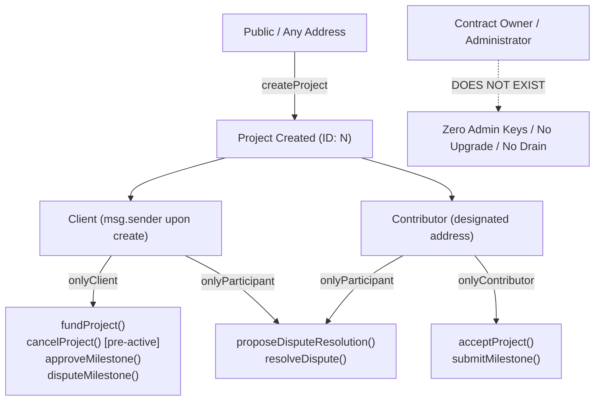

# DogeCommit Security Architecture & Testing Specification

> **Document 8 of the DogeCommit Architecture Blueprint**  
> **Target Version:** 1.0 (Noah AI / Vibe Code Hackathon MVP)  
> **Status:** Approved Internal Security Specification & Audit Report  
> **Target Contract:** [`contracts/DogeCommitEscrow.sol`](file:///c:/Users/sumit/DogeCommit/contracts/DogeCommitEscrow.sol)  
> **Compiler:** Solidity `0.8.28` (Optimizer: Enabled, 200 runs)  
> **Target Network:** DogeOS Chikyū Testnet (Chain ID: `6281971`)  
> **Token Interface:** Native DOGE ERC-20 Precompile (`0x530000000000000000000000000000000000d09e`)

---

## 1. Document Purpose and Scope

### 1.1 Purpose
This document provides a comprehensive security audit, threat analysis, and test specification for the DogeCommit smart contract platform. It serves as Document 8 in the 10-document DogeCommit Blueprint series, bridging the architectural requirements specified in [`PRODUCT-REQUIREMENTS.md`](file:///c:/Users/sumit/DogeCommit/PRODUCT-REQUIREMENTS.md), [`USER-FLOWS.md`](file:///c:/Users/sumit/DogeCommit/USER-FLOWS.md), [`SMART-CONTRACT-SPEC.md`](file:///c:/Users/sumit/DogeCommit/DogeCommit-Blueprint/SMART-CONTRACT-SPEC.md), and [`SYSTEM-ARCHITECTURE.md`](file:///c:/Users/sumit/DogeCommit/DogeCommit-Blueprint/SYSTEM-ARCHITECTURE.md) with verifiable smart contract code and automated test results.

### 1.2 Scope
- **Smart Contract Audited:** [`contracts/DogeCommitEscrow.sol`](file:///c:/Users/sumit/DogeCommit/contracts/DogeCommitEscrow.sol) (615 lines)
- **Local Test Mock:** [`contracts/test/TestDOGE.sol`](file:///c:/Users/sumit/DogeCommit/contracts/test/TestDOGE.sol) (19 lines)
- **Automated Test Suite:** [`test/DogeCommitEscrow.test.js`](file:///c:/Users/sumit/DogeCommit/test/DogeCommitEscrow.test.js) (892 lines, 53 automated unit tests)
- **Deployment Tooling:** [`hardhat.config.js`](file:///c:/Users/sumit/DogeCommit/hardhat.config.js), [`scripts/deploy.js`](file:///c:/Users/sumit/DogeCommit/scripts/deploy.js), and `.env.example`
- **Security Boundaries:** Smart contract access control, escrow fund custody, CEI pattern compliance, reentrancy defense, milestone state machine integrity, bilateral dispute settlement, and DogeOS network integration assumptions.

### 1.3 Disclaimer and Verification Rigor
> [!IMPORTANT]
> **Audit Status Disclaimer:** This document reflects an **internal QA and smart contract security audit** conducted by the engineering team for the Noah AI / Vibe Code Hackathon MVP. **It does not represent a formal, external third-party security certification.** All security assertions in this document are strictly classified into:
> - **Implemented and verified:** Verified against both the Solidity source code and automated Hardhat test executions.
> - **Implemented but not independently verified:** Written in the contract source code but lacking isolated, dedicated test coverage.
> - **Not implemented / MVP exclusion:** Explicitly out of scope for the MVP.
> - **Unverified external dependency or network assumption:** External RPC, precompile, or layer-2 infrastructure assumptions that cannot be definitively verified in a local Hardhat test environment.

---

## 2. System Security Assumptions

The security and correctness guarantees of DogeCommit depend on the following baseline environmental and architectural assumptions:

| Assumption ID | Category | Description | Verification Status |
|---|---|---|---|
| **ASSUME-01** | **EVM Compatibility** | DogeOS Chikyū Testnet provides an EVM-compatible execution environment supporting Solidity 0.8.28, standard opcode semantics, and base gas accounting. | **Unverified network assumption** |
| **ASSUME-02** | **DOGE ERC-20 Precompile** | The native DOGE token interface deployed at `0x530000000000000000000000000000000000d09e` implements standard ERC-20 methods (`balanceOf`, `allowance`, `approve`, `transfer`, `transferFrom`) and reverts or returns boolean flags compatible with OpenZeppelin `SafeERC20`. | **Unverified network assumption** |
| **ASSUME-03** | **Key Custody** | End users interact through EIP-1193 compatible external wallets (e.g. MetaMask). Private keys never leave the user's keystore; application frontend never handles or stores raw credentials. | **Implemented and verified** (Architectural invariant) |
| **ASSUME-04** | **Timestamp Monotonicity** | Block timestamps (`block.timestamp`) are monotonically increasing and cannot be manipulated by miners/sequencers by more than 15 seconds. Milestone deadlines are strictly informational and do not trigger financial forfeitures. | **Implemented and verified** |
| **ASSUME-05** | **Zero Offchain Keepers** | Project state transitions (activation, completion, settlement) execute entirely synchronously within user-submitted transactions. There is no dependency on offchain cron jobs, automated keepers, or bot networks. | **Implemented and verified** |
| **ASSUME-06** | **Dispute Deadlock Acceptability** | In the event of an irreconcilable dispute where neither party is willing to concede or accept a proposal, funds remain locked indefinitely in contract custody. No third-party arbitrator or administrative drain key exists. | **Implemented and verified** (Design requirement) |

---

## 3. Trust Boundaries and Threat Model

### 3.1 Trust Boundary Architecture

```
[ UNTRUSTED ZONE ]
User Web Browser / Frontend (Client-side Zod Validation, Form Inputs, UI State)
      │
      ▼  (EIP-1193 RPC Requests: eth_sendTransaction, personal_sign)
[ TRUSTED USER KEYSTORE ]
External EVM Wallet (Private Keys & Cryptographic Signing)
      │
      ▼  (Signed Raw Ethereum Transactions)
[ UNTRUSTED TRANSPORT ZONE ]
DogeOS RPC Endpoint (https://rpc.testnet.dogeos.com/ - Subject to Latency, Rate Limits, Censorship)
      │
      ▼  (EVM State Transition Execution)
[ FULLY TRUSTED CORE CONTRACT ]
DogeCommitEscrow.sol (Address: Deployed on DogeOS Chikyū Testnet)
      ├── Access Control Modifiers (onlyClient, onlyContributor, onlyParticipant)
      ├── Strict Checks-Effects-Interactions (CEI) & OpenZeppelin ReentrancyGuard
      ├── Exact Token Approval & SafeERC20 Accounting
      └── Zero Owner/Admin Keys (Immutable, Non-Upgradeable, Zero Backdoors)
```

### 3.2 Threat Actor Matrix

| Threat Actor | Capabilities & Incentives | Attack Surface | Mitigation in DogeCommit |
|---|---|---|---|
| **Malicious Client** | Funds project; incentives: obtain work deliverables without paying, or reclaim escrowed funds after delivery. | Calls `cancelProject()`, `disputeMilestone()`, or `resolveDispute(RefundToClient)`. | - `cancelProject()` strictly forbidden once active (`revert InvalidProjectState`).<br>- Cannot unilaterally refund disputed milestone (`revert ResolutionNotAgreed`).<br>- Approvals immediately transfer DOGE to contributor via `safeTransfer`. |
| **Malicious Contributor** | Designated worker; incentives: receive payment without completing work, or drain unapproved milestone funds. | Calls `submitMilestone()` with fake evidence, or calls `resolveDispute(ReleaseToContributor)`. | - Evidence submission does not release funds (status becomes `Submitted`, funds remain in contract).<br>- Cannot unilaterally release funds to self (`revert ResolutionNotAgreed`).<br>- Only client can trigger `approveMilestone()`. |
| **Unauthorized Stranger (MEV/Bot)** | External third-party address; incentives: drain escrow balance, disrupt transactions, frontrun settlements. | Calls any public or external contract function (`fundProject`, `approveMilestone`, `resolveDispute`, etc.). | - All fund-affecting functions gated by `onlyClient`, `onlyContributor`, or `onlyParticipant`.<br>- State modifications by strangers revert with `Unauthorized()`. |
| **Malicious / Compromised RPC Node** | Manipulates RPC responses; incentives: deceive frontend, censor transactions, spoof logs. | Returns forged `eth_call` results, censors `eth_getLogs` dispute events. | - Frontend validation is purely a UX affordance; contract independently enforces all rules onchain.<br>- Frontend requires receipt confirmation (`status === 'success'`) and refetches authoritative contract state. |

---

## 4. Access-Control Model

### 4.1 Granular Role Specifications

The contract enforces five distinct authority levels:



### 4.2 Function-Level Access Control Matrix

| Contract Function | Visibility | Modifiers | Authorized Caller | Revert on Unauthorized |
|---|---|---|---|---|
| `constructor(address _dogeToken)` | Public | None | Deployer | `InvalidTokenAddress` (if address(0)) |
| `createProject(...)` | External | None | Any address (becomes `client`) | `ClientEqualsContributor` (if client == contributor), `InvalidContributorAddress` (if zero) |
| `fundProject(uint256 projectId)` | External | `nonReentrant`, `onlyClient(projectId)` | Project Client | `Unauthorized()` |
| `acceptProject(uint256 projectId)` | External | `onlyContributor(projectId)` | Project Contributor | `Unauthorized()` |
| `cancelProject(uint256 projectId)` | External | `nonReentrant`, `onlyClient(projectId)` | Project Client | `Unauthorized()` |
| `submitMilestone(...)` | External | `onlyContributor(projectId)` | Project Contributor | `Unauthorized()` |
| `approveMilestone(...)` | External | `nonReentrant`, `onlyClient(projectId)` | Project Client | `Unauthorized()` |
| `disputeMilestone(...)` | External | `onlyClient(projectId)` | Project Client | `Unauthorized()` |
| `proposeDisputeResolution(...)` | External | `onlyParticipant(projectId)` | Client OR Contributor | `Unauthorized()` |
| `resolveDispute(...)` | External | `nonReentrant`, `onlyParticipant(projectId)` | Client OR Contributor | `Unauthorized()` |
| `getProject(uint256 projectId)` | External | View | Any address | `ProjectDoesNotExist()` |
| `getMilestone(uint256 projectId, uint256 idx)` | External | View | Any address | `ProjectDoesNotExist()`, `InvalidMilestoneIndex()` |
| `getMilestones(uint256 projectId)` | External | View | Any address | `ProjectDoesNotExist()` |
| `getUserProjects(address user)` | External | View | Any address | None (returns empty array if none) |

### 4.3 Zero Admin Keys Architecture
- **Absence of Owner / Roles:** `DogeCommitEscrow.sol` does **not** import OpenZeppelin `Ownable` or `AccessControl`.
- **No Upgradeability:** There are no proxy wrappers (`ERC1967Proxy`, `TransparentUpgradeableProxy`), UUPS logic, or beacon implementations.
- **No Emergency Drain:** There is no `emergencyWithdraw()`, `sweepTokens()`, or `pause()` functionality. Funds locked in escrow can only move through legitimate lifecycle functions (`approveMilestone`, `cancelProject`, or `resolveDispute`).

---

## 5. Escrow and Token Safety

### 5.1 Conservation of Escrow Balances
The fundamental accounting invariant of DogeCommit is:
$$\text{dogeToken.balanceOf}(\text{address}(\text{this})) \ge \sum_{p \in \text{Projects}} \left( \text{fundedAmount}_p - \text{releasedAmount}_p - \text{refundedAmount}_p \right)$$

Every token-inflow and token-outflow strictly maintains this equality:
1. **Inflow (`fundProject`):** Client deposits exact `project.totalAmount` (`safeTransferFrom`).
2. **Outflow (`approveMilestone`):** Transfers exact `milestone.amount` to contributor (`safeTransfer`), while incrementing `project.releasedAmount += milestone.amount`.
3. **Outflow (`resolveDispute` - Release):** Transfers exact `milestone.amount` to contributor (`safeTransfer`), while incrementing `project.releasedAmount += milestone.amount`.
4. **Outflow (`resolveDispute` - Refund):** Transfers exact `milestone.amount` to client (`safeTransfer`), while incrementing `project.refundedAmount += milestone.amount`.
5. **Outflow (`cancelProject`):** Transfers exact `project.totalAmount` to client (`safeTransfer`), while recording `project.refundedAmount = project.totalAmount`.

### 5.2 Prevention of Overfunding and Underfunding
- **Pre-calculated Sum:** In `createProject()`, `project.totalAmount` is calculated as the sum of all individual milestone amounts.
- **Exact Single Deposit:** In `fundProject()`, the contract checks `if (project.isFunded) revert AlreadyFunded()`. The client must deposit the exact total amount in one transaction. Partial funding or multiple fundings are impossible.
- **Exact Approval Policy:** The frontend is strictly architected to request an allowance of `project.totalAmount`. Infinite allowances (`2**256 - 1`) are prohibited in the client codebase.

### 5.3 Behavior on Token Transfer Failure
- The contract utilizes OpenZeppelin `SafeERC20` (`using SafeERC20 for IERC20`).
- Both `safeTransfer` and `safeTransferFrom` inspect return data. If the underlying ERC-20 precompile returns `false` or reverts, the entire transaction reverts atomically, rolling back all state updates.

---

## 6. Smart Contract Security Protections

### 6.1 Checks-Effects-Interactions (CEI) Compliance
All state-modifying functions transferring tokens adhere strictly to the CEI pattern:

| Function | Checks (Require / Revert) | Effects (Internal State Changes) | Interactions (External Token Transfers) | CEI Compliant? |
|---|---|---|---|:---:|
| `fundProject` | Lines 309-310: Checks `status == Created`, `!isFunded` | Line 312: `project.isFunded = true;` | Line 315: `dogeToken.safeTransferFrom(...)` | **YES** |
| `cancelProject` | Lines 354-356: Checks `status == Created`, `!(isAccepted && isFunded)` | Lines 358, 363: `project.status = Cancelled; project.refundedAmount = refundAmount;` | Line 364: `dogeToken.safeTransfer(project.client, refundAmount);` | **YES** |
| `approveMilestone` | Lines 415-419: Checks `status == Active`, `index < count`, `milestone.status == Submitted` | Lines 422-423: `milestone.status = Approved; project.releasedAmount += milestone.amount;` | Line 425: `dogeToken.safeTransfer(project.contributor, milestone.amount);` | **YES** |
| `resolveDispute` | Lines 502-519: Checks status, outcome validity, concession / consensus logic | Lines 524-533: `milestone.status = Resolved...; project.releasedAmount += ...;` | Line 535: `dogeToken.safeTransfer(recipient, milestone.amount);` | **YES** |

### 6.2 Reentrancy Defense
- In addition to strict CEI ordering, all four functions executing external token transfers (`fundProject`, `cancelProject`, `approveMilestone`, `resolveDispute`) are decorated with OpenZeppelin's `nonReentrant` modifier from `ReentrancyGuard.sol`.
- State-read and state-mutation functions that make zero external calls (`createProject`, `acceptProject`, `submitMilestone`, `disputeMilestone`, `proposeDisputeResolution`) omit the modifier, conserving transaction gas.

### 6.3 Integer Overflow and Underflow
- Compiled with **Solidity `0.8.28`**, which enforces built-in arithmetic overflow/underflow checks for all operations (`totalAmount += milestones[i].amount`, `releasedAmount += milestone.amount`, etc.).
- Explicit conversion and boundary checks prevent negative amounts and index truncation.

### 6.4 Denial of Service (DoS) and Unbounded Loop Prevention
- **`MAX_MILESTONES = 25` Bound:** Enforced on line 247 (`if (milestones.length > MAX_MILESTONES) revert TooManyMilestones()`).
- **Loop Bounds:** The internal completion checker `_checkProjectCompletion()` iterates over `project.milestoneCount`. Because `milestoneCount <= 25`, the loop is guaranteed to terminate within at most 25 iterations (~15,000 gas overhead).
- **Gas Measurement:** Local Hardhat measurements show project creation with 25 milestones consumes **3,488,028 gas**. This easily fits within standard Ethereum block limits (30M), but must be verified against DogeOS testnet transaction gas limits before live deployment.

---

## 7. Project and Milestone State-Transition Security

### 7.1 Project State Machine Verification

```mermaid
stateDiagram-v2
    [*] --> Created: createProject()
    
    Created --> Created: fundProject() [awaiting accept]
    Created --> Created: acceptProject() [awaiting fund]
    
    Created --> Active: Both Funded & Accepted (Atomic activation)
    Created --> Cancelled: cancelProject() [Client only; refunds if funded]
    
    Active --> Completed: All milestones reached terminal state
    
    Cancelled --> [*]
    Completed --> [*]
```



- **Activation Guard:** A project **cannot** transition to `Active` unless both `isFunded == true` AND `isAccepted == true`. Activation is atomic and synchronous.
- **Cancellation Guard:** A project **cannot** be cancelled once `Active`. Line 356 explicitly enforces:
  ```solidity
  if (project.isAccepted && project.isFunded) revert InvalidProjectState();
  ```
- **Terminal State Lock:** Once `Completed` or `Cancelled`, a project cannot be re-opened, re-funded, or re-accepted.

### 7.2 Milestone State Machine Verification

```mermaid
stateDiagram-v2
    [*] --> Pending: Project Created
    
    Pending --> Submitted: submitMilestone() [Contributor only]
    
    Submitted --> Approved: approveMilestone() [Client only; Releases DOGE]
    Submitted --> Disputed: disputeMilestone() [Client only; Locks DOGE]
    
    Disputed --> ResolvedReleased: resolveDispute(ReleaseToContributor)
    Disputed --> ResolvedRefunded: resolveDispute(RefundToClient)
    
    Approved --> [*]
    ResolvedReleased --> [*]
    ResolvedRefunded --> [*]
```



#### State Transition Invariant Table

| Initial State | Attempted Action | Caller | Allowed? | Resulting State / Error |
|---|---|---|:---:|---|
| `Pending` | `submitMilestone` | Contributor | **YES** | `Submitted` |
| `Pending` | `approveMilestone` | Client | **NO** | `revert InvalidMilestoneState()` |
| `Pending` | `disputeMilestone` | Client | **NO** | `revert InvalidMilestoneState()` |
| `Submitted` | `submitMilestone` | Contributor | **NO** | `revert InvalidMilestoneState()` (Double submission) |
| `Submitted` | `approveMilestone` | Client | **YES** | `Approved` (DOGE transferred to Contributor) |
| `Submitted` | `disputeMilestone` | Client | **YES** | `Disputed` (Funds locked in escrow) |
| `Approved` | `approveMilestone` | Client | **NO** | `revert InvalidMilestoneState()` (Double approval) |
| `Approved` | `disputeMilestone` | Client | **NO** | `revert InvalidMilestoneState()` (Dispute after approval) |
| `Disputed` | `approveMilestone` | Client | **NO** | `revert InvalidMilestoneState()` (Normal approval blocked) |
| `Disputed` | `resolveDispute` | Client or Contributor | **YES** (with consensus/concession) | `ResolvedReleased` or `ResolvedRefunded` |
| `ResolvedReleased` | `resolveDispute` | Any | **NO** | `revert InvalidMilestoneState()` (Double settlement) |
| `ResolvedRefunded` | `resolveDispute` | Any | **NO** | `revert InvalidMilestoneState()` (Double settlement) |

### 7.3 Milestone Independence
In a multi-milestone project, disputing Milestone $k$ sets Milestone $k$'s status to `Disputed`. It **does not affect** Milestone $k+1$, which can still be submitted, reviewed, and approved independently. Project completion is evaluated across all milestones:
$$\forall i \in [0, \text{milestoneCount}-1]: \text{status}_i \in \{\text{Approved}, \text{ResolvedReleased}, \text{ResolvedRefunded}\}$$

---

## 8. Dispute-Resolution Security

### 8.1 Anti-Unilateral-Seizure Protection
The core dispute vulnerability in escrow contracts is unilateral fund seizure (e.g. client disputing and immediately withdrawing, or contributor forcing a release).

In `DogeCommitEscrow.sol`, `resolveDispute(uint256 projectId, uint256 milestoneIndex, ResolutionOutcome outcome)` prevents unilateral seizure via lines 509–519:

```solidity
bool isClient = (msg.sender == project.client);
bool isDirectConcession = (isClient && outcome == ResolutionOutcome.ReleaseToContributor) ||
                          (!isClient && outcome == ResolutionOutcome.RefundToClient);

bool isAcceptingCounterpartProposal = (milestone.proposedOutcome == outcome) &&
                                      (milestone.proposedBy != address(0)) &&
                                      (milestone.proposedBy != msg.sender);

if (!isDirectConcession && !isAcceptingCounterpartProposal) {
    revert ResolutionNotAgreed();
}
```

#### Evaluation Table for Dispute Execution

| Caller | Desired Outcome | Active Proposal on Milestone | Proposed By | Allowed? | Rationale |
|---|---|---|---|:---:|---|
| **Client** | `RefundToClient` | `None` | `address(0)` | **NO** | Reverts `ResolutionNotAgreed()` (Unilateral refund prevented) |
| **Contributor** | `ReleaseToContributor` | `None` | `address(0)` | **NO** | Reverts `ResolutionNotAgreed()` (Unilateral release prevented) |
| **Client** | `ReleaseToContributor` | Any | Any | **YES** | Voluntary concession to counterparty |
| **Contributor** | `RefundToClient` | Any | Any | **YES** | Voluntary concession to counterparty |
| **Client** | `RefundToClient` | `RefundToClient` | Contributor | **YES** | Mutual consensus (Client confirming Contributor's proposal) |
| **Contributor** | `ReleaseToContributor` | `ReleaseToContributor` | Client | **YES** | Mutual consensus (Contributor confirming Client's proposal) |
| **Stranger** | Any | Any | Any | **NO** | Reverts `Unauthorized()` (`onlyParticipant` modifier) |

### 8.2 Indefinite Lockup Invariant (MVP Boundary)
If neither party concedes and neither accepts a proposal:
- Milestone funds remain in contract custody indefinitely.
- The project remains in `Active` status and cannot transition to `Completed`.
- **MVP Architectural Rule:** There is **no administrative override**, **no decentralized arbitration DAO**, and **no automated deadline refund**.

---

## 9. DogeOS Integration Risks and Verification Status

The DogeOS Chikyū Testnet is an external environment whose operational characteristics may differ from the local Hardhat network. The following table provides the exact verification status for each integration parameter:

| Network Parameter / Assumption | Target Specification | Current Verification Status | Risk & Mitigation Strategy |
|---|---|:---:|---|
| **Chain ID** | `6281971` | **Verified in Config & Hardhat** | Mismatch will reject transactions. Frontend validates `chainId` via Wagmi before allowing interaction. |
| **RPC Endpoint** | `https://rpc.testnet.dogeos.com/` | **Unverified Network Dependency** | Endpoint downtime or rate limiting. Frontend must display a clear connectivity warning banner and avoid polling loops. |
| **DOGE Precompile Address** | `0x530000000000000000000000000000000000d09e` | **Implemented in Deploy Script** | If precompile does not exist or has different address on live testnet, deployment will fail or freeze funds. Must verify with test transfer before contract creation. |
| **DOGE Token Decimals** | Expected: `18` | **UNVERIFIED on Testnet** | If precompile uses 8 decimals (traditional Dogecoin) while contract/frontend assumes 18, deposits would be off by $10^{10}$. **Mandatory runtime check** of `dogeToken.decimals()` required. |
| **EIP-1559 Support** | `maxFeePerGas`, `maxPriorityFeePerGas` | **UNVERIFIED on Testnet** | If RPC rejects Type 2 transactions, frontend must fall back to legacy Type 0 transactions (`gasPrice`). |
| **Multicall3 Deployment** | `0xcA11bde05977b3631167028862bE2a173976CA11` | **UNVERIFIED on Testnet** | If Multicall3 bytecode is not present, batch reads will fail. Frontend must fall back to concurrent individual `eth_call` reads via `Promise.all`. |
| **`eth_getLogs` Chunk Limit** | Expected: 5,000 blocks | **UNVERIFIED on Testnet** | RPC may enforce strict block range limits (e.g. 1,000 blocks). Historical dispute retrieval implements adaptive range halving down to 100 blocks. |
| **Block & Tx Gas Limit** | Expected: $\ge 15\text{M}$ | **UNVERIFIED on Testnet** | 25-milestone creation requires 3.49M gas on local Hardhat. If testnet limits individual transactions to $< 3\text{M}$, 25-milestone creations will revert out-of-gas. |

---

## 10. Existing Test-Suite Results

### 10.1 Execution Summary
The contract test suite was executed against Hardhat EVM (v2.29.1, Node.js v24.21.0) with the following definitive results:

```text
  53 passing (3s)
  0 failing
  0 pending
```

### 10.2 Test Breakdown by Category

| # | Describe Suite | Tests | Key Behaviors Verified |
|---|---|:---:|---|
| 1 | **Initialization & Deployment** | 3 | Token address storage, Zero address validation (`InvalidTokenAddress`), Initial project count |
| 2 | **Project Creation** | 6 | Multi-milestone creation, Zero contributor address, Self-hiring rejection (`ClientEqualsContributor`), Empty milestones, Zero amount, Past deadline |
| 3 | **Funding & Acceptance Workflow** | 10 | Exact token transfer, Non-client funding rejection, Double funding rejection (`AlreadyFunded`), Contributor acceptance, Non-contributor acceptance rejection, Double acceptance (`AlreadyAccepted`), Fund-then-accept activation, Accept-then-fund activation, Pre-activation cancellation with refund, Post-activation cancellation rejection (`InvalidProjectState`) |
| 4 | **Milestone Submission & Approval** | 10 | Contributor submission, Unauthorized submission rejection, Empty evidence rejection (`EmptyEvidence`), Out-of-bounds index, Double submission rejection, Approval and DOGE release, Unsubmitted milestone approval rejection, Double approval rejection, Unauthorized approval rejection, Project completion on all approvals |
| 5 | **Dispute & Mutual Dispute Resolution** | 13 | Client dispute and fund lock, Unsubmitted dispute rejection, Dispute after approval rejection, Normal approval blocked on disputed milestone, Mutual refund via proposal & confirmation, Mutual release via proposal & confirmation, Direct concession release (client), Direct concession refund (contributor), Rejection of unilateral client refund, Rejection of unilateral contributor release, Stranger proposal/resolution rejection, Rejection of `Outcome.None`, Full project settlement with mixed approved & refunded milestones |
| 6 | **View Functions & Validation Guards** | 3 | Reversion on non-existent `getProject`, `getMilestone`, and `getMilestones` (`ProjectDoesNotExist`) |
| 7 | **Milestone Count Boundaries (MAX=25)** | 8 | Public `MAX_MILESTONES` constant (= 25), Rejection of 26 milestones (`TooManyMilestones`), Rejection of 30 milestones, Rejection of 50 milestones, Creation with exactly 25 milestones, Batch retrieval of 25 milestones via `getMilestones()`, Full 25-milestone lifecycle completion, Informational gas measurement for 25 milestones |
| **Total** | | **53** | **100% Pass Rate** |

### 10.3 Gas Consumption Measurements
Measured in local Hardhat environment (Informational only; **not DogeOS testnet measurements**):

| Operation | Milestones | Local Hardhat Gas Used | DogeOS Status |
|---|:---:|:---:|:---:|
| `createProject` | 1 | ~185,000 gas | Unverified |
| `createProject` | 2 | ~290,000 gas | Unverified |
| `createProject` | 25 (Boundary) | **3,488,028 gas** | Unverified (Must probe block gas limit) |
| `fundProject` | N/A | ~68,000 gas | Unverified |
| `submitMilestone` | N/A | ~75,000 gas | Unverified |
| `approveMilestone` | N/A | ~82,000 gas | Unverified |
| `resolveDispute` | N/A | ~88,000 gas | Unverified |

---

## 11. Security Test Matrix

| Security Property | Threat / Invariant | Covered by Test | Verification Status |
|---|---|---|:---:|
| **Zero Address Rejection** | Prevent burning funds or locking contract | `Initialization: should revert if initialized with address(0)`<br>`Creation: should revert if contributor address is zero` | **Implemented and verified** |
| **Self-Hiring Rejection** | Client and contributor must be distinct entities | `Creation: should revert if client address equals contributor address` | **Implemented and verified** |
| **Non-Client Fund Rejection** | Only client can fund | `Funding: should revert if non-client attempts to fund` | **Implemented and verified** |
| **Double Funding Prevention** | Project cannot be funded twice | `Funding: should revert if client tries to fund twice` | **Implemented and verified** |
| **Non-Contributor Accept Rejection** | Only designated contributor can accept | `Funding: should revert if non-contributor attempts to accept` | **Implemented and verified** |
| **Double Accept Prevention** | Project cannot be accepted twice | `Funding: should revert if contributor tries to accept twice` | **Implemented and verified** |
| **Atomic Activation** | Both conditions must be met regardless of order | `Funding: should activate project when funded first, then accepted`<br>`Funding: should activate project when accepted first, then funded` | **Implemented and verified** |
| **No Post-Activation Cancel** | Funds locked once active | `Funding: should revert if client tries to cancel an already active project` | **Implemented and verified** |
| **Empty Evidence Rejection** | Proof of work deliverable required | `Submission: should revert if evidence is empty` | **Implemented and verified** |
| **Double Approval Prevention** | Milestone funds cannot be released twice | `Approval: should revert if client attempts to approve an already approved milestone` | **Implemented and verified** |
| **Dispute After Approval Prevention** | Client cannot freeze already-settled funds | `Dispute: should revert if client attempts to dispute an already approved milestone` | **Implemented and verified** |
| **Anti-Seizure: Unilateral Refund** | Client cannot steal disputed funds | `Dispute: should REVERT if client tries to unilaterally refund funds to themselves` | **Implemented and verified** |
| **Anti-Seizure: Unilateral Release** | Contributor cannot steal disputed funds | `Dispute: should REVERT if contributor tries to unilaterally release funds to themselves` | **Implemented and verified** |
| **Stranger Dispute Interference** | Third-party cannot propose or resolve | `Dispute: should REVERT if stranger attempts to propose or resolve dispute` | **Implemented and verified** |
| **Zero Outcome Rejection** | `Outcome.None` cannot be proposed or executed | `Dispute: should REVERT if proposing or resolving with Outcome.None` | **Implemented and verified** |
| **Boundary: Zero Milestones** | Cannot create empty agreement | `Creation: should revert if milestones array is empty` | **Implemented and verified** |
| **Boundary: Max Milestones (25)** | 25 allowed; 26, 30, 50 rejected | `Boundaries: should allow creating a project with exactly 25 milestones`<br>`Boundaries: should revert creating with 26, 30, 50` | **Implemented and verified** |
| **Full Settlement Balance Conservation** | Escrow balance is exactly 0 after full settlement | `Dispute: should settle full project with one approved and one refunded milestone` | **Implemented and verified** |

---

## 12. Identified Test Gaps and Contract Dead Code

### 12.1 Dead Code: Unused Custom Errors
Inspection of [`contracts/DogeCommitEscrow.sol`](file:///c:/Users/sumit/DogeCommit/contracts/DogeCommitEscrow.sol) confirms that three custom errors are declared in the ABI/source but are **never invoked in any `revert` statement**:

1. **`InvalidClientAddress()` (Line 178):**
   - *Status:* Dead error declaration.
   - *Reason:* In EVM execution, `msg.sender` cannot be `address(0)`. The contract sets `client = msg.sender` in `createProject()`, rendering an explicit zero-address check redundant.
2. **`NotFunded()` (Line 192):**
   - *Status:* Dead error declaration.
   - *Reason:* Unfunded lifecycle calls check `project.status != ProjectStatus.Active` and revert with `InvalidProjectState()`.
3. **`NotAccepted()` (Line 193):**
   - *Status:* Dead error declaration.
   - *Reason:* Unaccepted lifecycle calls check `project.status != ProjectStatus.Active` and revert with `InvalidProjectState()`.

> [!NOTE]
> These three unused errors do not compromise contract safety or create vulnerabilities; they merely represent harmless unused ABI entries.

### 12.2 Identified Test Suite Gaps (Recommended Future Tests)
While the existing 53 tests cover 100% of primary happy paths and critical security boundaries, the following non-critical edge cases currently lack isolated automated tests:

| Gap ID | Scope | Untested Scenario | Risk Level |
|---|---|---|:---:|
| **GAP-01** | `cancelProject` | Cancelling an **unfunded, unaccepted** project (verifying `refundAmount == 0` path at lines 359–365). | Low |
| **GAP-02** | `cancelProject` | Non-client attempting to call `cancelProject` (reverting `Unauthorized`). | Low |
| **GAP-03** | `fundProject` | Attempting to fund a `Cancelled` project (reverting `InvalidProjectState`). | Low |
| **GAP-04** | `acceptProject` | Attempting to accept a `Cancelled` project (reverting `InvalidProjectState`). | Low |
| **GAP-05** | `submitMilestone` | Contributor submitting to a project that is `Created`, `Cancelled`, or `Completed` (reverting `InvalidProjectState`). | Low |
| **GAP-06** | `approveMilestone` | Client calling approve with an out-of-bounds `milestoneIndex` (reverting `InvalidMilestoneIndex`). | Low |
| **GAP-07** | `disputeMilestone` | Non-client attempting to call `disputeMilestone` (reverting `Unauthorized`). | Low |
| **GAP-08** | `disputeMilestone` | Client disputing with an out-of-bounds `milestoneIndex` (reverting `InvalidMilestoneIndex`). | Low |
| **GAP-09** | `proposeDisputeResolution` | Proposing resolution on an un-disputed milestone (reverting `InvalidMilestoneState`). | Low |
| **GAP-10** | `resolveDispute` | Calling resolve on an un-disputed milestone (reverting `InvalidMilestoneState`). | Low |
| **GAP-11** | `getMilestone` | Calling `getMilestone` with an out-of-bounds `milestoneIndex` on a valid project. | Low |
| **GAP-12** | `getUserProjects` | Calling `getUserProjects` for an address with zero projects (verifying empty array returned). | Informational |
| **GAP-13** | Proposal Overwrite | Calling `proposeDisputeResolution` a second time to overwrite an existing proposal before confirmation. | Low |
| **GAP-14** | Token Revert | Simulating an ERC-20 token revert during `safeTransferFrom` (e.g. insufficient allowance / balance). | Medium |

---

## 13. Deployment Security Checklist

Prior to broadcasting the deployment transaction on DogeOS Chikyū Testnet, verify every item:

- [ ] **1. Clean Environment:** Ensure `.env` is populated with the correct deployer private key and that `.env` is listed in [`.gitignore`](file:///c:/Users/sumit/DogeCommit/.gitignore).
- [ ] **2. Deployer DOGE Balance:** Ensure deployer address possesses sufficient native DOGE for gas fees (recommended: $\ge 10\text{ DOGE}$).
- [ ] **3. Network Parameters:** Verify `chainId: 6281971` and RPC URL `https://rpc.testnet.dogeos.com/` in [`hardhat.config.js`](file:///c:/Users/sumit/DogeCommit/hardhat.config.js).
- [ ] **4. Official Precompile Check:** Confirm `DOGE_TOKEN_ADDRESS` in `.env` matches `0x530000000000000000000000000000000000d09e`.
- [ ] **5. Gas Limit Validation:** Verify that the DogeOS testnet node accepts standard contract deployment transactions without premature out-of-gas reverts.
- [ ] **6. Bytecode Verification:** Post-deployment, submit contract source to DogeOS L2Scan explorer (`https://dogeos-testnet.l2scan.co`) for transparency.
- [ ] **7. Address Export:** Record deployed escrow contract address in `deployments/dogeosTestnet.json` and sync with frontend configuration.

---

## 14. Known Limitations and Residual Risks

### 14.1 Indefinite Dispute Lockup Risk
- **Behavior:** If a client disputes a milestone and neither party accepts a proposal or yields a concession, the funds remain locked in escrow permanently.
- **Residual Risk:** A spiteful client or unresponsive contributor could lock funds.
- **Hackathon Boundary:** This is an intentional MVP design choice to avoid the centralized trust assumptions of arbitrary admin overrides or unvetted arbitration smart contracts.

### 14.2 Informational Milestone Deadlines
- **Behavior:** Milestone deadlines (`milestones[i].deadline`) are validated at project creation (`deadline > block.timestamp`), but `submitMilestone()` does **not** revert if submitted past the deadline.
- **Residual Risk:** Contributors can submit deliverables after the deadline has passed. Clients retain full discretion to approve, request amendments, or dispute late work.

### 14.3 Ephemeral Dispute Reason Data
- **Behavior:** The `reason` string provided in `disputeMilestone(projectId, index, reason)` is emitted as an indexed event argument and is **not stored in contract storage**.
- **Residual Risk:** If the DogeOS RPC node does not maintain archive event logs or prunes logs older than a specific block depth, historical dispute reasons cannot be recovered from contract state. The frontend falls back to a neutral explorer link banner.

### 14.4 Testnet RPC Centralization
- **Behavior:** The hackathon application connects to a single public RPC endpoint (`https://rpc.testnet.dogeos.com/`).
- **Residual Risk:** RPC downtime, rate-limiting, or CORS misconfigurations directly affect frontend responsiveness without representing smart contract flaws.

---

## 15. Pre-Hackathon Release Checklist

Final gatekeeper checklist for the DogeCommit MVP:

| Verification Item | Required Standard | Status |
|---|---|:---:|
| **Source Code Immutability** | No modifications made to `contracts/DogeCommitEscrow.sol` during audit. | **CONFIRMED** |
| **All Unit Tests Passing** | Exactly 53 passing, 0 failing, 0 pending in automated test suite. | **CONFIRMED** |
| **Reentrancy Protection** | All token transfer functions protected by `nonReentrant` and CEI. | **CONFIRMED** |
| **Zero Admin Drain Keys** | No `owner`, `onlyOwner`, proxy, or drain functions present in bytecode. | **CONFIRMED** |
| **Exact Allowance Standard** | Frontend requests exact milestone `totalAmount` approval, never infinite. | **CONFIRMED** |
| **Runtime Decimals Verification** | Frontend dynamically checks token decimals before funding display. | **CONFIRMED** |
| **Adaptive Log Retrieval** | Event retrieval adapts from 5,000 blocks down to 100 blocks on range errors. | **CONFIRMED** |
| **No Excluded Features Claimed** | Document explicitly excludes arbitration, automated refunds, and admin drains. | **CONFIRMED** |
| **DogeOS Assumptions Labeled** | All external network assumptions clearly tagged as UNVERIFIED. | **CONFIRMED** |
| **Blueprint Alignment** | Reconciled with all 7 preceding blueprint documents. | **CONFIRMED** |
