# DogeCommit — Smart Contract Technical Specification

**Document:** SMART-CONTRACT-SPEC.md  
**Version:** 1.0  
**Status:** Blueprint Specification  
**Target Contract:** `DogeCommitEscrow.sol`  
**Target Network:** DogeOS Chikyū Testnet (Chain ID: `6281971`)  
**Primary Asset:** DOGE (Native ERC-20 Interface: `0x530000000000000000000000000000000000d09e`)

---

## 1. Contract Overview and Responsibilities

`DogeCommitEscrow` is a trust-minimized, milestone-based escrow smart contract deployed on DogeOS Chikyū Testnet. It mediates agreements between a **Client** (funder) and a **Contributor** (service provider), ensuring payment assurance and delivery transparency using DOGE as the settlement currency.

### Primary Responsibilities
1. **Agreement Registry:** Immutable onchain registration of multi-milestone agreements with defined deliverable requirements, deadlines, and DOGE allocations.
2. **Custody & Escrow:** Secure custody of deposited DOGE tokens using exact approval and deposit accounting.
3. **Activation Enforcement:** Ensuring work only activates once both funding and contributor acceptance are fulfilled.
4. **Milestone Settlement:** Safe release of DOGE upon client approval of verified deliverable evidence.
5. **Dispute Freezing:** Locking disputed milestone funds onchain to prevent unauthorized withdrawals.
6. **Mutual Dispute Resolution:** Enforcing consensus-based settlement (bilateral agreement or direct concession) without centralized intermediaries or automated third-party arbiters.
7. **Accounting Integrity:** Enforcing strict conservation of funds: total DOGE deposited must equal the sum of released, refunded, and actively locked funds at all times.

---

## 2. DogeOS Chikyū Testnet Configuration

| Parameter | Value | Verification Status | Notes |
|---|---|---|---|
| **Network Name** | DogeOS Chikyū Testnet | Confirmed | Layer 2 EVM network for Dogecoin |
| **Chain ID** | `6281971` (`0x5fdaf3`) | Verified onchain | RPC `eth_chainId` returns `0x5fdaf3` |
| **RPC URL** | `https://rpc.testnet.dogeos.com/` | Verified responsive | JSON-RPC 2.0 endpoint |
| **Block Explorer** | `https://dogeos-testnet.l2scan.co` | Active | L2Scan block explorer |
| **Native Asset** | DOGE | 18 Decimals | Used as native gas and settlement currency |
| **Native DOGE ERC-20 Interface** | `0x530000000000000000000000000000000000d09e` | Bytecode verified (length: 3360 hex chars) | Precompiled / canonical system ERC-20 contract for DOGE |

> [!NOTE]
> On DogeOS, DOGE acts as both native gas and as a precompiled ERC-20 token at address `0x530000000000000000000000000000000000d09e`. Escrow operations utilize standard ERC-20 functions (`transferFrom`, `transfer`, `balanceOf`) on this address.

---

## 3. DOGE Token Interface and Payment Model

### Token Standards & Interface
The contract interacts with DOGE via OpenZeppelin's `IERC20` and `SafeERC20` wrappers:
- **Token Address:** Fixed immutable address set at constructor deployment (`dogeToken`).
- **Precision:** 18 decimals ($1 \text{ DOGE} = 10^{18} \text{ base units}$).
- **Deposit Mechanism:** Client grants an **exact ERC-20 approval** to the escrow contract for `totalAmount`, followed by `safeTransferFrom(msg.sender, address(this), totalAmount)`.
- **Payout Mechanism:** Released or refunded funds are transferred using `safeTransfer(recipient, amount)`.
- **No Mock Tokens in Testnet/Production:** The contract is bound to the official DOGE ERC-20 address on testnet. (Local in-memory unit tests deploy a matching 18-decimal test token).
- **Exact Approval Policy:** Frontends and clients must request approvals strictly for the exact total project amount (`totalAmount`), explicitly avoiding `type(uint256).max` infinite approvals.

---

## 4. Contract Roles and Permissions

| Role | Address Definition | Capabilities & Permissions |
|---|---|---|
| **Client** | `project.client` (the creator of the project) | - Call `fundProject()`<br>- Call `cancelProject()` (pre-activation only)<br>- Call `approveMilestone()`<br>- Call `disputeMilestone()`<br>- Call `proposeDisputeResolution()`<br>- Call `resolveDispute()` (conceding release or confirming refund) |
| **Contributor** | `project.contributor` (assigned address) | - Call `acceptProject()` (or choose not to accept; no onchain decline function exists)<br>- Call `submitMilestone()`<br>- Call `proposeDisputeResolution()`<br>- Call `resolveDispute()` (conceding refund or confirming release) |
| **Participant** | Either `client` or `contributor` | - Participate in dispute resolution proposals and executions |
| **Third Party / Public** | Any other address | - Call read-only view functions (`getProject`, `getMilestone`, `getMilestones`, `getUserProjects`, `projectCount`)<br>- Call `createProject` (acting as client for a new project) |
| **Contract Admin** | None | **Zero Admin Keys.** The contract is immutable, non-upgradeable, and contains no backdoors or owner drain functions. |

---

## 5. Project Data Structures

### `ProjectStatus` Enum
```solidity
enum ProjectStatus {
    Created,    // 0: Created; awaiting funding and/or contributor acceptance
    Active,     // 1: Both funded and accepted; milestone execution enabled
    Completed,  // 2: All milestone funds settled (released or refunded)
    Cancelled   // 3: Cancelled before activation; funds refunded to client if deposited
}
```

### Project Constants & State Variables
```solidity
/// @notice Maximum number of milestones allowed per project to ensure gas safety
uint256 public constant MAX_MILESTONES = 25;
```

### `Project` Struct
```solidity
struct Project {
    uint256 id;                // Unique incremental project identifier (1, 2, ...)
    address client;            // Employer wallet address
    address contributor;       // Assigned contractor/freelancer wallet address
    string title;              // Project title
    string description;        // High-level scope of work / agreement details
    uint256 totalAmount;       // Total DOGE escrow amount (sum of all milestone amounts)
    uint256 releasedAmount;    // Cumulative DOGE released to contributor
    uint256 refundedAmount;    // Cumulative DOGE refunded to client
    bool isFunded;             // True once client deposits totalAmount
    bool isAccepted;           // True once designated contributor accepts agreement
    ProjectStatus status;      // Current state of the project
    uint256 milestoneCount;    // Number of milestones defined in project (1 to 25)
}
```

---

## 6. Milestone Data Structures

### `MilestoneStatus` Enum
```solidity
enum MilestoneStatus {
    Pending,          // 0: Initial state; waiting for contributor deliverable
    Submitted,        // 1: Deliverable evidence submitted; awaiting client review
    Approved,         // 2: Client approved submission; payment released to contributor
    Disputed,         // 3: Client raised dispute; milestone payment locked in escrow
    ResolvedReleased, // 4: Dispute settled with release of payment to contributor
    ResolvedRefunded  // 5: Dispute settled with refund of payment back to client
}
```

### `ResolutionOutcome` Enum
```solidity
enum ResolutionOutcome {
    None,                 // 0: No outcome proposed
    ReleaseToContributor, // 1: Release milestone payment to contributor
    RefundToClient        // 2: Refund milestone payment back to client
}
```

### `MilestoneInput` Struct (Function calldata)
```solidity
struct MilestoneInput {
    string name;                    // Short milestone title
    string description;             // Expected milestone tasks
    uint256 amount;                 // DOGE amount allocated for this milestone
    uint256 deadline;               // Target completion unix timestamp
    string deliverableRequirements; // Concrete evidence expectations
}
```

### `Milestone` Struct (Onchain storage)
```solidity
struct Milestone {
    string name;                        // Milestone title
    string description;                 // Detailed description
    uint256 amount;                     // Locked DOGE amount
    uint256 deadline;                   // Target completion timestamp
    string deliverableRequirements;     // Deliverable specifications
    string evidenceUrl;                 // Deliverable URL (GitHub PR, commit, doc, demo)
    string evidenceHash;                // IPFS CID or SHA-256 hash of deliverable
    uint256 submittedAt;                // Timestamp when evidence was submitted
    MilestoneStatus status;             // Current milestone status
    ResolutionOutcome proposedOutcome; // Proposed outcome during dispute
    address proposedBy;                // Address of participant who proposed the resolution
}
```

---

## 7. Project Lifecycle and State Transitions

```mermaid
stateDiagram-v2
    [*] --> Created: createProject()
    
    Created --> Created: fundProject() [if not yet accepted]
    Created --> Created: acceptProject() [if not yet funded]
    
    Created --> Active: fundProject() [when already accepted]
    Created --> Active: acceptProject() [when already funded]
    
    Created --> Cancelled: cancelProject() [Client only; refunds DOGE if funded]
    
    Active --> Completed: All milestones in Approved / ResolvedReleased / ResolvedRefunded
    
    Cancelled --> [*]
    Completed --> [*]
```



### Transition Invariants
- `Created -> Active`: Permitted if and only if `isFunded == true` AND `isAccepted == true`.
- `Created -> Cancelled`: Permitted only if project has NOT transitioned to `Active` (i.e. `isFunded && isAccepted == false`).
- `Active -> Cancelled`: **Strictly Forbidden.** Once active, the contract does not permit blanket cancellation.
- `Active -> Completed`: Occurs automatically when the final milestone transitions to `Approved`, `ResolvedReleased`, or `ResolvedRefunded`.
- `Completed -> *` or `Cancelled -> *`: Terminal states. No further transitions or modifications allowed.

---

## 8. Milestone Lifecycle and State Transitions

```mermaid
stateDiagram-v2
    [*] --> Pending: createProject()
    
    Pending --> Submitted: submitMilestone() [Contributor only, Project Active]
    
    Submitted --> Approved: approveMilestone() [Client only; Releases DOGE]
    Submitted --> Disputed: disputeMilestone() [Client only; Locks DOGE]
    
    Disputed --> ResolvedReleased: resolveDispute(ReleaseToContributor) [Mutual Agreement / Client Concession]
    Disputed --> ResolvedRefunded: resolveDispute(RefundToClient) [Mutual Agreement / Contributor Concession]
    
    Approved --> [*]
    ResolvedReleased --> [*]
    ResolvedRefunded --> [*]
```



### State Definitions
1. **`Pending`:** Contributor is working on the milestone. Submissions are only accepted while the project status is `Active`.
2. **`Submitted`:** Evidence has been recorded onchain. The client can either approve or dispute.
3. **`Approved`:** Terminal milestone state. Payment was successfully transferred to contributor.
4. **`Disputed`:** Milestone funds are frozen. The normal approval function is blocked. Evidence resubmission and milestone reopening are excluded from the MVP; disputed funds stay locked until an allowed resolution or direct concession settles the milestone.
5. **`ResolvedReleased`:** Terminal milestone state. Dispute was resolved in favor of the contributor, and payment was released.
6. **`ResolvedRefunded`:** Terminal milestone state. Dispute was resolved in favor of the client, and payment was refunded.

---

## 9. Complete External Function Specifications

### 9.1 `createProject`
```solidity
function createProject(
    address contributor,
    string calldata title,
    string calldata description,
    MilestoneInput[] calldata milestones
) external returns (uint256 projectId);
```
- **Description:** Registers a new escrow project agreement.
- **Access Control:** Anyone (caller becomes `client`).
- **Validations:**
  - `contributor != address(0)` (reverts with `InvalidContributorAddress`).
  - `msg.sender != contributor` (reverts with `ClientEqualsContributor`).
  - `milestones.length > 0` (reverts with `EmptyMilestones`).
  - `milestones.length <= MAX_MILESTONES` (reverts with `TooManyMilestones` if `milestones.length > 25`).
  - For each milestone:
    - `milestones[i].amount > 0` (reverts with `InvalidMilestoneAmount`).
    - `milestones[i].deadline > block.timestamp` (reverts with `InvalidMilestoneDeadline`).
- **State Changes:** Increments `projectCount`, populates `Project` struct, stores all `Milestone` records with `status = Pending`, appends `projectId` to `userProjectIds` for both client and contributor.
- **Emits:** `ProjectCreated(projectId, msg.sender, contributor, title, totalAmount, milestones.length)`.

### 9.2 `fundProject`
```solidity
function fundProject(uint256 projectId) external nonReentrant onlyClient(projectId);
```
- **Description:** Transfers exact project `totalAmount` in DOGE from client to escrow.
- **Access Control:** `onlyClient(projectId)`.
- **Validations:**
  - `project.status == ProjectStatus.Created` (reverts with `InvalidProjectState`).
  - `!project.isFunded` (reverts with `AlreadyFunded`).
- **State Changes:** Sets `project.isFunded = true`. Calls `dogeToken.safeTransferFrom(msg.sender, address(this), project.totalAmount)`. If `project.isAccepted == true`, sets `project.status = ProjectStatus.Active` and emits `ProjectActivated`.
- **Emits:** `ProjectFunded(projectId, msg.sender, project.totalAmount)`.

### 9.3 `acceptProject`
```solidity
function acceptProject(uint256 projectId) external onlyContributor(projectId);
```
- **Description:** Records explicit acceptance of project terms by the designated contributor. If the contributor does not agree, no onchain action is required (there is no explicit `declineProject()` function); the project remains in `Created` status until the client cancels it.
- **Access Control:** `onlyContributor(projectId)`.
- **Validations:**
  - `project.status == ProjectStatus.Created` (reverts with `InvalidProjectState`).
  - `!project.isAccepted` (reverts with `AlreadyAccepted`).
- **State Changes:** Sets `project.isAccepted = true`. If `project.isFunded == true`, sets `project.status = ProjectStatus.Active` and emits `ProjectActivated`.
- **Emits:** `ProjectAccepted(projectId, msg.sender)`.

### 9.4 `cancelProject`
```solidity
function cancelProject(uint256 projectId) external nonReentrant onlyClient(projectId);
```
- **Description:** Cancels project before activation and returns any deposited funds to client.
- **Access Control:** `onlyClient(projectId)`.
- **Validations:**
  - `project.status == ProjectStatus.Created` (reverts with `InvalidProjectState`).
  - `!(project.isAccepted && project.isFunded)` (reverts with `InvalidProjectState`).
- **State Changes:** Sets `project.status = ProjectStatus.Cancelled`. If `project.isFunded == true`, sets `project.refundedAmount = project.totalAmount` and calls `dogeToken.safeTransfer(project.client, project.totalAmount)`.
- **Emits:** `ProjectCancelled(projectId, msg.sender, refundAmount)`.

### 9.5 `submitMilestone`
```solidity
function submitMilestone(
    uint256 projectId,
    uint256 milestoneIndex,
    string calldata evidenceUrl,
    string calldata evidenceHash
) external onlyContributor(projectId);
```
- **Description:** Submits deliverable evidence for client review.
- **Access Control:** `onlyContributor(projectId)`.
- **Validations:**
  - `project.status == ProjectStatus.Active` (reverts with `InvalidProjectState`).
  - `milestoneIndex < project.milestoneCount` (reverts with `InvalidMilestoneIndex`).
  - `milestone.status == MilestoneStatus.Pending` (reverts with `InvalidMilestoneState`).
  - `bytes(evidenceUrl).length > 0 || bytes(evidenceHash).length > 0` (reverts with `EmptyEvidence`).
- **State Changes:** Sets `milestone.evidenceUrl`, `milestone.evidenceHash`, `milestone.submittedAt = block.timestamp`, and `milestone.status = MilestoneStatus.Submitted`.
- **Emits:** `MilestoneSubmitted(projectId, milestoneIndex, evidenceUrl, evidenceHash, block.timestamp)`.

### 9.6 `approveMilestone`
```solidity
function approveMilestone(
    uint256 projectId,
    uint256 milestoneIndex
) external nonReentrant onlyClient(projectId);
```
- **Description:** Approves submitted deliverable and releases milestone DOGE to contributor.
- **Access Control:** `onlyClient(projectId)`.
- **Validations:**
  - `project.status == ProjectStatus.Active` (reverts with `InvalidProjectState`).
  - `milestoneIndex < project.milestoneCount` (reverts with `InvalidMilestoneIndex`).
  - `milestone.status == MilestoneStatus.Submitted` (reverts with `InvalidMilestoneState`).
- **State Changes:** Sets `milestone.status = MilestoneStatus.Approved`. Increments `project.releasedAmount += milestone.amount`. Calls `dogeToken.safeTransfer(project.contributor, milestone.amount)`. Calls `_checkProjectCompletion(projectId)`.
- **Emits:** `MilestoneApproved(projectId, milestoneIndex, milestone.amount, project.contributor)`.

### 9.7 `disputeMilestone`
```solidity
function disputeMilestone(
    uint256 projectId,
    uint256 milestoneIndex,
    string calldata reason
) external onlyClient(projectId);
```
- **Description:** Disputes submitted deliverable, freezing milestone funds in escrow.
- **Access Control:** `onlyClient(projectId)`.
- **Validations:**
  - `project.status == ProjectStatus.Active` (reverts with `InvalidProjectState`).
  - `milestoneIndex < project.milestoneCount` (reverts with `InvalidMilestoneIndex`).
  - `milestone.status == MilestoneStatus.Submitted` (reverts with `InvalidMilestoneState`).
- **State Changes:** Sets `milestone.status = MilestoneStatus.Disputed`. Resets `milestone.proposedOutcome = ResolutionOutcome.None` and `milestone.proposedBy = address(0)`.
- **Dispute Reason Persistence:** Emits `MilestoneDisputed(projectId, milestoneIndex, reason)`. The string `reason` is **not** written to contract storage. It must be indexed offchain or read from event logs. Limitation: If historical logs are purged or unavailable via RPC, dispute reasons cannot be retrieved directly from the contract state.
- **Evidence Resubmission Excluded:** A disputed milestone cannot be reopened or resubmitted by the contributor; it remains frozen until settled via mutual dispute resolution or direct concession.
- **Emits:** `MilestoneDisputed(projectId, milestoneIndex, reason)`.

### 9.8 `proposeDisputeResolution`
```solidity
function proposeDisputeResolution(
    uint256 projectId,
    uint256 milestoneIndex,
    ResolutionOutcome outcome
) external onlyParticipant(projectId);
```
- **Description:** Formally proposes a dispute settlement outcome (`ReleaseToContributor` or `RefundToClient`).
- **Access Control:** `onlyParticipant(projectId)` (client or contributor).
- **Validations:**
  - `project.status == ProjectStatus.Active` (reverts with `InvalidProjectState`).
  - `milestoneIndex < project.milestoneCount` (reverts with `InvalidMilestoneIndex`).
  - `milestone.status == MilestoneStatus.Disputed` (reverts with `InvalidMilestoneState`).
  - `outcome != ResolutionOutcome.None` (reverts with `InvalidResolutionOutcome`).
- **State Changes:** Stores `milestone.proposedOutcome = outcome` and `milestone.proposedBy = msg.sender`.
- **Emits:** `DisputeResolutionProposed(projectId, milestoneIndex, outcome, msg.sender)`.

### 9.9 `resolveDispute`
```solidity
function resolveDispute(
    uint256 projectId,
    uint256 milestoneIndex,
    ResolutionOutcome outcome
) external nonReentrant onlyParticipant(projectId);
```
- **Description:** Executes a dispute settlement based on bilateral agreement or direct concession.
- **Access Control:** `onlyParticipant(projectId)`.
- **Validations:**
  - `project.status == ProjectStatus.Active` (reverts with `InvalidProjectState`).
  - `milestoneIndex < project.milestoneCount` (reverts with `InvalidMilestoneIndex`).
  - `milestone.status == MilestoneStatus.Disputed` (reverts with `InvalidMilestoneState`).
  - `outcome != ResolutionOutcome.None` (reverts with `InvalidResolutionOutcome`).
  - Authorization check: Caller must satisfy **either**:
    1. *Direct Concession:* Caller is Client granting `ReleaseToContributor`, OR caller is Contributor granting `RefundToClient`.
    2. *Proposal Confirmation:* Caller is confirming an active proposal created by the other party (`milestone.proposedOutcome == outcome && milestone.proposedBy == counterpart`).
    - Otherwise reverts with `ResolutionNotAgreed`.
- **State Changes:**
  - If `ReleaseToContributor`: sets `milestone.status = MilestoneStatus.ResolvedReleased`, increments `project.releasedAmount += milestone.amount`, calls `dogeToken.safeTransfer(project.contributor, milestone.amount)`.
  - If `RefundToClient`: sets `milestone.status = MilestoneStatus.ResolvedRefunded`, increments `project.refundedAmount += milestone.amount`, calls `dogeToken.safeTransfer(project.client, milestone.amount)`.
  - Calls `_checkProjectCompletion(projectId)`.
- **Emits:** `DisputeResolved(projectId, milestoneIndex, outcome, milestone.amount, recipient)`.

### 9.10 View Functions
- `getProject(uint256 projectId)`: Returns full `Project` struct. Reverts `ProjectDoesNotExist` if invalid.
- `getMilestone(uint256 projectId, uint256 milestoneIndex)`: Returns specific `Milestone`. Reverts `InvalidMilestoneIndex` if out of bounds.
- `getMilestones(uint256 projectId)`: Returns dynamic array of all `Milestone` structs for a project.
- `getUserProjects(address user)`: Returns array of `uint256` project IDs where address is client or contributor.
- `projectCount()`: Returns total number of projects created.

---

## 10. Internal Function Responsibilities

### `_checkProjectCompletion`
```solidity
function _checkProjectCompletion(uint256 projectId) internal;
```
- **Responsibility:** Iterates over all milestones for `projectId`.
- **Condition:** Verifies whether every milestone has reached a final settled status:
  $$\forall i \in [0, \text{milestoneCount}-1]: \text{status}_i \in \{\text{Approved}, \text{ResolvedReleased}, \text{ResolvedRefunded}\}$$
- **Effect:** If all milestones are settled, updates `project.status = ProjectStatus.Completed` and emits `ProjectCompleted(projectId)`. If any milestone is still `Pending`, `Submitted`, or `Disputed`, returns without state change.

---

## 11. Events and Emitted Data

All state transitions emit events to support frontend indexing and offchain auditability:

```solidity
event ProjectCreated(
    uint256 indexed projectId,
    address indexed client,
    address indexed contributor,
    string title,
    uint256 totalAmount,
    uint256 milestoneCount
);

event ProjectFunded(
    uint256 indexed projectId,
    address indexed client,
    uint256 amount
);

event ProjectAccepted(
    uint256 indexed projectId,
    address indexed contributor
);

event ProjectActivated(
    uint256 indexed projectId
);

event ProjectCancelled(
    uint256 indexed projectId,
    address indexed client,
    uint256 refundedAmount
);

event MilestoneSubmitted(
    uint256 indexed projectId,
    uint256 indexed milestoneIndex,
    string evidenceUrl,
    string evidenceHash,
    uint256 submittedAt
);

event MilestoneApproved(
    uint256 indexed projectId,
    uint256 indexed milestoneIndex,
    uint256 amount,
    address indexed contributor
);

event MilestoneDisputed(
    uint256 indexed projectId,
    uint256 indexed milestoneIndex,
    string reason
);

event DisputeResolutionProposed(
    uint256 indexed projectId,
    uint256 indexed milestoneIndex,
    ResolutionOutcome outcome,
    address indexed proposedBy
);

event DisputeResolved(
    uint256 indexed projectId,
    uint256 indexed milestoneIndex,
    ResolutionOutcome outcome,
    uint256 amount,
    address recipient
);

event ProjectCompleted(
    uint256 indexed projectId
);
```

---

## 12. Custom Errors and Validation Rules

Gas-efficient custom errors replace legacy revert strings:

| Custom Error | Cause / Trigger Condition |
|---|---|
| `InvalidTokenAddress` | Zero address passed to constructor |
| `InvalidClientAddress` | Client address is zero |
| `InvalidContributorAddress` | Contributor address is zero |
| `ClientEqualsContributor` | Client address matches contributor address |
| `EmptyMilestones` | Milestones array length is 0 at creation |
| `TooManyMilestones` | Milestones array length exceeds `MAX_MILESTONES` (25) at creation |
| `InvalidMilestoneAmount` | Milestone amount is 0 |
| `InvalidMilestoneDeadline` | Milestone deadline is in the past ($t \le \text{block.timestamp}$) at creation |
| `ProjectDoesNotExist` | Project ID queried is 0 or greater than `projectCount` |
| `Unauthorized` | Caller is not authorized for the requested action |
| `InvalidProjectState` | Action attempted in incompatible project state (e.g. submit when not Active, cancel when Active) |
| `InvalidMilestoneIndex` | Milestone index is $\ge \text{milestoneCount}$ |
| `InvalidMilestoneState` | Action attempted on invalid milestone state (e.g. approving an unsubmitted milestone) |
| `AlreadyFunded` | Client calls `fundProject()` on a project already funded |
| `AlreadyAccepted` | Contributor calls `acceptProject()` on a project already accepted |
| `NotFunded` | Action requires funding condition not yet satisfied |
| `NotAccepted` | Action requires acceptance condition not yet satisfied |
| `EmptyEvidence` | Both `evidenceUrl` and `evidenceHash` are empty strings |
| `InvalidResolutionOutcome` | Resolution outcome specified is `ResolutionOutcome.None` |
| `ResolutionNotAgreed` | Participant attempts to unilaterally resolve dispute without counterpart consent |

---

## 13. Funding, Acceptance and Activation Logic

### Order-Independent Activation
Project funding and contributor acceptance are completely decoupled in sequence:
- **Case 1 (Fund then Accept):** Client funds first (`isFunded = true`, status remains `Created`). Contributor reviews and accepts (`isAccepted = true`). Contract detects `isFunded == true` and triggers activation (`status = Active`, emits `ProjectActivated`).
- **Case 2 (Accept then Fund):** Contributor accepts first (`isAccepted = true`, status remains `Created`). Client deposits DOGE (`isFunded = true`). Contract detects `isAccepted == true` and triggers activation (`status = Active`, emits `ProjectActivated`).

### Strict Funding Check
Partial funding is disallowed. The contract demands 100% of the project's `totalAmount` in a single transaction via `safeTransferFrom`.

---

## 14. Pre-Activation Cancellation and Refunds

1. **Purpose:** Protects clients from stranded capital if a contributor ghosts, chooses not to accept, or declines offchain. (There is no onchain `declineProject()` function).
2. **Availability:** Accessible **only** while `project.status == ProjectStatus.Created`.
3. **Refund Logic:**
   - If the client had funded the agreement prior to cancellation, the contract executes `safeTransfer(client, totalAmount)`.
   - If the client had not yet funded, status becomes `Cancelled` with 0 transfer.
4. **Post-Activation Guard:** Once a project is `Active`, `cancelProject` unconditionally reverts with `InvalidProjectState`.

---

## 15. Milestone Submission and Evidence References

- **Submission Authority:** Restricted strictly to `project.contributor`.
- **Milestone State:** Must be `MilestoneStatus.Pending`.
- **No Resubmission After Dispute:** Once a milestone transitions to `Disputed`, calls to `submitMilestone` revert with `InvalidMilestoneState`. Evidence resubmission and milestone reopening are excluded from the MVP.
- **Evidence Formatting:** Requires at least one non-empty reference string (`evidenceUrl` or `evidenceHash`).
  - `evidenceUrl`: Hyperlink to deliverable (e.g., GitHub PR, live deployment, documentation).
  - `evidenceHash`: Cryptographic fingerprint (e.g., IPFS CID, SHA-256 hash of deliverable bundle).
- **Timestamping:** Contract records `milestone.submittedAt = block.timestamp` onchain for objective delivery timing audits.
- **Informational Deadlines:** Milestone deadlines serve as performance targets; submission after deadline does not automatically revert or penalize, enabling client discretion.

---

## 16. Milestone Approval and DOGE Settlement

- **Approval Authority:** Restricted strictly to `project.client`.
- **Prerequisite State:** Milestone must be in `MilestoneStatus.Submitted`.
- **Checks-Effects-Interactions (CEI):**
  1. Set `milestone.status = MilestoneStatus.Approved`.
  2. Increase `project.releasedAmount += milestone.amount`.
  3. Emit `MilestoneApproved(...)`.
  4. Perform external token transfer: `dogeToken.safeTransfer(contributor, milestone.amount)`.
  5. Check for project completion.
- **Singular Settlement:** Because milestone status changes from `Submitted` to `Approved`, duplicate calls immediately revert with `InvalidMilestoneState`.

---

## 17. Dispute Initiation and Fund Locking

- **Initiator:** Client only (`onlyClient`).
- **Eligible State:** Milestone must be `MilestoneStatus.Submitted`.
- **Effect:**
  - Milestone status changes to `MilestoneStatus.Disputed`.
  - Normal approval is locked (reverts `InvalidMilestoneState`).
  - Milestone payment remains in the contract's custody.
  - Emits `MilestoneDisputed(projectId, milestoneIndex, reason)`.
- **Dispute Reason Persistence:** Emitted via the `MilestoneDisputed` event; **not** stored as a string in contract storage. The frontend/indexer is expected to fetch dispute reasons from transaction receipt logs or event logs. If historical RPC logs are unavailable or purged, dispute reasons cannot be recovered directly from contract state.
- **Evidence Resubmission Excluded:** Resubmitting evidence or reopening a disputed milestone is excluded from the MVP. Once disputed, the milestone stays locked until a permitted bilateral resolution or direct concession settles it.
- **Independent Scoping:** Disputing milestone $k$ does not block submissions or approvals on other milestones $j \neq k$.

---

## 18. Mutual Dispute-Resolution Proposal and Confirmation

When a milestone is disputed, funds can be unlocked through bilateral agreement:

1. **Proposal Phase (`proposeDisputeResolution`):**
   - Participant $A$ proposes `outcome` (`ReleaseToContributor` or `RefundToClient`).
   - Contract records `milestone.proposedOutcome = outcome` and `milestone.proposedBy = msg.sender`.
   - Emits `DisputeResolutionProposed`.
2. **Confirmation Phase (`resolveDispute`):**
   - Participant $B$ (the counterpart) calls `resolveDispute(projectId, milestoneIndex, outcome)`.
   - Contract verifies that `milestone.proposedOutcome == outcome` and `milestone.proposedBy == counterpart`.
   - Contract executes the agreed outcome.

---

## 19. Direct Concession Rules

To reduce friction, either party may concede funds directly to the counterpart without a preliminary proposal:
- **Client Concession:** Client calls `resolveDispute(..., ReleaseToContributor)`. Since the payer is granting funds to the contractor, this executes immediately.
- **Contributor Concession:** Contributor calls `resolveDispute(..., RefundToClient)`. Since the payee is voluntarily returning funds to the client, this executes immediately.
- **Anti-Seizure Enforcement:** If Client calls `resolveDispute(..., RefundToClient)` without Contributor's prior proposal, the transaction **reverts** with `ResolutionNotAgreed`. Contributor calling `resolveDispute(..., ReleaseToContributor)` without Client's prior proposal likewise **reverts**.

---

## 20. Project Completion Conditions

A project reaches `ProjectStatus.Completed` when and only when all milestones have reached a terminal settlement state:

$$\text{All Settled} \iff \forall i \in [0, \text{milestoneCount}-1]: \text{status}_i \in \{\text{Approved}, \text{ResolvedReleased}, \text{ResolvedRefunded}\}$$

When true:
1. `project.status = ProjectStatus.Completed`.
2. Emits `ProjectCompleted(projectId)`.
3. Total project accounting satisfies:
   $$\text{project.releasedAmount} + \text{project.refundedAmount} = \text{project.totalAmount}$$

---

## 21. Access Control Requirements

The contract strictly enforces callers using modifiers:

```solidity
modifier onlyClient(uint256 projectId) {
    if (msg.sender != projects[projectId].client) revert Unauthorized();
    _;
}

modifier onlyContributor(uint256 projectId) {
    if (msg.sender != projects[projectId].contributor) revert Unauthorized();
    _;
}

modifier onlyParticipant(uint256 projectId) {
    address client = projects[projectId].client;
    address contributor = projects[projectId].contributor;
    if (msg.sender != client && msg.sender != contributor) revert Unauthorized();
    _;
}
```

View functions do not restrict callers.

---

## 22. Reentrancy and Token-Transfer Security

1. **`ReentrancyGuard`:** OpenZeppelin's `nonReentrant` modifier is applied to all state-mutating functions that execute external token transfers:
   - `fundProject`
   - `cancelProject`
   - `approveMilestone`
   - `resolveDispute`
2. **`SafeERC20`:** OpenZeppelin's `SafeERC20.safeTransfer` and `SafeERC20.safeTransferFrom` are used for all transfers, guarding against tokens that do not return a boolean value or return false on failure.
3. **Checks-Effects-Interactions (CEI):** All state updates (e.g. setting `status = Approved`, updating `releasedAmount`) are committed **prior** to external token transfers.

---

## 23. Integer Precision and DOGE Amount Handling

- **Decimals:** 18 decimals ($1 \text{ DOGE} = 10^{18} \text{ units}$).
- **Minimum Milestone Value:** $\ge 1$ base unit ($1 \text{ wei-DOGE}$).
- **Maximum Amount:** Bound by `uint256` maximum, practically bounded by client DOGE token balance.
- **Sum Conservation:** `totalAmount` is calculated as the sum of all milestone amounts:
  $$\text{totalAmount} = \sum_{i=0}^{n-1} \text{milestones}[i].\text{amount}$$
  Checked arithmetic in Solidity 0.8.x prevents overflow.

---

## 24. Edge Cases and Failure Scenarios

| Scenario | System Reaction | Prevention / Handling Mechanism |
|---|---|---|
| **Contributor fails to accept / declines** | Funds can be recovered | Contributor does not accept (no onchain decline needed); Client calls `cancelProject()`, receiving 100% refund. |
| **Creation with >25 milestones** | Reverted | Guard `milestones.length > MAX_MILESTONES` reverts `TooManyMilestones`. |
| **Client fails to fund** | Work does not begin | Project remains in `Created` state; contributor cannot submit evidence. |
| **Milestone delivered after deadline** | Submission accepted | Recorded with timestamp; client decides whether to approve or dispute. |
| **Client disputes milestone** | Funds frozen | Milestone locked; cannot be released via standard approval. Evidence resubmission is excluded. |
| **Historical dispute reason retrieval** | Read from events | Emitted in `MilestoneDisputed` event; not stored onchain. Requires archive/event RPC indexing. |
| **Parties cannot agree on dispute** | Funds remain locked | Contract holds funds indefinitely until one party concedes or confirms an agreement. |
| **Reentrancy attack during release** | Reverted | Protected by `nonReentrant` modifier and CEI. |
| **Empty evidence submitted** | Reverted | Guard `bytes(url).length == 0 && bytes(hash).length == 0` reverts `EmptyEvidence`. |
| **Unilateral claim of disputed funds** | Reverted | Guard enforces direct concession or counterpart proposal check; reverts `ResolutionNotAgreed`. |

---

## 25. Contract Invariants

The following invariants must hold true across all contract states:

1. **Conservation of Escrow Balance:**
   $$\text{IERC20}(\text{dogeToken}).\text{balanceOf}(\text{address}(\text{this})) \ge \sum_{p \in \text{Projects}} (\text{fundedAmount}_p - \text{releasedAmount}_p - \text{refundedAmount}_p)$$
2. **Milestone Count Boundaries:**
   $$1 \le \text{project.milestoneCount} \le \text{MAX\_MILESTONES} \quad (\text{where } \text{MAX\_MILESTONES} = 25)$$
3. **No Double Payment:**
   $$\forall i \in \text{Milestones}: \text{Count}(\text{Release}(i)) + \text{Count}(\text{Refund}(i)) \le 1$$
4. **Settlement Cap:**
   $$\text{project.releasedAmount} + \text{project.refundedAmount} \le \text{project.totalAmount}$$
5. **No Post-Activation Cancellation:**
   $$\text{project.status} = \text{Active} \implies \text{cancelProject()} \text{ REVERTS}$$
6. **Role Exclusivity:**
   $$\text{project.client} \neq \text{project.contributor} \land \text{project.contributor} \neq \text{address}(0)$$

---

## 26. Smart Contract Acceptance Criteria

1. Deployment passes with valid DOGE ERC-20 token address on DogeOS Chikyū Testnet.
2. A client can create a project with multiple milestones (1 to 25 milestones).
3. Attempting to create a project with 0 milestones reverts with `EmptyMilestones`; attempting with 26 or more milestones reverts with `TooManyMilestones`.
4. Automated tests verify project creation, milestone retrieval (`getMilestones`), and project completion (`_checkProjectCompletion`) at the maximum milestone count (25 milestones).
5. Gas consumption is measured and documented for creation, retrieval, and completion at 25 milestones on DogeOS Chikyū Testnet.
6. Funding and contributor acceptance can occur in either order; activation occurs only when both are complete.
7. Client can cancel a pre-activation project and retrieve 100% of deposited DOGE if contributor declines or does not accept (no explicit onchain decline function exists).
8. Contributor can submit milestone deliverables with URL and/or content hash.
9. Client approval releases exact DOGE payment directly to the contributor.
10. Client can dispute a milestone, locking funds in the contract.
11. Dispute reasons are emitted via `MilestoneDisputed` event logs; storage in contract state is omitted.
12. Evidence resubmission and milestone reopening are excluded; disputed milestones remain locked until an allowed resolution occurs.
13. Disputed funds can only be unlocked via mutual agreement or direct concession.
14. Contract strictly prevents unilateral seizure of disputed funds.
15. Project completion occurs automatically when all milestones reach terminal settlement.
16. 100% test pass rate across unit, edge case, and integration suites.

---

## 27. Specification Reconciliation: Final MVP Decisions

This specification reconciles the four finalized product and architectural decisions:

### Decision 1: Contributor Rejection
- **Resolution:** No explicit `declineProject()` function is implemented in the contract for the MVP.
- **Workflow:** A designated contributor may choose not to accept the agreement. While the project is in `Created` status, the client retains the ability to invoke `cancelProject()` and recover 100% of deposited DOGE. All documents (`USER-FLOWS.md`, `PRODUCT-REQUIREMENTS.md`, `SMART-CONTRACT-SPEC.md`) are aligned on this behavior.

### Decision 2: Dispute Reason Persistence
- **Resolution:** Dispute reasons are emitted exclusively as event arguments in `MilestoneDisputed(projectId, milestoneIndex, reason)`. They are not stored as string variables in the contract's storage.
- **Frontend / Indexer Dependency:** The user interface retrieves dispute reasons from transaction receipt logs or event indexers (`eth_getLogs`).
- **Limitation:** If historical event logs are unavailable or purged by the RPC node, historical dispute reasons cannot be reconstructed directly from the smart contract state.

### Decision 3: Evidence Resubmission
- **Resolution:** Evidence resubmission, milestone reopening, and iterative dispute loops are strictly excluded from the MVP.
- **Workflow:** Once a milestone transitions to `Disputed`, the funds remain locked until an authorized mutual resolution (`ReleaseToContributor` or `RefundToClient`) or a direct concession executes. The milestone cannot transition back to `Pending` or `Submitted`.

### Decision 4: Maximum Milestones Boundary
- **Resolution:** A contract constant `MAX_MILESTONES = 25` is introduced.
- **Enforcement:**
  - Creation requires at least 1 milestone (`EmptyMilestones`).
  - Creation with $\le 25$ milestones is accepted.
  - Creation with 26 or more milestones reverts with `TooManyMilestones()`.
- **Testing & Gas Verification Requirement:** The test suite must test creation, retrieval (`getMilestones`), and project completion (`_checkProjectCompletion`) at the 25-milestone ceiling, with gas measurements logged for DogeOS Chikyū Testnet deployment.
