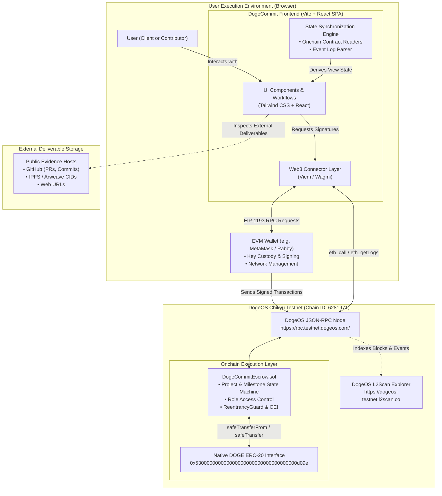
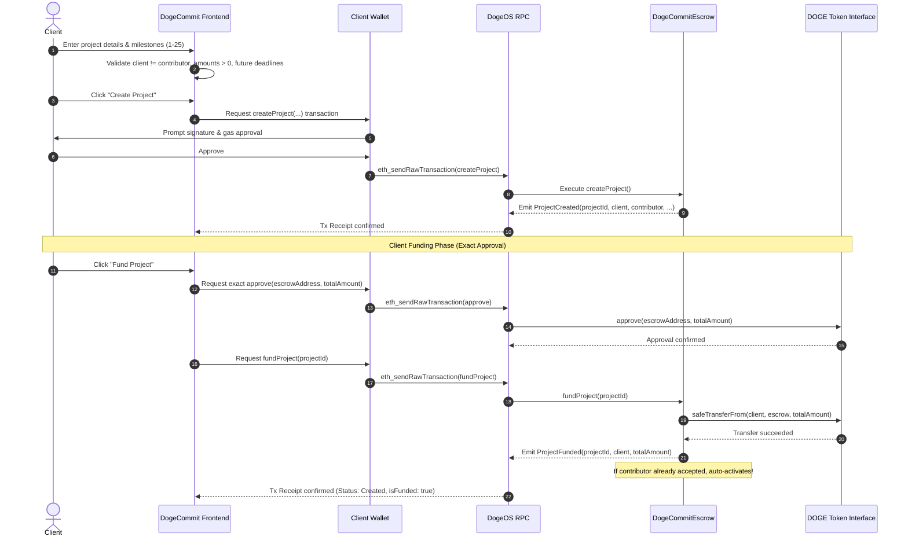
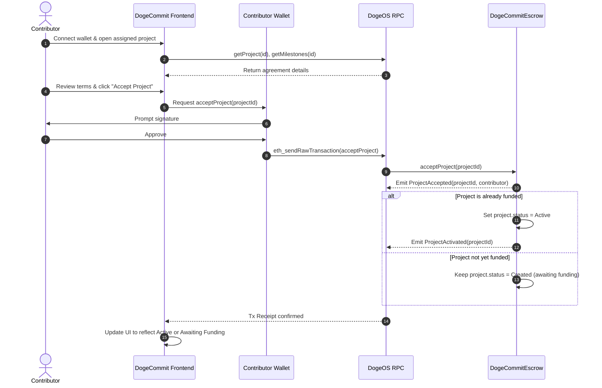
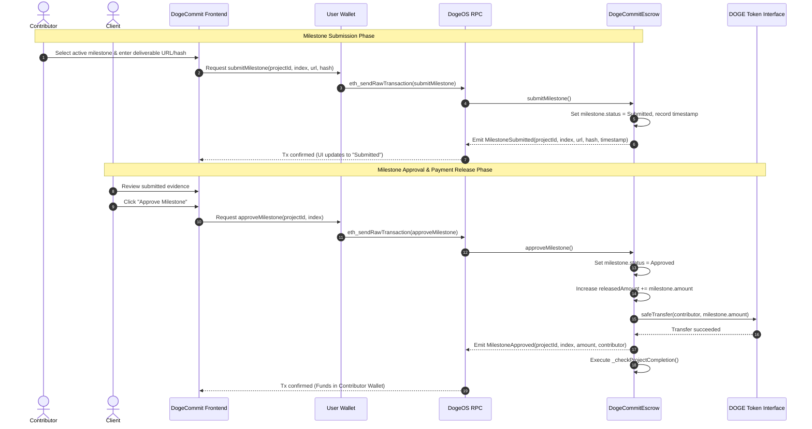
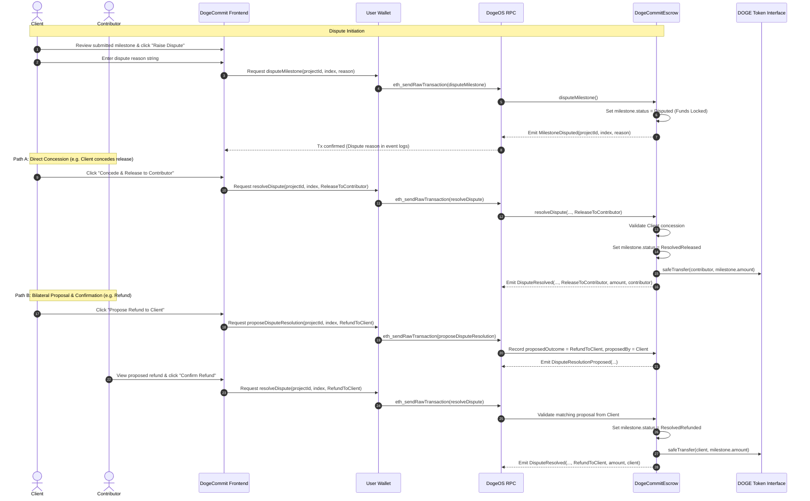
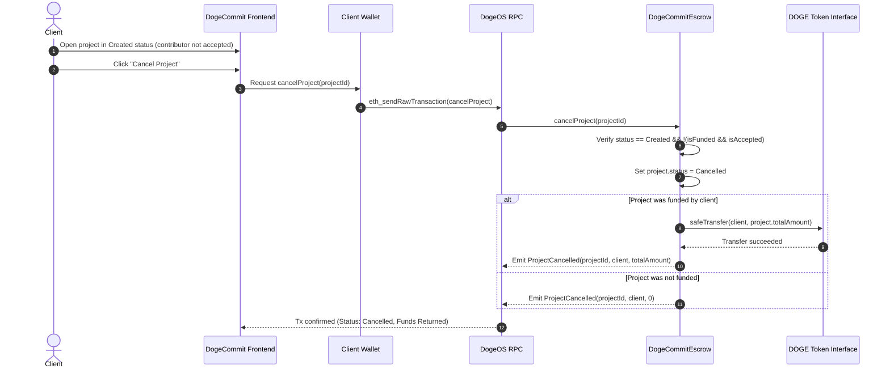
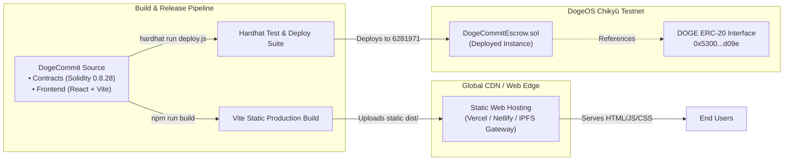

# DogeCommit — System Architecture

**Document:** SYSTEM-ARCHITECTURE.md  
**Version:** 1.0  
**Status:** Approved Technical Architecture  
**Target Platform:** DogeOS Chikyū Testnet (Chain ID: `6281971`)  
**Settlement Asset:** DOGE (`0x530000000000000000000000000000000000d09e`)

---

## 1. Architecture Overview

DogeCommit is a fully decentralized, milestone-based escrow application designed to establish trustless, verifiable payment workflows between clients and independent contributors. 

The system operates as a **two-tier decentralized application (dApp)**:
1. **Client-Side Single-Page Application (SPA):** A pure frontend interface executing in the user's browser, responsible for wallet interactions, user experience, input validation, and reading blockchain state directly via JSON-RPC.
2. **Onchain Smart Contract Layer:** Autonomous, immutable smart contracts deployed on DogeOS Chikyū Testnet that hold custody of native DOGE tokens, enforce agreement terms, manage milestone state transitions, and execute settlement.

There is **no centralized web server, database, or intermediary API** required for core operations. The DogeOS blockchain and the `DogeCommitEscrow` smart contract serve as the definitive, single source of truth for all project states, payment custody, milestone progress, and financial settlements.

---

## 2. Architecture Goals and Principles

1. **Smart Contract as the Source of Truth:** All project balances, milestone statuses, authorization permissions, and financial disbursements are governed exclusively by onchain code. Frontend interfaces reflect contract state rather than local or cached assumptions.
2. **True Native Asset Custody:** DOGE is the actual settlement asset via its canonical DogeOS ERC-20 precompiled interface (`0x530000000000000000000000000000000000d09e`). No intermediate wrapped mock tokens or synthetic assets are used.
3. **Zero-Custody Client Architecture:** Private keys and seed phrases remain strictly within the user's external wallet (e.g., MetaMask, Rabby). The frontend never accesses, handles, transmits, or stores user credentials.
4. **Exact Approval Standard:** Token approvals are strictly limited to the exact project amount (`totalAmount`), eliminating systemic risks associated with unlimited (`type(uint256).max`) token allowances.
5. **Decoupled Asynchronous Activation:** Project funding and contributor acceptance are architecturally decoupled. Activation occurs deterministically if and only if both prerequisites are fulfilled, regardless of execution order.
6. **Bilateral Dispute Settlement:** Fund release under dispute requires explicit bilateral consensus (via proposal and counterpart confirmation) or unilateral direct concession to the counterparty. Unilateral self-allocation of disputed funds is cryptographically prevented.
7. **Minimalist Offchain Footprint:** Storage overhead is pushed to standard event logs (e.g., dispute reasoning) and external references (deliverable URLs and content hashes), keeping onchain execution fast and gas-efficient.

---

## 3. High-Level System Architecture



---

## 4. Component Responsibilities

### 4.1 Frontend Application
- **Technology:** React, Vite, Tailwind CSS, Viem / Wagmi.
- **Hosting:** Static file hosting (e.g., Vercel, Netlify, Cloudflare Pages, or IPFS decentralized pinning).
- **Responsibilities:**
  - Render project dashboards for both Client and Contributor personas.
  - Validate input bounds client-side prior to transaction broadcast (e.g., enforcing $1 \le \text{milestones} \le 25$).
  - Calculate accurate sums for total project funding.
  - Facilitate network switching to DogeOS Chikyū Testnet (`6281971`).
  - Read onchain contract state via multicall/read calls and reconstruct dynamic project status.
  - Query and display historical event logs (e.g., `MilestoneDisputed` reasons).

### 4.2 Wallet Integration (EIP-1193)
- **Supported Providers:** Injected Web3 providers compliant with EIP-1193 (MetaMask, Rabby, Coinbase Wallet, etc.).
- **Responsibilities:**
  - Secure key storage and transaction signing.
  - Enforce user authorization for every state-mutating transaction.
  - Expose current active account address and chain ID to the frontend.
  - Execute chain-switch requests (`wallet_switchEthereumChain` / `wallet_addEthereumChain`).

### 4.3 Smart Contract (`DogeCommitEscrow.sol`)
- **Runtime:** EVM-compatible bytecode deployed on DogeOS Chikyū Testnet.
- **Responsibilities:**
  - Enforce immutable project rules, roles, amounts, and deadlines.
  - Hold custody of deposited DOGE tokens.
  - Enforce exact token transfers using OpenZeppelin `SafeERC20`.
  - Execute Checks-Effects-Interactions (CEI) to eliminate reentrancy vulnerabilities.
  - Manage milestone state progression: `Pending` $\rightarrow$ `Submitted` $\rightarrow$ `Approved` / `Disputed` $\rightarrow$ `Resolved`.
  - Automatically evaluate project completion criteria.

### 4.4 DogeOS Chikyū Testnet
- **Network Specification:** High-throughput, EVM-compatible Layer 2 roll-up network settling to Dogecoin.
- **Chain ID:** `6281971` (`0x5fdaf3`).
- **RPC URL:** `https://rpc.testnet.dogeos.com/`.
- **Block Explorer:** `https://dogeos-testnet.l2scan.co`.
- **Responsibilities:**
  - Execute EVM transactions with deterministic finality.
  - Maintain historical block data and state trees.
  - Expose standard JSON-RPC endpoints for transaction submission and data queries.

### 4.5 DOGE Token Interface
- **Address:** `0x530000000000000000000000000000000000d09e`.
- **Decimals:** 18 ($1 \text{ DOGE} = 10^{18} \text{ base units}$).
- **Responsibilities:**
  - Canonical ERC-20 precompile representing the native DOGE token on DogeOS.
  - Execute `transferFrom(client, escrow, amount)` during funding.
  - Execute `transfer(recipient, amount)` during milestone approval or dispute resolution.
  - Expose `balanceOf(account)` and `allowance(owner, spender)` queries.

### 4.6 Blockchain RPC Interface
- **Protocol:** Ethereum JSON-RPC 2.0 over HTTPS.
- **Methods Used:**
  - `eth_chainId`: Validate network alignment.
  - `eth_call`: Read contract state (`getProject`, `getMilestones`, `getUserProjects`, `allowance`, `balanceOf`).
  - `eth_sendRawTransaction`: Broadcast wallet-signed state mutations.
  - `eth_getTransactionReceipt`: Verify transaction confirmation and extract event logs.
  - `eth_getLogs`: Query event logs (`MilestoneDisputed`, `ProjectCreated`, etc.).

### 4.7 Event Retrieval and Indexing
- **Architecture:** Client-side event log filtering via `eth_getLogs`.
- **Responsibilities:**
  - Filter logs emitted by `DogeCommitEscrow` matching topic signatures.
  - Extract indexed topics (`projectId`, `milestoneIndex`, `client`, `contributor`).
  - Decode non-indexed data fields (specifically the dispute `reason` string from `MilestoneDisputed`).
  - Handle RPC block-range query limits through chunked range requests.

### 4.8 Evidence Reference Handling
- **Scope:** External deliverables referenced by contributors.
- **Formats Supported:**
  - Standard HTTPS URLs (e.g., GitHub pull request, staging deployment link, Google Drive document).
  - Cryptographic Content Identifiers (IPFS CIDv0/v1, SHA-256 deliverable digest).
- **Responsibilities:**
  - Validate that at least one non-empty string is provided upon submission.
  - Display hyperlinks and hashes transparently in the client review interface.
  - **Explicit Non-Responsibility:** The system records evidence references onchain; it does **not** perform automated quality assessment, code compilation, or automated deliverable verification.

---

## 5. Component Interaction and Communication

The application communicates exclusively via standard Web3 protocols:

```
[User Browser]
      │
      ├──(EIP-1193)──> [Local Wallet] ──(Sign Tx)──> [JSON-RPC Node]
      │                                                     │
      └──(HTTPS/JSON-RPC: eth_call / eth_getLogs)───────────┤
                                                            ▼
                                                   [DogeCommitEscrow]
                                                            │
                                                   (ERC-20 Interface)
                                                            ▼
                                                       [DOGE Token]
```

- **Read Operations:** Executed directly by the frontend making `eth_call` queries to the RPC node. These are free, immediate, and do not require wallet approvals.
- **Write Operations:** Formatted by the frontend, passed to the wallet via EIP-1193 for cryptographic signature and gas payment, and broadcast to DogeOS via `eth_sendRawTransaction`.
- **Log Subscriptions / Polling:** Polled periodically or on transaction confirmation to refresh state.

---

## 6. Project Creation and Funding Sequence

Funding can occur before or after contributor acceptance. Below is the primary flow where the client creates and funds the agreement first.



---

## 7. Contributor Acceptance and Project Activation Sequence



---

## 8. Milestone Submission and Approval Sequence



---

## 9. Dispute and Mutual Resolution Sequence



---

## 10. Pre-Activation Cancellation Sequence



---

## 11. Project and Milestone State Synchronization

### 11.1 Synchronization Model
Because DogeCommit has no central backend, the frontend maintains a reactive state synchronization loop:
1. **Initial Mount:**
   - Detect wallet connection and verify chain ID (`6281971`).
   - Query user project IDs via `escrow.getUserProjects(userAddress)`.
   - Batch-fetch project headers via `escrow.getProject(id)`.
   - Batch-fetch milestones via `escrow.getMilestones(id)`.
2. **Post-Transaction Invalidation:**
   - On transaction broadcast: mark local UI state as "pending confirmation" with transaction hash linked to DogeOS L2Scan.
   - On transaction receipt (`receipt.status === 1`): trigger an immediate re-fetch of `getProject(id)` and `getMilestones(id)`.
3. **Background Polling:**
   - Poll current block number and project data every 10–15 seconds to detect counterparty state transitions (e.g. contributor submitting evidence while client has the tab open).

### 11.2 Derived Frontend States
The frontend derives user-friendly statuses from the raw contract variables:
- **`Awaiting Contributor Acceptance`:** `status == Created && !isAccepted`
- **`Awaiting Client Funding`:** `status == Created && !isFunded`
- **`Ready for Activation`:** Transient state when either condition is satisfied.
- **`Active (In Progress)`:** `status == Active`
- **`Completed`:** `status == Completed`
- **`Cancelled`:** `status == Cancelled`

---

## 12. On-Chain and Off-Chain Data Responsibilities

| Data Element | Layer / Location | Storage Medium | Mutability | Authoritative Source |
|---|---|---|---|---|
| **Project Financial State** | Onchain | `Project` struct (contract storage) | Mutable via contract logic | Smart Contract |
| **Milestone Allocations & Deadlines** | Onchain | `Milestone` struct (contract storage) | Immutable post-creation | Smart Contract |
| **Milestone Status** | Onchain | `MilestoneStatus` enum (storage) | State-machine transitions | Smart Contract |
| **Deliverable URLs & Hashes** | Onchain | `Milestone` struct strings | Written once per milestone | Smart Contract |
| **DOGE Custody Balances** | Onchain | DOGE ERC-20 contract balance | Updated on fund/release/refund | DOGE ERC-20 Precompile |
| **Dispute Reason** | Onchain Event | `MilestoneDisputed` event data | Written once in receipt logs | Blockchain Event Log |
| **Actual Deliverable Content** | Offchain | GitHub / IPFS / External Web | External host mutability | External Provider |
| **Wallet Session & Address** | Client Memory | Browser Local State / Injected Provider | Ephemeral | User Wallet |
| **Derived Status Badges** | Client Memory | React Component State | Computed | Frontend Logic |

---

## 13. Event Retrieval and Historical Data Limitations

### 13.1 Dispute Reason Retrieval Strategy
In compliance with Decision 2, dispute reasons are **not** stored in contract storage slots (`SSTORE`) to prevent state bloat. Instead, they are emitted in the `MilestoneDisputed` event:

```solidity
event MilestoneDisputed(
    uint256 indexed projectId,
    uint256 indexed milestoneIndex,
    string reason
);
```

#### Frontend Retrieval Flow:
1. When a milestone has `status == MilestoneStatus.Disputed`, the frontend initiates an `eth_getLogs` call.
2. The query filters by:
   - `address`: `DogeCommitEscrow` address.
   - `topics[0]`: `keccak256("MilestoneDisputed(uint256,uint256,string)")`.
   - `topics[1]`: `abi.encode(projectId)`.
   - `topics[2]`: `abi.encode(milestoneIndex)`.
3. The event data is decoded to extract the `reason` string and displayed in the dispute panel.

### 13.2 Technical Limitations & Fallback Strategy
- **RPC Query Range Constraints:** Public RPC nodes on Layer 2 networks typically limit `eth_getLogs` queries to a maximum block span (e.g. 5,000–10,000 blocks).
- **Log Pruning on Testnets:** If the public testnet RPC node is pruned or does not maintain archive logs from project inception, historical dispute logs may return empty.
- **Graceful Fallback UI:**
  - If the event log query returns a valid reason, the UI displays the reason in the dispute card.
  - If the event query times out or fails to return logs, the UI gracefully displays:  
    `"Milestone disputed onchain. (Detailed dispute reason unavailable from historical RPC logs; refer to DogeOS L2Scan for tx details)."`
  - The lack of an event log **never blocks** the mutual resolution or direct concession workflow, as dispute resolution functions depend solely on contract storage states.

---

## 14. Security and Trust Boundaries

```
[ UNTRUSTED ] Web Application Frontend (Client Browser)
      │
      ▼  (EIP-1193 Signed Payload)
[ TRUSTED KEYSTORE ] User Wallet (Private Keys Never Leave Device)
      │
      ▼  (Signed Raw Transaction)
[ UNTRUSTED TRANSPORT ] Public DogeOS RPC Endpoint
      │
      ▼  (EVM Execution Environment)
[ FULLY TRUSTED ] DogeCommitEscrow Smart Contract
      ├── Checks-Effects-Interactions (CEI)
      ├── ReentrancyGuard
      ├── Exact Token Approval & SafeERC20
      └── Zero Owner Backdoors (Immutable)
```

### Core Security Guarantees
1. **Checks-Effects-Interactions (CEI):** All state updates (marking milestones approved, updating released amounts) occur prior to invoking external token transfers.
2. **Reentrancy Immunity:** All functions executing token disbursements (`fundProject`, `cancelProject`, `approveMilestone`, `resolveDispute`) are protected by OpenZeppelin's `nonReentrant` modifier.
3. **Immutability & Zero Admin Privilege:** The contract has no owner, admin keys, pause mechanisms, or upgradable proxies. Contract logic cannot be altered, and funds cannot be drained by an administrative account.
4. **Anti-Seizure Enforcement:** The smart contract cryptographically enforces that disputed funds can only be released to the counterparty (via direct concession) or transferred under verified mutual agreement.

---

## 15. Failure Handling and Recovery

| Failure Mode | Root Cause | System Response & User Guidance |
|---|---|---|
| **User Rejects Signature** | User cancels prompt in wallet | Frontend catches rejection code (e.g., `4001`), displays an inline notice, and leaves the application state unchanged. |
| **Wrong Network Connected** | Wallet is on Ethereum/Polygon/etc. | Frontend blocks transaction buttons and displays a persistent network modal with a one-click button calling `wallet_switchEthereumChain` for DogeOS Chikyū Testnet. |
| **Insufficient DOGE Balance** | Insufficient DOGE for funding or gas | Frontend pre-checks client balance against `totalAmount`. If insufficient, prompts the user to acquire testnet DOGE from the faucet. |
| **Insufficient Allowance** | Funder skipped or lowered approval | `fundProject` requires exact allowance. If `allowance < totalAmount`, frontend prompts the approval transaction first before enabling funding. |
| **RPC Timeout or Unreachable** | RPC node latency or downtime | Frontend retries read queries up to 3 times with exponential backoff. If persistent, displays an RPC connectivity banner prompting the user to refresh. |
| **Transaction Revert** | Onchain constraint violated (e.g. deadline expired at creation) | Frontend decodes custom errors (e.g. `InvalidMilestoneDeadline`, `TooManyMilestones`) and presents a human-readable explanation instead of raw hex. |
| **Wallet Disconnection** | User locks wallet or disconnects site | Frontend resets session state to "Disconnected", clears cached user balances, and prompts reconnection. |

---

## 16. Deployment Architecture



### Deployment Configuration Parameters
- **Smart Contract Compiler:** Solidity `0.8.28`, Optimizer enabled (200 runs), EVM target `paris`.
- **Target RPC:** `https://rpc.testnet.dogeos.com/`.
- **Constructor Argument:** `0x530000000000000000000000000000000000d09e`.
- **Frontend Environment Variables:**
  - `VITE_DOGEOS_CHAIN_ID=6281971`
  - `VITE_DOGEOS_RPC_URL=https://rpc.testnet.dogeos.com/`
  - `VITE_ESCROW_CONTRACT_ADDRESS=<deployed_contract_address>`
  - `VITE_DOGE_TOKEN_ADDRESS=0x530000000000000000000000000000000000d09e`
  - `VITE_BLOCK_EXPLORER_URL=https://dogeos-testnet.l2scan.co`

---

## 17. Architecture Decisions and Trade-offs

| Architecture Decision | Options Considered | Selected Approach | Trade-off / Justification |
|---|---|---|---|
| **Backend Architecture** | Centralized Node/PostgreSQL vs. Pure Client-Side Web3 | **Pure Client-Side Web3** | Eliminates centralized points of failure, hosting costs, and database synchronization bugs; trade-off is reliance on public RPC log indexing. |
| **Dispute Reason Persistence** | `SSTORE` in contract struct vs. Event Emission | **Event Emission (`MilestoneDisputed`)** | Saves significant gas on dispute creation; trade-off is dependency on RPC log retention for historical display. |
| **Milestone Ceiling** | Unbounded dynamic array vs. Fixed upper bound | **`MAX_MILESTONES = 25`** | Guarantees that milestone iteration during `_checkProjectCompletion` never exceeds block gas limits; trade-off is disallowing agreements with >25 milestones. |
| **Settlement Currency** | Synthetic wrapped token vs. Canonical DOGE ERC-20 | **Canonical DOGE ERC-20 (`0x5300...d09e`)** | Real value transfer using native DogeOS token; adheres strictly to the primary product mandate. |
| **Dispute Resolution Model** | Decentralized arbitration network vs. Bilateral mutual resolution | **Bilateral Mutual Consensus** | Zero external dependencies, immediate execution, simple game theory; trade-off is that funds remain locked if neither party yields. |

---

## 18. MVP Architecture Boundaries

The following capabilities are deliberately and strictly **excluded** from the DogeCommit architecture:
- **No Centralized Relayers or Custodians:** No gasless meta-transactions or centralized transaction relayers.
- **No External Arbitrators or DAOs:** No third-party arbitration or automated dispute juries.
- **No Automated Deadline Penalties:** Milestone deadlines do not trigger automatic balance distributions or cancellations.
- **No Deliverable Resubmission:** Once disputed, a milestone cannot be reopened or resubmitted in the contract.
- **No Custom Token Wrapping:** Only native DOGE via its designated precompile is accepted.
- **No Onchain Communication Protocol:** User communication occurs out-of-band (e.g. Discord, Telegram, email).

---

## 19. Technical Verification Checklist & Open Questions

The following technical environment parameters should be monitored and verified during testnet operations:

1. **DogeOS RPC `eth_getLogs` Block Limit:**
   - *Status:* Functioning on basic tests.
   - *Verification Item:* Determine the exact maximum block range supported by `https://rpc.testnet.dogeos.com/` for single `eth_getLogs` requests (e.g., whether it limits queries to 10,000 blocks or allows unrestricted range). The frontend query helper should implement a conservative 5,000-block chunking strategy.
2. **DogeOS Gas Price Volatility & Floor:**
   - *Status:* Testnet gas is currently minimal.
   - *Verification Item:* Ensure the frontend Viem/Wagmi client accurately fetches `maxFeePerGas` and `maxPriorityFeePerGas` from DogeOS to avoid stuck transactions.
3. **RPC Rate Limiting:**
   - *Status:* Verified responsive for standard development workflows.
   - *Verification Item:* Check whether public RPC rate-limiting occurs under rapid successive `eth_call` multicall queries, ensuring the frontend bundles view calls appropriately.
