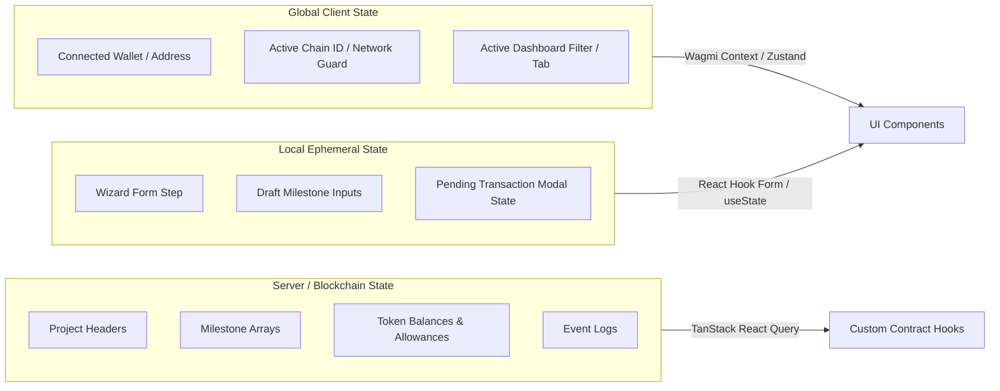

# DogeCommit — Technology Stack Specification

**Document:** TECH-STACK.md  
**Version:** 1.3  
**Status:** Approved Technical Stack Specification (Post-Audit Final Revision)  
**Project:** DogeCommit  
**Target Platform:** DogeOS Chikyū Testnet (Chain ID: `6281971`)  
**Settlement Asset:** DOGE (`0x530000000000000000000000000000000000d09e`)

---

## 1. Technology Stack Overview

DogeCommit is a DOGE-native milestone escrow decentralized application (dApp) operating as a **two-tier zero-custody architecture**:
1. **Client-Side Single-Page Application (SPA):** Static frontend executed purely in the user's browser, communicating directly with the user's Web3 wallet and the DogeOS JSON-RPC endpoint.
2. **Onchain Smart Contract Layer:** Autonomous EVM bytecode deployed to DogeOS Chikyū Testnet holding escrow custody of native DOGE and managing milestone state transitions.

The application has **zero centralized backend services, zero databases, and zero custodial servers**. The DogeOS blockchain serves as the authoritative persistence engine and state machine.


---

## 2. Frontend Framework

| Parameter | Selection | Evaluation & Status | Rationale |
|---|---|---|---|
| **Primary Framework** | **React** | Evaluated: **18.3.1** vs. **19.x** | **Both versions are officially supported by Wagmi v2.** Wagmi v2 (`wagmi@>=2.14.0`, latest `2.19.5`) officially specifies [`peerDependencies: { react: ">=18" }`](https://www.npmjs.com/package/wagmi). TanStack React Query v5, Radix UI primitives, React Hook Form v7, Sonner, and Lucide React all declare peer support for both React 18 and React 19. |
| **Recommended Target** | **React 18.3.1** (or React 19.x) | Recommended: **18.3.1** for conservative hackathon delivery | React 18.3.1 provides maximum ecosystem maturity across external third-party wallet connector extensions and typing definitions. However, React 19 is fully viable if modern React 19 primitives (e.g., `useActionState`, direct ref props) are desired. Neither choice introduces Wagmi compatibility issues. |
| **Alternative Evaluated** | Next.js 14/15 | Rejected | DogeCommit requires no Server-Side Rendering (SSR) or Server Actions. Next.js adds deployment complexity, Node.js server dependencies, and potential SSR hydration mismatches with browser wallets. |
| **Alternative Evaluated** | Vue 3 / Svelte | Rejected | Smaller ecosystem for Web3 connector hooks (Wagmi is React-first); would require maintaining custom wallet-state bindings. |

---

## 3. Programming Language

| Parameter | Selection | Status | Rationale |
|---|---|---|---|
| **Language** | **TypeScript** | Proposed (`^5.5.4` / `^5.6.x`) | Strict type safety for complex milestone structs, contract return tuples, event payloads, and Web3 transaction arguments. Prevents runtime property mismatches and enforces exhaustive enum handling. |
| **Compiler Configuration** | `tsconfig.json` (`strict: true`) | Proposed | Enforces `noImplicitAny`, `strictNullChecks`, and `exactOptionalPropertyTypes` across all contract data structures and UI models. |

---

## 4. Build Tool

| Parameter | Selection | Status | Rationale |
|---|---|---|---|
| **Build Tool & Dev Server** | **Vite** | Proposed: **Vite 8** (`^8.3.5`) | Ultra-fast Hot Module Replacement (HMR) based on native ES modules, lightweight bundler, minimal configuration overhead, and deterministic output hashing. |
| **Release Line & Plugin Pairing** | **Vite `^8.3.5`** + **`@vitejs/plugin-react` `^6.2.1`** | **Verified Stable Pairing** | Vite 8.3.5 is the current stable release on npm. The officially compatible React plugin for Vite 8 is `@vitejs/plugin-react` 6.x (`^6.2.1`), which declares `peerDependencies: { vite: "^8.0.0" }`. Both require Node.js `^20.19.0 || >=22.12.0`. |
| **Node.js Engine Compatibility** | Active System: **Node.js v24.21.0**, npm **11.19.0** | **Verified Compatible** | The active host environment (`v24.21.0`) natively satisfies the Node engine requirements of both Vite 8.3.5 and `@vitejs/plugin-react` 6.2.1 without flags. |
| **Static Build Target** | `dist/` SPA bundle | Proposed | Produces pure static HTML/JS/CSS that can be served from any static host or decentralized CDN (Vercel, Netlify, Cloudflare Pages, IPFS). |

---

## 5. Styling and UI Component Libraries

Per the visual audit in [`UI-UX-DESIGN.md`](file:///C:/Users/sumit/DogeCommit/DogeCommit-Blueprint/UI-UX-DESIGN.md) (derived directly from live Stargate Finance production bundles):

| Component / Layer | Selection | Version / Source | Rationale |
|---|---|---|---|
| **CSS Utility Framework** | **Tailwind CSS v3.4** | Proposed (`^3.4.17`) | **Tailwind CSS v3.4.x is selected over v4.0.** In [`UI-UX-DESIGN.md`](file:///C:/Users/sumit/DogeCommit/DogeCommit-Blueprint/UI-UX-DESIGN.md), all audited design tokens (surfaces `#141414`, `#1A1A1A`, `#212121`, `#272727`; DOGE Gold `#E1B342`; status colors; border radii; elevated box shadows) are defined as a standard JavaScript `tailwind.config.js` theme dictionary. Tailwind v4 introduces a new CSS-first `@theme` configuration format. Sticking with v3.4 eliminates configuration migration risks and guarantees immediate compatibility during the 4-day hackathon. |
| **PostCSS & Autoprefixer** | `postcss` (`^8.4.49`), `autoprefixer` (`^10.4.20`) | Proposed | Standard automated CSS vendor prefixing and build optimization. |
| **Typography System** | **Geist** & **Geist Mono** | `@fontsource/geist-sans` (`^5.1.0`), `@fontsource/geist-mono` (`^5.1.0`) | Verified primary font family from Stargate Finance audit; clean negative-tracking headings and monospaced cryptographic hashes/numbers. Self-hosted via npm packages to eliminate Google Fonts third-party tracking dependencies. |
| **Headless UI Primitives** | **Radix UI Primitives** | `@radix-ui/react-dialog` (`^1.1.4`), `@radix-ui/react-dropdown-menu` (`^2.1.4`), `@radix-ui/react-tooltip` (`^1.1.6`), `@radix-ui/react-tabs` (`^1.1.2`) | Unstyled, fully accessible (WAI-ARIA compliant) headless components that can be customized with exact Stargate design tokens. Peer dependencies support React 18 and 19. |
| **Iconography** | **Lucide React** | Proposed (`^0.469.0`) | Modern, clean outline icons matching Stargate's minimalist visual style (checkmarks, alert triangles, chevron arrows, copy buttons, external link indicators). |
| **Class Name Utility** | `clsx` (`^2.1.1`), `tailwind-merge` (`^2.6.0`) | Proposed | Safe dynamic concatenation and conflict resolution of Tailwind utility classes. |

---

## 6. Wallet Integration

| Parameter | Selection | Status | Rationale |
|---|---|---|---|
| **Connector Framework** | **Wagmi v2** (`wagmi`) | Proposed (`^2.14.9` / `^2.19.5`) | **Intentional Major-Version Architecture Choice:** While newer major versions (such as Wagmi v3) exist on npm, Wagmi v2 is deliberately chosen. Wagmi v2 is battle-tested, provides universal compatibility across existing Web3 wallet adapters, aligns with Viem v2, and avoids breaking API churn during the hackathon. Officially declares [`peerDependencies: { viem: "2.x", react: ">=18", "@tanstack/react-query": ">=5.0.0" }`](https://www.npmjs.com/package/wagmi). |
| **Wallet Providers** | Injected (`injected()`), MetaMask (`metaMask()`), Coinbase Wallet (`coinbaseWallet()`) | Proposed | Covers all standard browser extension wallets (MetaMask, Rabby, Frame, Brave Wallet, Coinbase Wallet). |
| **Modal / Connect Kit** | Custom Connect Modal (or `@rainbow-me/rainbowkit`) | Evaluated | A lightweight custom modal styled with Radix UI + Tailwind prevents external dependency bloat and guarantees exact alignment with Stargate styling tokens. |

---

## 7. Blockchain Interaction Library

| Parameter | Selection | Status | Rationale |
|---|---|---|---|
| **EVM Client Library** | **Viem v2** (`viem`) | Proposed (`^2.21.0` / `^2.23.0`) | Lightweight, tree-shakeable, type-safe replacement for Ethers.js. Native support for ABI inference (`as const`), low memory footprint, and first-class JSON-RPC performance. |
| **Server State Management** | **TanStack React Query v5** (`@tanstack/react-query`) | Proposed (`^5.62.0`) | Required core peer dependency of Wagmi v2. Manages caching, query deduplication, polling, and background revalidation of onchain contract reads. Officially supports React 18 and React 19. |

---

## 8. DogeOS Chikyū Testnet Configuration

The DogeOS Chikyū Testnet is defined as a custom chain in Viem / Wagmi:

```typescript
import { defineChain } from 'viem';

export const dogeosTestnet = defineChain({
  id: 6281971,
  name: 'DogeOS Chikyū Testnet',
  nativeCurrency: {
    decimals: 18,
    name: 'Dogecoin',
    symbol: 'DOGE',
  },
  rpcUrls: {
    default: {
      http: ['https://rpc.testnet.dogeos.com/'],
    },
    public: {
      http: ['https://rpc.testnet.dogeos.com/'],
    },
  },
  blockExplorers: {
    default: {
      name: 'DogeOS L2Scan',
      url: 'https://dogeos-testnet.l2scan.co',
    },
  },
  testnet: true,
});
```

### Network Verification Matrix

| Parameter | Value | Verification Status | Notes |
|---|---|---|---|
| **Chain ID** | `6281971` (`0x5fdaf3`) | **Verified onchain** | Query to `eth_chainId` confirmed |
| **RPC URL** | `https://rpc.testnet.dogeos.com/` | **Verified responsive** | Public JSON-RPC endpoint |
| **Block Explorer** | `https://dogeos-testnet.l2scan.co` | **Verified active** | Transaction, block, and address indexing |
| **EIP-1559 Support** | `baseFeePerGas` / dynamic fee | **UNVERIFIED** | Must treat EIP-1559 as conditional. If RPC reverts or returns null for base fees, client must fall back to legacy `gasPrice`. |
| **Block Gas Limit** | Unknown ($\ge 10\text{M}$ estimated) | **UNVERIFIED** | Must verify before scheduling large transaction bursts |
| **Target EVM Version** | `paris` | **Verified in Hardhat** | Set in contract compilation target |

---

## 9. DOGE Token Integration

- **Canonical Address:** `0x530000000000000000000000000000000000d09e`
- **Decimals:** 18 ($1 \text{ DOGE} = 10^{18} \text{ base units / wei-DOGE}$) (**Live precompile runtime behavior remains UNVERIFIED on testnet**).
- **Interface Model:** Standard ERC-20 (`IERC20`):
  - `allowance(owner, spender)`
  - `approve(spender, amount)` (Strictly exact amounts; no infinite `type(uint256).max`)
  - `balanceOf(account)`
  - `transfer(to, amount)`
  - `transferFrom(from, to, amount)`
- **Local Dev vs. Testnet:**
  - Local Hardhat testnet deploys `TestDOGE.sol` (matching 18-decimal token).
  - Testnet / Production binds directly to `0x530000000000000000000000000000000000d09e`. Mock tokens are strictly prohibited on live networks.

---

## 10. Smart Contract Development Environment

| Parameter | Installed Configuration (Verified from `package-lock.json`) | Status |
|---|---|---|
| **Framework** | **Hardhat** `2.29.1` | **Installed & Verified** |
| **Toolbox** | `@nomicfoundation/hardhat-toolbox` `6.1.2` | **Installed & Verified** |
| **Plugins Included** | `@nomicfoundation/hardhat-ethers`, `@nomicfoundation/hardhat-network-helpers`, `@nomicfoundation/hardhat-chai-matchers`, `typechain` | **Installed & Verified** |
| **Transitive Ethers** | `ethers` `6.17.0` | **Installed & Verified** (via toolbox) |
| **Test Runner** | Mocha + Chai matchers | **Installed & Active** (53/53 tests passing) |
| **Network Helpers** | `@nomicfoundation/hardhat-network-helpers` (`time.latest()`) | **Installed & Active** |
| **Host Environment** | Node.js **`v24.21.0`**, npm **`11.19.0`** | **Verified Active** |
| **Node.js 24 Test Suite Execution** | **53/53 tests passing** under Node.js `v24.21.0` | **Verified in Local Test Runs** |

> [!NOTE]
> **Hardhat 2 Lifecycle & Maintenance Notice:**
> - Hardhat 2 (`2.29.1`) remains the official active development toolchain for DogeCommit.
> - Hardhat 2 is approaching end of life (EoL), with official support ending no later than **June 1, 2027**.
> - Migration to **Hardhat 3** is an identified future maintenance task and is intentionally out of scope for this hackathon MVP.
> - The entire 53-test test suite (`npx hardhat test`) executes and passes cleanly under the active Node.js `24.21.0` runtime without errors.

---

## 11. Solidity and Compiler Configuration

| Setting | Value in `hardhat.config.js` | Verification Status |
|---|---|---|
| **Solidity Version** | `0.8.28` | **Configured & Verified** |
| **Optimizer** | `enabled: true`, `runs: 200` | **Configured & Verified** |
| **EVM Target** | `paris` | **Verified during compilation** |
| **Contract File** | [`contracts/DogeCommitEscrow.sol`](file:///C:/Users/sumit/DogeCommit/contracts/DogeCommitEscrow.sol) | **Implemented & Committed** (615 lines) |
| **Constants Enforced** | `MAX_MILESTONES = 25` | **Implemented & Tested** |

---

## 12. OpenZeppelin Dependencies

| Package | Installed Version | Used Contracts & Modules | Rationale |
|---|---|---|---|
| `@openzeppelin/contracts` | `5.6.1` (Verified in `package-lock.json`) | `@openzeppelin/contracts/token/ERC20/IERC20.sol`<br>`@openzeppelin/contracts/token/ERC20/utils/SafeERC20.sol`<br>`@openzeppelin/contracts/utils/ReentrancyGuard.sol` | Secure, audited ERC-20 interaction primitives and reentrancy protection. Version 5.x uses custom errors and modern EVM optimizations. |

---

## 13. Contract ABI and Type Generation

1. **Source of Truth:** Compiled artifact generated by Hardhat:
   `artifacts/contracts/DogeCommitEscrow.sol/DogeCommitEscrow.json`
2. **Frontend ABI Export:** Extracted via automated script or build step to:
   `src/contracts/DogeCommitEscrow.json` (or TypeScript constant with `as const`).
3. **Type Safety via Viem:** Viem infers strict function parameter and return types directly from `const DogeCommitEscrowABI = [...] as const` without needing external TypeChain runtime wrappers in the frontend.

---

## 14. Frontend State Management

DogeCommit separates state into three distinct scopes:



- **Blockchain State:** Governed by **TanStack Query** (via Wagmi hooks `useReadContract`, `useWatchContractEvent`). Automatic cache invalidation occurs when transaction receipts are confirmed.
- **Global Session State:** Managed natively by Wagmi's React Context (account address, connection status, network mismatch). For lightweight UI state (e.g., active dashboard filter, notification drawer), React `useState` or **Zustand** (`^4.5.5`) is recommended.
- **Local Form State:** Managed by **React Hook Form**.

---

## 15. Form Validation

| Parameter | Selection | Status | Rationale |
|---|---|---|---|
| **Form Library** | **React Hook Form** | Proposed (`^7.54.2`) | Performant uncontrolled inputs with minimal re-renders; native support for dynamic milestone array fields (`useFieldArray`). Peer support for React 18 & 19. |
| **Schema Validation** | **Zod** | Proposed (`^3.24.1`) | Composable TypeScript-first schemas validating boundary rules before wallet submission. |

### Client-Side Validation Rules Enforced via Zod:
1. `contributor`: Valid Ethereum address (`isAddress()`), non-zero, cannot equal client address.
2. `title`: 3–100 characters, non-empty.
3. `description`: 10–2000 characters.
4. `milestones`: Array length between **1 and 25** (`MAX_MILESTONES`). Creation with $\ge 26$ is blocked client-side.
5. `milestones.*.amount`: Number $> 0$, precision up to 18 decimals.
6. `milestones.*.deadline`: Unix timestamp in the future ($> \text{Date.now}() + 300\text{s}$).
7. `evidenceUrl` / `evidenceHash`: At least one non-empty reference string on milestone submission.

---

## 16. Notifications and Transaction Feedback

| Parameter | Selection | Status | Rationale |
|---|---|---|---|
| **Toast Notification Engine** | **Sonner** | Proposed (`^1.7.1` / `^2.0.8`) | Lightweight, performant toast library with smooth stacking, dark theme alignment, and rich action buttons (e.g., "View on L2Scan"). Peer support for React 18 & 19. |
| **Transaction Lifecycle UX** | Step-by-Step Status Flow | Standard Web3 Pattern | Formulates clear UI state:
  1. *Prompted:* Awaiting wallet signature.
  2. *Submitted:* Transaction broadcast with pending spinner and L2Scan link.
  3. *Confirmed:* Transaction receipt received; refetches contract state.
  4. *Error / Rejected:* Displays readable custom error interpretation. |

---

## 17. Blockchain Event Retrieval

The frontend queries onchain events (e.g., `MilestoneDisputed` for dispute reasons, `ProjectCreated` for activity feeds) directly via `eth_getLogs`.

### Historical Logs Strategy & Fallbacks:
- **Default Window:** Configurable 5,000-block range (`DEFAULT_LOGS_BLOCK_RANGE = 5000`).
- **UNVERIFIED Status:** DogeOS RPC query limits on block range have not been officially documented.
- **Adaptive Splitter:** If `eth_getLogs` returns an RPC error (e.g., range timeout or response payload limit), the query engine dynamically halves the range (e.g., $5,000 \rightarrow 2,500 \rightarrow 1,000$ blocks) and queries sequentially.
- **Graceful UI Fallback:** If event logs are pruned or unavailable via RPC, the UI falls back to showing onchain status (`MilestoneStatus.Disputed`) with a note: *"Dispute reason recorded in transaction log (historical RPC event log unavailable)"*.

---

## 18. Multicall and Read Fallback

| Parameter | Architectural Pattern | Verification Status |
|---|---|---|
| **Multicall3 Engine** | `0xcA11bde05977b3631167028862bE2a173976CA11` | **UNVERIFIED on DogeOS** |
| **Primary Query Strategy** | Wagmi batching / multicall aggregation if standard Multicall3 contract exists on DogeOS. | To be probed onchain during pre-implementation verification. |
| **Mandatory Fallback** | Individual `eth_call` reads executed concurrently via `Promise.all` (`getProject(id)` + `getMilestones(id)`). | **Guaranteed Compatible**; works against any standard EVM RPC node. |

---

## 19. Environment Variables and Secrets

### Separation of Concerns
1. **Frontend (`.env` / `vite.config.ts`):** Only public variables prefixed with `VITE_` are bundled.
2. **Hardhat / Deployer (`.env`):** Deployment secrets (`PRIVATE_KEY`) reside exclusively in local root `.env` and are strictly excluded from frontend builds and version control.

### Required Frontend Environment Variables (`.env.example` for web app):
```env
# Public RPC URL for DogeOS Chikyū Testnet
VITE_DOGEOS_RPC_URL=https://rpc.testnet.dogeos.com/

# DogeOS Chain ID
VITE_CHAIN_ID=6281971

# Deployed DogeCommitEscrow Contract Address
VITE_ESCROW_CONTRACT_ADDRESS=0x...

# Canonical DOGE ERC-20 Address
VITE_DOGE_TOKEN_ADDRESS=0x530000000000000000000000000000000000d09e

# Block Explorer URL
VITE_EXPLORER_URL=https://dogeos-testnet.l2scan.co

# Default Block Range for eth_getLogs
VITE_LOGS_BLOCK_RANGE=5000
```

> [!CAUTION]
> Private keys, deployer mnemonics, and administrative credentials must NEVER be placed in `VITE_` environment variables or committed to version control.

---

## 20. Build and Deployment

| Stage | Tooling | Target / Output |
|---|---|---|
| **Local Development** | Vite Dev Server (`npm run dev`) | `http://localhost:5173` |
| **Contract Testing** | Hardhat Test Runner (`npx hardhat test`) | Local Hardhat Network (53 tests passing under Node.js 24) |
| **Production Build** | `tsc && vite build` | Static assets in `dist/` |
| **Hosting Platform** | Vercel / Netlify / Cloudflare Pages / IPFS | Zero-backend static single-page hosting |
| **CI / Quality Checks** | ESLint (`^9.x`) + TypeScript Compiler (`tsc --noEmit`) | Automated linting and type verification |

---

## 21. Dependency Version Compatibility

### 21.1 Existing Installed Dependencies (Verified from `package-lock.json`)

| Package | Recommended Version | Purpose | Compatibility Status | Verification Source |
|---|---|---|---|---|
| `hardhat` | `2.29.1` | Smart contract compilation and testing | Installed & active; passes all 53 tests on Node.js 24.21.0 | [npmjs.com/package/hardhat](https://www.npmjs.com/package/hardhat) |
| `@nomicfoundation/hardhat-toolbox` | `6.1.2` | Hardhat testing and tooling bundle | Installed & active; bundles ethers 6.17.0 and network helpers | [npmjs.com/package/@nomicfoundation/hardhat-toolbox](https://www.npmjs.com/package/@nomicfoundation/hardhat-toolbox) |
| `@openzeppelin/contracts` | `5.6.1` | Escrow security primitives (SafeERC20, ReentrancyGuard) | Installed & active; compiles clean with solc 0.8.28 | [npmjs.com/package/@openzeppelin/contracts](https://www.npmjs.com/package/@openzeppelin/contracts) |
| `dotenv` | `18.0.9` | Environment variable management | Installed & active | [npmjs.com/package/dotenv](https://www.npmjs.com/package/dotenv) |
| `ethers` (transitive) | `6.17.0` | Test runner blockchain interactions | Installed & active (via hardhat-toolbox) | [npmjs.com/package/ethers](https://www.npmjs.com/package/ethers) |

### 21.2 Proposed Frontend Dependencies (To Be Installed)

| Package | Recommended Version | Purpose | Compatibility Status | Verification Source |
|---|---|---|---|---|
| `react` | `^18.3.1` (or `^19.0.0`) | UI view layer and component rendering | Conservative stable choice (React 19 fully supported) | [npmjs.com/package/react](https://www.npmjs.com/package/react) |
| `react-dom` | `^18.3.1` (or `^19.0.0`) | DOM rendering for React | Matches React version | [npmjs.com/package/react-dom](https://www.npmjs.com/package/react-dom) |
| `typescript` | `^5.6.3` | Type system and static analysis | Fully compatible with Viem and React | [npmjs.com/package/typescript](https://www.npmjs.com/package/typescript) |
| `vite` | `^8.3.5` | Frontend build tool and development server | Latest stable; natively supports Node.js 24 | [npmjs.com/package/vite](https://www.npmjs.com/package/vite) |
| `@vitejs/plugin-react` | `^6.2.1` | React fast refresh and JSX transformation | Official React plugin for Vite 8 (`peer: vite ^8.0.0`) | [npmjs.com/package/@vitejs/plugin-react](https://www.npmjs.com/package/@vitejs/plugin-react) |
| `wagmi` | `^2.14.9` (up to `^2.19.5`) | Web3 React hooks for account and wallet state | Intentional v2 architecture; supports React 18 & 19 | [npmjs.com/package/wagmi](https://www.npmjs.com/package/wagmi) |
| `viem` | `^2.21.0` | EVM JSON-RPC client and type-safe contract reader | Built for Wagmi v2; supports strict ABI typing | [npmjs.com/package/viem](https://www.npmjs.com/package/viem) |
| `@tanstack/react-query` | `^5.62.0` | Asynchronous blockchain query cache and revalidation | Required Wagmi v2 peer; supports React 18 & 19 | [npmjs.com/package/@tanstack/react-query](https://www.npmjs.com/package/@tanstack/react-query) |
| `tailwindcss` | `^3.4.17` | Utility-first CSS styling engine | Configured via `tailwind.config.js` for Stargate tokens | [npmjs.com/package/tailwindcss](https://www.npmjs.com/package/tailwindcss) |
| `postcss` | `^8.4.49` | CSS transformation and pipeline runner | Standard Tailwind CSS v3 peer | [npmjs.com/package/postcss](https://www.npmjs.com/package/postcss) |
| `autoprefixer` | `^10.4.20` | Vendor prefix parsing for CSS | Standard PostCSS plugin | [npmjs.com/package/autoprefixer](https://www.npmjs.com/package/autoprefixer) |
| `@fontsource/geist-sans` | `^5.1.0` | Self-hosted Geist typography | Audited primary font from Stargate Finance | [npmjs.com/package/@fontsource/geist-sans](https://www.npmjs.com/package/@fontsource/geist-sans) |
| `@fontsource/geist-mono` | `^5.1.0` | Self-hosted Geist Mono typography | Cryptographic hash and DOGE amount typography | [npmjs.com/package/@fontsource/geist-mono](https://www.npmjs.com/package/@fontsource/geist-mono) |
| `lucide-react` | `^0.469.0` | Modern outline icon set | Peer supports React 18 & 19 | [npmjs.com/package/lucide-react](https://www.npmjs.com/package/lucide-react) |
| `@radix-ui/react-dialog` | `^1.1.4` | Accessible modal dialog primitive | Peer supports React 18 & 19 | [npmjs.com/package/@radix-ui/react-dialog](https://www.npmjs.com/package/@radix-ui/react-dialog) |
| `@radix-ui/react-dropdown-menu` | `^2.1.4` | Accessible dropdown and action menu | Peer supports React 18 & 19 | [npmjs.com/package/@radix-ui/react-dropdown-menu](https://www.npmjs.com/package/@radix-ui/react-dropdown-menu) |
| `@radix-ui/react-tooltip` | `^1.1.6` | Accessible tooltip primitive | Peer supports React 18 & 19 | [npmjs.com/package/@radix-ui/react-tooltip](https://www.npmjs.com/package/@radix-ui/react-tooltip) |
| `@radix-ui/react-tabs` | `^1.1.2` | Accessible tabbed navigation primitive | Peer supports React 18 & 19 | [npmjs.com/package/@radix-ui/react-tabs](https://www.npmjs.com/package/@radix-ui/react-tabs) |
| `react-hook-form` | `^7.54.2` | Uncontrolled form state and milestone field arrays | Peer supports React 18 & 19 | [npmjs.com/package/react-hook-form](https://www.npmjs.com/package/react-hook-form) |
| `zod` | `^3.24.1` | TypeScript-first schema and boundary validator | Standalone schema validation library | [npmjs.com/package/zod](https://www.npmjs.com/package/zod) |
| `@hookform/resolvers` | `^3.9.1` | Zod resolver bridge for React Hook Form | Integrates Zod with React Hook Form 7 | [npmjs.com/package/@hookform/resolvers](https://www.npmjs.com/package/@hookform/resolvers) |
| `sonner` | `^1.7.1` | Toast notification engine | Peer supports React 18 & 19 | [npmjs.com/package/sonner](https://www.npmjs.com/package/sonner) |
| `clsx` | `^2.1.1` | Conditional class name utility | Zero-dependency class merger | [npmjs.com/package/clsx](https://www.npmjs.com/package/clsx) |
| `tailwind-merge` | `^2.6.0` | Tailwind utility conflict resolver | Resolves conflicting Tailwind utility rules | [npmjs.com/package/tailwind-merge](https://www.npmjs.com/package/tailwind-merge) |

### 21.3 Compatibility Notes & Peer-Dependency Verification Details

1. **Vite 8 & `@vitejs/plugin-react` Pairing:**
   - `vite@8.3.5` requires Node.js `^20.19.0 || >=22.12.0`.
   - `@vitejs/plugin-react@6.2.1` explicitly requires `peerDependencies: { vite: "^8.0.0" }` and Node.js `^20.19.0 || >=22.12.0`.
   - The active system Node.js `v24.21.0` natively satisfies both packages.
2. **Wagmi v2 Peer Dependencies:**
   - `wagmi@2.14.9` – `2.19.5` specifies `peerDependencies: { viem: "2.x", react: ">=18", "@tanstack/react-query": ">=5.0.0", typescript: ">=5.0.4" }`.
   - Both React 18 (`^18.3.1`) and React 19 (`^19.0.0`) satisfy the `react: ">=18"` requirement without warnings.
3. **Radix UI Primitives & React 19:**
   - All proposed Radix UI component packages (`@radix-ui/react-dialog`, `@radix-ui/react-dropdown-menu`, etc.) officially declare `peerDependencies: { react: "^16.8 || ^17.0 || ^18.0 || ^19.0 || ^19.0.0-rc", "react-dom": "^16.8 || ^17.0 || ^18.0 || ^19.0 || ^19.0.0-rc" }`.
4. **React Hook Form & Sonner:**
   - `react-hook-form@^7.54.2` declares `peerDependencies: { react: "^16.8.0 || ^17 || ^18 || ^19" }`.
   - `sonner@^1.7.1` declares `peerDependencies: { react: "^18.0.0 || ^19.0.0 || ^19.0.0-rc", "react-dom": "^18.0.0 || ^19.0.0 || ^19.0.0-rc" }`.

---

## 22. Technology Decisions and Trade-offs

| Decision | Selected Path | Trade-off / Rationale |
|---|---|---|
| **Vite 8 vs. Older Vite Releases** | Vite 8 (`^8.3.5`) + `@vitejs/plugin-react` (`^6.2.1`) | Vite 8 is the current stable release on npm and is fully supported under the host environment's Node.js 24.21.0. Pairing with `@vitejs/plugin-react` 6.x provides native ES module bundling with zero peer-dependency mismatches. |
| **Wagmi v2 vs. Wagmi v3** | Wagmi v2 (`^2.14.9` – `^2.19.5`) | **Intentional Decision:** Wagmi v2 is selected over v3 for stability and ecosystem maturity. It avoids API churn while providing complete, battle-tested support for React 18/19, Viem v2, and all major injected wallets. |
| **React 18.3.1 vs. React 19** | Either (React 18.3.1 recommended for MVP stability) | Both versions are officially supported by Wagmi v2 (`react: ">=18"`). React 18.3.1 provides maximum ecosystem maturity across external Web3 wallet adapters, while React 19 provides the latest React capabilities. |
| **Tailwind v3.4 vs. Tailwind v4** | Tailwind CSS v3.4.x | [`UI-UX-DESIGN.md`](file:///C:/Users/sumit/DogeCommit/DogeCommit-Blueprint/UI-UX-DESIGN.md) defines tokens as a JavaScript theme object. Tailwind v3.4 allows immediate copy-paste integration into `tailwind.config.js` without rewriting to CSS `@theme` syntax. |
| **Pure SPA vs. Next.js SSR** | Pure SPA (Vite + React) | Eliminates node server dependencies; immune to wallet hydration mismatches; lower hosting complexity; zero server custody. |
| **Viem/Wagmi vs. Ethers.js v6** | Viem / Wagmi v2 | Viem provides automatic TypeScript ABI type inference and smaller bundle footprints. Wagmi provides React hooks optimized for concurrent renders. |
| **Tailwind + Radix vs. Material UI** | Tailwind + Radix UI | Stargate Finance's visual identity requires exact custom tokens, dark surfaces, and subtle glows. Material UI introduces heavy runtime CSS-in-JS and styling friction. |
| **Event Reason Query vs. Contract Storage** | `eth_getLogs` | Keeps contract storage minimal and saves gas on dispute creation. Trade-off: relies on RPC log retention. Mitigated with retry splitter and UI fallback notes. |
| **Exact Approvals vs. Unlimited Approvals** | Exact `totalAmount` Approval | Requires separate approval transaction per project creation/funding, but guarantees absolute user asset security against systemic contract drains. |

---

## 23. MVP Technology Boundaries

To ensure delivery within the 4-day hackathon timeline, the following technical capabilities are strictly out of scope:

1. **No Backend Database:** No PostgreSQL, MongoDB, Supabase, or Firebase. All state is onchain.
2. **No Centralized API:** No Express/NestJS server, indexing daemon, or cloud worker.
3. **No Centralized Storage Servers:** Deliverables reside on third-party links (GitHub, IPFS) supplied as plain strings.
4. **No Custodial Wallets / Social Logins:** No Web3Auth, Privy, or custodial key sharding. Users connect via standard EIP-1193 browser extensions.
5. **No Cross-Chain Bridges:** Escrow operations are native to DogeOS Chikyū Testnet.
6. **No Arbitrator Oracles:** Dispute resolution is exclusively bilateral consensus or voluntary concession.

---

## 24. Pre-Implementation Verification Checklist

Before writing frontend implementation code, the following operational checks must be executed:

- [ ] **Probe DogeOS JSON-RPC (`https://rpc.testnet.dogeos.com/`):**
  - Verify response time and stability via `curl` / `fetch`.
  - Check whether `eth_feeHistory` and EIP-1559 fields are returned, or if legacy `gasPrice` must be specified.
  - Test `eth_getLogs` with a 5,000-block range to check for RPC throttling or limits.
- [ ] **Check Multicall3 Contract Presence:**
  - Call `eth_getCode` on `0xcA11bde05977b3631167028862bE2a173976CA11` on DogeOS. If bytecode is empty, configure frontend exclusively for individual read fallbacks.
- [ ] **Probe DOGE Precompile Address (`0x530000000000000000000000000000000000d09e`):**
  - Verify `name()`, `symbol()`, `decimals()`, and `balanceOf()` on testnet.
- [ ] **Deploy DogeCommitEscrow to Testnet:**
  - Run `scripts/deploy.js --network dogeosTestnet` once faucet DOGE is available to verify deployment bytecode size, constructor acceptance, and explorer recognition.
- [ ] **Initialize Frontend Directory Structure:**
  - Create Vite 8 + React + TypeScript scaffold without modifying existing Hardhat and contract files.
